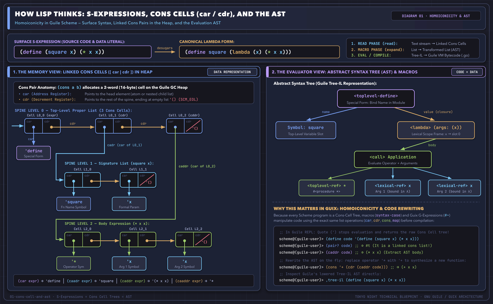
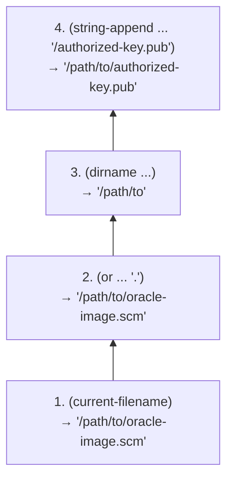
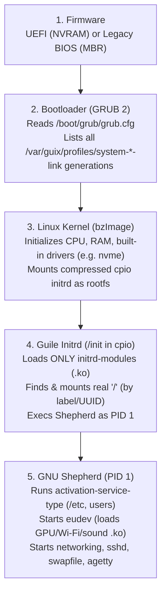
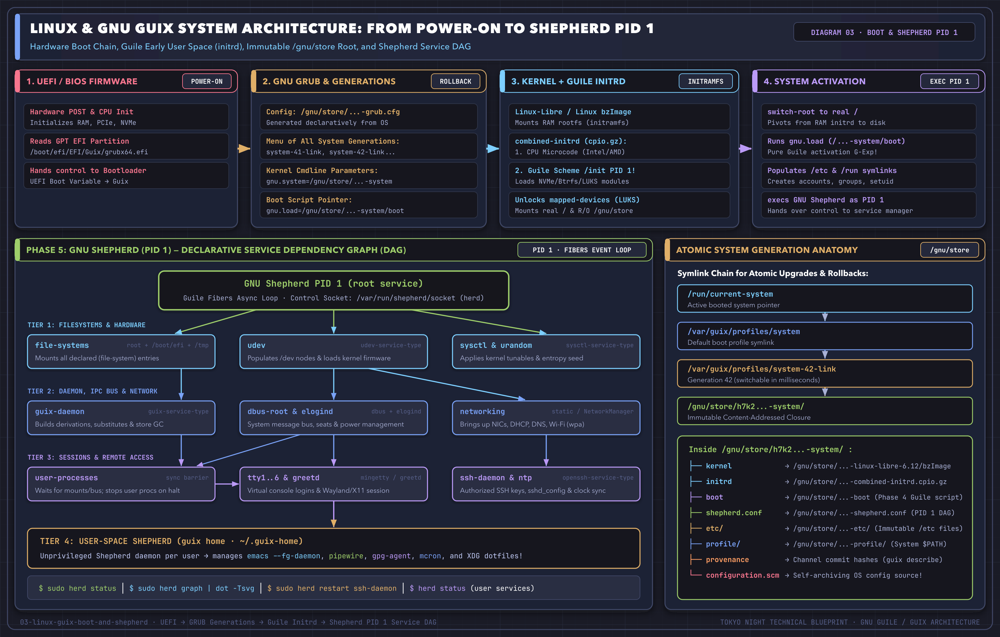
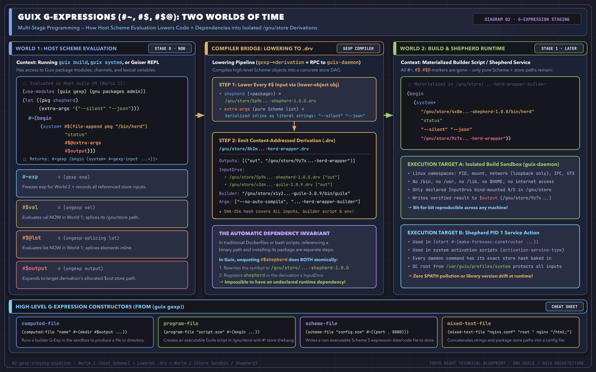
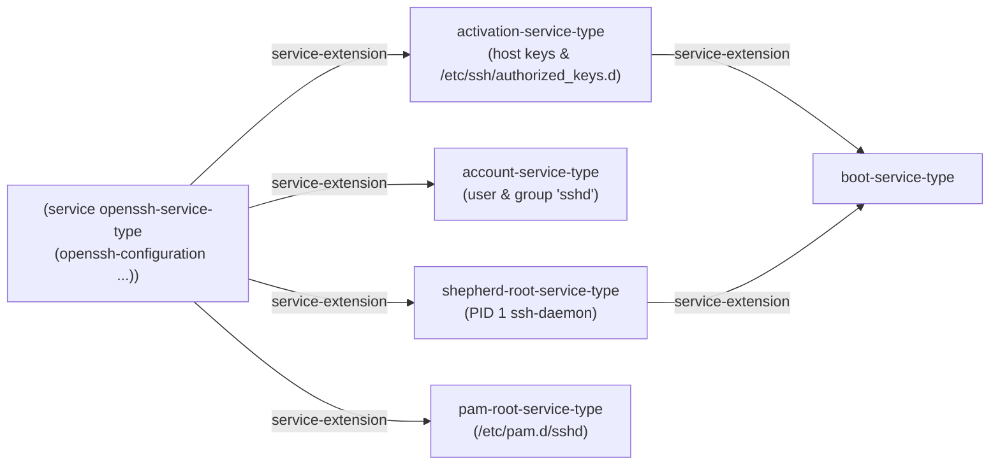
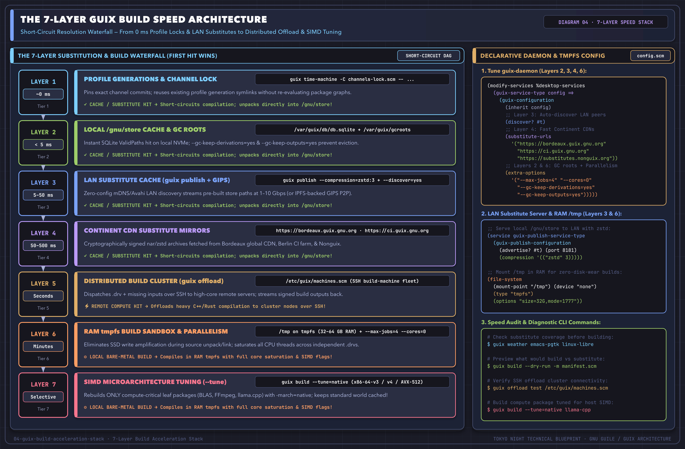

# Zero-to-Mastery: Guile Scheme, GNU Guix & Linux System Internals
## Part 1 (Modules 1–3): The Lisp Mindset, Systems Scripting in Guile, and Declarative Linux Architecture

> **Target Audience**: Experienced Linux / DevOps systems engineers (written for Omran "devo" Altunaiji) who think in kernel boot paths, file descriptors, process trees, and reproducible infrastructure, and want a rigorous, first-principles mastery of **Guile Scheme** and **GNU Guix** — starting from zero prior Lisp experience and scaling all the way to PID 1 Shepherd services, G-expression staging, and multi-tier build acceleration.

---

# Module 1: The Lisp Mindset — Demystifying Parentheses & Homoiconicity (For Lisp Newcomers)

If you have spent years writing Bash, Python, Go, or C, your first look at a GNU Guix system configuration feels like staring into a wall of nested parentheses. Your eyes instinctively hunt for operators (`=`, `+`, `&&`, `{`, `;`), keywords, and line breaks to anchor your mental parser — and find none.

Here is the secret that turns Lisp from an alien syntax into the sharpest systems-engineering tool you will ever use: **Lisp does not have syntax in the way C or Python does. When you read or write Scheme, you are directly reading and writing the compiler's Abstract Syntax Tree (AST).**



---

## 1.1 Why `(op arg1 arg2)` Has Zero Operator-Precedence Ambiguity

In C, Python, or Bash, the surface syntax is packed with infix operators, prefix unary operators, postfix calls, and implicit precedence tables. Consider what your brain has to memorize in C or Python just to parse a single line:

- Does `a + b * c` mean `(a + b) * c` or `a + (b * c)`?
- Does `x & y == 0` mean `(x & y) == 0` or `x & (y == 0)`? (In C, `==` binds tighter than bitwise `&` — a classic kernel bug!)
- In Bash, does `cmd1 && cmd2 || cmd3` group as `(cmd1 && cmd2) || cmd3` or `cmd1 && (cmd2 || cmd3)`?

When a C or Python compiler reads `a + b * c`, its lexer and parser immediately throw away the infix notation and build an in-memory tree where every internal node is an **operation** and its children are its **arguments**:

```text
      C / Python Infix                   Compiler AST                  Scheme S-Expression
      ----------------                   ------------                  -------------------
         a + b * c                            +                           (+ a (* b c))
                                             / \
                                            a   *
                                               / \
                                              b   c
```

Scheme eliminates the middleman. Instead of writing an ambiguous infix string that the parser converts into a tree, **you write the tree directly** using **S-expressions** (Symbolic Expressions).

### The Universal Rule of S-Expressions

Every parenthesized list in Scheme has one uniform shape:

```scheme
(operator arg1 arg2 arg3 ...)
```

1. **Slot 0 (the head)** is ALWAYS the operation — a function, a macro, or a core special form (`define`, `let`, `if`, `lambda`, `quote`).
2. **Slots 1..N (the tail)** are ALWAYS the operands passed to that operation.
3. **There are zero precedence rules.** Grouping is explicit, local, and 100% unambiguous. You never need a precedence table because every operation carries its own bounding parentheses.
4. **Variadic operations require no repeated operators:** Instead of `1 + 2 + 3 + 4` or `"a" + "b" + "c"`, you write:
   ```scheme
   (+ 1 2 3 4)                        ; => 10
   (string-append "/home/" user "/.ssh/authorized_keys")
   ```

### Reading S-Expressions: Inside-Out vs. Outside-In

Systems engineers new to Lisp often try to read a Scheme expression strictly left-to-right, counting parentheses `(((` as they go. **Never count parentheses.** Instead, use two complementary reading modes depending on your goal:

#### Mode A: Reading Outside-In (Top-Down Intent / Structural Reading)
Use **Outside-In** when reading declarations, control flow, or Guix system configs to understand *what* the code does at a high level. Look at the head of each outer form and follow indentation (which in Lisp always reflects tree depth):

```scheme
;; Read Outside-In:
;; 1. "If the file exists..."
;; 2. "...then return #t..."
;; 3. "...otherwise create the directory and chmod it to 0700."
(if (file-exists? dir)
    #t
    (begin
      (mkdir dir #o700)
      (chmod dir #o700)))
```

#### Mode B: Reading Inside-Out (Bottom-Up Dataflow / Execution Order)
Use **Inside-Out** when tracing how values are computed at runtime (just like tracing nested function calls `f(g(h(x)))` or a Unix pipeline ` h x | g | f`):

```scheme
;; From guix-platform-install/oracle/image/oracle-image.scm:
(string-append (dirname (or (current-filename) ".")) "/authorized-key.pub")
```

Trace it from the deepest leaf outward:

```text
Step 1 (deepest):  (current-filename)
                   => "/root/guix-platform-install/oracle/image/oracle-image.scm"

Step 2 (parent):   (or "/root/.../oracle-image.scm" ".")
                   => "/root/.../oracle-image.scm"   (fallback "." if run in REPL)

Step 3 (parent):   (dirname "/root/.../oracle-image.scm")
                   => "/root/guix-platform-install/oracle/image"

Step 4 (outer):    (string-append "/root/.../oracle/image" "/authorized-key.pub")
                   => "/root/guix-platform-install/oracle/image/authorized-key.pub"
```



---

## 1.2 Atoms, Symbols, and the Quoting System (`'`, `` ` ``, `,`, `,@`)

Every S-expression in Scheme is built from two kinds of building blocks: **Atoms** (indivisible values) and **Pairs / Lists** (compound structures built with parentheses).

### Atoms and Self-Evaluation vs. Symbols

When the Guile evaluator sees an atom, what does it do?

| Atom Type | Example Syntax | Evaluation Behavior | Systems Analogy |
| :--- | :--- | :--- | :--- |
| **Numbers** | `42`, `-3.14`, `#o700`, `#x1b`, `1/3` | **Self-evaluating** (`#o700` $\rightarrow$ `448`) | Integer/float literals (`#o` = octal for `chmod`!) |
| **Strings** | `"eth0"`, `"/gnu/store"` | **Self-evaluating** | `char*` / string literal |
| **Booleans** | `#t`, `#f` | **Self-evaluating** | `true` / `false` |
| **Characters** | `#\a`, `#\newline`, `#\:` | **Self-evaluating** (`#\: ` used in `string-split`) | C `'a'`, `'\n'`, `':'` |
| **Keywords** | `#:use-module`, `#:key`, `#:export` | **Self-evaluating** named flags | CLI `--flag` or Python kwargs |
| **Symbols** | `eth0`, `linux-libre`, `+`, `x` | **Evaluated as variable lookup!** | Identifier / variable name |

Notice the last row: an unquoted word like `eth0` or `swapfile` is a **Symbol**. If you type `swapfile` into Guile without quoting it, Guile looks up the variable named `swapfile` in the current lexical environment.

What if you want the literal symbol `'swapfile` itself — as an identifier or tag (like a Shepherd service name `(provision '(swapfile))`) — without looking it up as a variable? You **quote** it!

### Homoiconicity: Code Is Data, Data Is Code

Because Scheme code is written as S-expression lists, **a piece of Scheme code and a Scheme list data structure have the exact same representation**. This property is called **homoiconicity** (*homo* = same, *icon* = representation).

Watch what happens when we put a quote `'` in front of a function call:

```scheme
(+ 1 2)          ; Evaluates the call: applies procedure + to 1 and 2 => 3
'(+ 1 2)         ; Quotes the form: returns a 3-element list of data => (+ 1 2)
(list '+ 1 2)    ; Explicitly constructs the exact same 3-element list => (+ 1 2)
(equal? '(+ 1 2) (list '+ 1 2)) ; => #t
```

Look closely at `(equal? '(+ 1 2) (list '+ 1 2))`:
- In `(list '+ 1 2)`, the symbol `+` is quoted (`'+`) so its first element is the symbol `+`, followed by `1` and `2`.
- In `'(+ 1 2)`, the single quote `'` in front of the outer parenthesis freezes the entire tree inside it into literal data.

### The Four Quoting Operators (`'`, `` ` ``, `,`, `,@`)

When building configurations, macros, or system definitions, you constantly want a **template** that is 90% static data and 10% dynamically computed values. If you only had `'`, you would have to manually stitch lists together with `(list ...)` and `(cons ...)`.

Scheme solves this with **Quasiquote** (`` ` ``), **Unquote** (`,`), and **Unquote-Splicing** (`,@`):

| Operator | Reader Expands To | Meaning | Bash / Shell Analogy |
| :--- | :--- | :--- | :--- |
| `'expr` | `(quote expr)` | **Quote**: Everything inside `expr` is literal data. Nothing is evaluated. | Single quotes `'hello $USER'` |
| `` `expr `` | `(quasiquote expr)` | **Quasiquote**: Everything inside `expr` is literal data *unless* marked with `,` or `,@`. | Double quotes `"hello $USER"` |
| `,expr` | `(unquote expr)` | **Unquote**: Step back into evaluation mode, evaluate `expr`, and insert the single result here. | Variable expansion `"$USER"` |
| `,@expr` | `(unquote-splicing expr)` | **Unquote-Splicing**: Evaluate `expr` (which must return a list) and splice its elements inline without outer parens. | Array expansion `"${ EXTRA_ARGS[@]}"` |

Let's run a concrete side-by-side demonstration:

```scheme
(define interface "eth0")
(define dns-servers '("1.1.1.1" "8.8.8.8"))

;; 1. Regular quote (') ignores variables completely — everything is literal symbols:
'(network (device interface) (dns dns-servers))
;; => (network (device interface) (dns dns-servers))

;; 2. Quasiquote (`) with unquote (,) evaluates `interface` and `dns-servers` in place:
`(network (device ,interface) (dns ,dns-servers))
;; => (network (device "eth0") (dns ("1.1.1.1" "8.8.8.8")))
;; Notice `dns-servers` was inserted as a nested list ("1.1.1.1" "8.8.8.8").

;; 3. Quasiquote (`) with unquote-splicing (,@) splices the elements of `dns-servers` inline:
`(network (device ,interface) (dns ,@dns-servers))
;; => (network (device "eth0") (dns "1.1.1.1" "8.8.8.8"))
```

### Why This Is the Exact Mental Model for Guix G-Expressions (`#~`, `#$`, `#$@`)

Why did we just spend five minutes mastering `` ` ``, `,`, and `,@`? Because **GNU Guix G-Expressions (G-exps)** — the core mechanism Guix uses to write Shepherd services, initrd scripts, and package build phases — are literally **quasiquotation across time and `/gnu/store`!**

Look at the exact 1-to-1 correspondence:

| Standard Scheme Quoting | Guix G-Expression | What It Does |
| :--- | :--- | :--- |
| `` `(...) `` (`quasiquote`) | `#~(...)` (`gexp`) | Quote a code template for **Target Execution** (in a build container or at boot inside Shepherd). |
| `,val` (`unquote`) | `#$val` (`ungexp`) | Evaluate `val` **right now on the Host** (and if `val` is a package like `coreutils`, compile it into `/gnu/store/...-coreutils-9.1` and insert that store path string!). |
| `,@lst` (`unquote-splicing`) | `#$@lst` (`ungexp-splicing`) | Evaluate `lst` **right now on the Host** and splice its elements inline into the target code. |

Look at a real bug documented in `guix-platform-install/oracle/image/oracle-image.scm` (lines 270–284):

```scheme
;; From oracle/image/oracle-image.scm:
(authorized-keys
 (if %authorized-key
     `((,%user-name ,%authorized-key))
     '()))
```

Look at `` `((,%user-name ,%authorized-key)) ``:
- Without the commas (if you wrote `'((%user-name %authorized-key))`), Guix would try to configure SSH keys for a literal user named `"%user-name"`!
- With the commas, `%user-name` evaluates to `"guix"` and `%authorized-key` evaluates to the `<local-file>` object pointing to `authorized-key.pub`, producing `(("guix" #<local-file .../authorized-key.pub>))`.
- And why the `(if %authorized-key ...)` guard? As the comment in `oracle-image.scm` explains: when `authorized-key.pub` is absent, `%authorized-key` is `#f`. An unconditional `` `((,%user-name ,%authorized-key)) `` evaluates to `(("guix" #f))`, which passes evaluation cleanly and then crashes at image build time with `Wrong type (expecting string): #f`!

---

## 1.3 Cons Cells (`cons`, `car`, `cdr`), Proper vs. Dotted Lists & Structural Sharing

Under the hood, how does Scheme represent lists and trees? Every list in Scheme is built from a single two-pointer struct called a **cons cell** (or **pair**).

### `cons`, `car`, and `cdr`

A cons cell is a 2-word memory allocation containing two pointers:
- **`car`**: The first slot (historically *Contents of the Address part of Register* on the 1950s IBM 704). Think of `car` as **`head` / `first`**.
- **`cdr`** (pronounced *"could-er"*): The second slot (*Contents of the Decrement part of Register*). Think of `cdr` as **`tail` / `rest`**.
- **`cons`**: Allocates a new pair `(cons a b)` whose `car` points to `a` and whose `cdr` points to `b`.

```text
(cons 'a 'b)   ==>   +-------+-------+
                     |   a   |   b   |     Printed as: (a . b)
                     +-------+-------+
                        car     cdr
```

### Dotted Pairs vs. Proper Lists (Spine Diagrams)

Wait — why did `(cons 'a 'b)` print with a dot `(a . b)` instead of `(a b)`?

Because in Scheme:
1. A **Dotted Pair** is any pair whose `cdr` is a non-list atom (like `'b` or `42`). You write it `(a . b)`.
2. A **Proper List** is a chain of cons cells (called the **spine**) where:
   - Each cell's `car` points to an element of the list.
   - Each cell's `cdr` points to the **next cons cell** in the spine.
   - The final cell's `cdr` points to the special empty list constant **`'()`** (often drawn as `/` or `nil`).

```text
Proper List: (list 'a 'b 'c)  ===  (cons 'a (cons 'b (cons 'c '())))
Printed as:  (a b c)

   Spine Cell 1          Spine Cell 2          Spine Cell 3
  +-----+-----+        +-----+-----+        +-----+-----+
  | car | cdr |------->| car | cdr |------->| car | cdr |---> '()
  +--+--+-----+        +--+--+-----+        +--+--+-----+
     |                    |                    |
     v                    v                    v
    'a                   'b                   'c
```

What happens if the last `cdr` of a multi-cell chain is an atom instead of `'()`? You get an **improper (dotted) list**:

```scheme
(cons 'a (cons 'b 'c))        ; => (a b . c)
(cons* 'installed 1 '("ssh-ed25519 AAAA...")) ; => (installed 1 "ssh-ed25519 AAAA...")
```

> **Real-World Sighting (`metadata-ssh-keys.scm` line 40)**:
> In `oracle/image/metadata-ssh-keys.scm`, when `metadata-retry` succeeds on attempt `attempt` with a list of `keys`, it returns:
> ```scheme
> (cons* 'installed attempt keys)
> ```
> `cons*` chains `cons` calls onto `keys`. Since `keys` is already a proper list `("ssh-ed25519 ...")`, `(cons* 'installed attempt keys)` is equivalent to `(cons 'installed (cons attempt keys))`, producing the flat proper list `(installed 1 "ssh-ed25519 ...")`! And on line 120, the caller extracts `keys` using `(cddr result)` — which means `(cdr (cdr result))`, skipping past `'installed` and `attempt` in two pointer hops!

### Shorthand Accessors: `cadr`, `cddr`, `caddr`

Scheme provides composable shorthands for chaining up to four `car` (`a`) and `cdr` (`d`) operations (read the middle letters **right-to-left**, from inside out):

```scheme
(define result '(installed 3 "ssh-ed25519 AAA..." "ssh-rsa BBB..."))

(car result)    ; 1st element                        => 'installed
(cdr result)    ; Tail after 1st element             => '(3 "ssh-ed25519 AAA..." "ssh-rsa BBB...")
(cadr result)   ; (car (cdr result)) = 2nd element   => 3
(cddr result)   ; (cdr (cdr result)) = tail after 2  => '("ssh-ed25519 AAA..." "ssh-rsa BBB...")
(caddr result)  ; (car (cdr (cdr result))) = 3rd     => "ssh-ed25519 AAA..."
```

### Immutability & Structural Sharing (Why Guix Uses `cons` Everywhere)

In `oracle/image/oracle-image.scm`, look at how the system's file systems and user accounts are defined:

```scheme
(file-systems
 (cons (file-system
        (mount-point "/")
        (device (file-system-label "Guix_image"))
        (type "ext4"))
       %base-file-systems))

(users (cons (user-account
              (name %user-name)
              ...)
             %base-user-accounts))
```

Why does Guix write `(cons my-user %base-user-accounts)`?
Because cons cells in idiomatic Scheme are treated as **immutable**, `(cons my-user %base-user-accounts)` allocates **only ONE new 16-byte cons cell**:
- Its `car` points to `my-user`.
- Its `cdr` points directly to the first cell of `%base-user-accounts`.

```text
my-users ──► [ my-user | ──]──┐
                              ▼
%base-user-accounts ────────► [ root | ──]──► [ nobody | '() ]
```

Both `my-users` and `%base-user-accounts` remain 100% valid, independent lists! `%base-user-accounts` is never mutated, and zero elements of `%base-user-accounts` were copied. This is **structural sharing**: prepending with `cons` is $O(1)$ time and $O(1)$ memory.

By contrast, what does `(append list-a list-b)` do (as seen in `(services (append (list ...) %base-services))`)?
- `append` must walk `list-a` and allocate a **copied spine** for `list-a` so that the final cell of the copy can point its `cdr` to `list-b` without mutating `list-a`.
- `list-b` (`%base-services`) is STILL shared without copying! That is why in Guix you always put your small list of custom services *first* and `%base-services` *last* in `(append my-services %base-services)`: copying a 4-element spine is instant, whereas `%base-services` is shared in $O(1)$.

---

## 1.4 Tail-Call Optimization (TCO), Named `let`, and `(srfi srfi-1)`

If you search the entire GNU Guix codebase (over 1,000,000 lines of Scheme), you will virtually never see a `while` loop or a C-style `for (i = 0; i < n; i++)` loop with `set!` mutation. How do you write loops in a functional language without blowing the call stack?

### Proper Tail Calls & Tail-Call Optimization (TCO)

In Python, C (without optimization), or Bash, every recursive function call pushes a new stack frame onto the call stack because the caller has work left to do after the callee returns.

In Scheme, the language specification **guarantees Tail-Call Optimization (TCO)**: if a function call is in **tail position** (meaning it is the *very last action* performed before returning, with no outer computation waiting on its result), the Guile VM **reuses the current stack frame** and compiles the call into a direct `jmp` instruction!

Compare a non-tail call with a tail call:

```scheme
;; BAD (Non-Tail Recursive): The `+ 1` is waiting outside the recursive call!
;; Must keep every stack frame alive to add 1 on the way back up. O(N) stack!
(define (my-length-bad lst)
  (if (null? lst)
      0
      (+ 1 (my-length-bad (cdr lst))))) ; <-- NOT in tail position! (+ 1 ...) wraps it.

;; GOOD (Tail Recursive): Pass an accumulator `acc`.
;; Nothing wraps `(loop (cdr rem) (+ acc 1))` — it IS the final return value! O(1) stack!
(define (my-length lst)
  (let loop ((rem lst)
             (acc 0))
    (if (null? rem)
        acc
        (loop (cdr rem) (+ acc 1)))))   ; <-- IN TAIL POSITION! Compiles to a jump (loop).
```

```text
Stack-Growing (my-length-bad '(a b c)):       Tail-Recursive (my-length '(a b c)):
  Frame 1: (+ 1 (my-length-bad '(b c)))         Frame 1: (loop '(a b c) 0)
  Frame 2: (+ 1 (+ 1 (my-length-bad '(c))))     Frame 1: (loop '(b c)   1)  <-- same frame reused!
  Frame 3: (+ 1 (+ 1 (+ 1 0)))                  Frame 1: (loop '(c)     2)  <-- same frame reused!
  Unwind : 3                                    Frame 1: (loop '()      3)  => returns 3
```

### Named `let`: The Systems Engineer's Loop

Look closely at the syntax we just used:

```scheme
(let loop ((var1 init1)
           (var2 init2))
  body...)
```

Wait: an ordinary `let` binds local variables: `(let ((x 10) (y 20)) (+ x y))`.
When you put a symbol (`loop`) right after `let`, it becomes a **Named `let`**:
1. It defines a local tail-recursive function named `loop` with parameters `(var1 var2)`.
2. It immediately calls `(loop init1 init2)` with the initial values.
3. Inside `body`, calling `(loop new-var1 new-var2)` in tail position jumps back to the top of the `let` with updated state variables — **without a single mutable variable (`set!`)!**

Let's examine two real-world named `let` loops from `guix-platform-install`:

#### Real Example 1: Bounded Retry Policy (`oracle/image/metadata-ssh-keys.scm` lines 32–46)
```scheme
(define (metadata-retry fetch-lines wait! log! max-attempts retry-delay)
  (let loop ((attempt 1))
    (let* ((lines (or (fetch-lines) '()))
           (keys (metadata-usable-keys lines)))
      (cond ((not (null? keys))
             (cons* 'installed attempt keys))
            ((>= attempt max-attempts)
             (list 'exhausted attempt))
            (else
             (log! attempt max-attempts retry-delay)
             (wait! retry-delay)
             (loop (+ attempt 1))))))) ; <-- Tail-recursive jump to next attempt!
```
Notice how clean that is: `attempt` starts at `1`. If keys are found, it returns `(installed 1 ...)`. If `attempt >= max-attempts`, it returns `(exhausted 12)`. Otherwise it logs, sleeps, and tail-calls `(loop (+ attempt 1))`.

#### Real Example 2: Reading All Lines from a Port (`oracle/image/metadata-ssh-keys.scm` lines 48–55)
```scheme
(define (metadata-read-lines path)
  (call-with-input-file path
    (lambda (port)
      (let loop ((lines '()))
        (let ((line (read-line port)))
          (if (eof-object? line)
              (reverse lines)                 ; <-- Reverse once at the end!
              (loop (cons line lines))))))))  ; <-- O(1) prepend onto accumulator!
```
> **Crucial Idiom (`cons` + `reverse`)**: Why does `metadata-read-lines` do `(cons line lines)` on each iteration and `(reverse lines)` at the end, instead of `(append lines (list line))`?
> Because `(cons line lines)` is $O(1)$, so reading $N$ lines takes $O(N)$ time, and a single `(reverse lines)` at EOF takes $O(N)$ time — total $O(N)$! If you used `(append lines (list line))` inside the loop, it would re-copy the growing list on every line, turning a 10,000-line file read into an $O(N^2)$ disaster!

### Higher-Order List Pipelines with `(srfi srfi-1)`

Even better than writing a manual named `let` is expressing data transformations as declarative pipelines using `(use-modules (srfi srfi-1))` — Scheme Request for Implementation #1 (the standard list library imported at the top of `fix-network.scm`, `metadata-ssh-keys.scm`, and `gips.scm`).

Here are the five essential functions you will use every day in Guile and Guix:

```scheme
(use-modules (srfi srfi-1))

(define Raw-Lines '("  \"ssh-ed25519 AAAAC3Nza...\" "
                    "<html>404 Not Found</html>"
                    ""
                    "ssh-rsa AAAAB3Nza..."))

;; 1. map: Transform every element x -> f(x)  (1-to-1)
(map string-trim-both Raw-Lines)

;; 2. filter: Keep only elements where (pred x) is truthy
;; From oracle/image/metadata-ssh-keys.scm:
(define (metadata-usable-keys lines)
  (map metadata-unquote-value (filter metadata-key-line? lines)))

;; 3. remove: Opposite of filter — drop elements where (pred x) is truthy
;; Often used in Guix to strip a service or package from %base-packages / %base-initrd-modules:
(remove (lambda (pkg) (string=? (package-name pkg) "nano"))
        %base-packages)

;; 4. any / every: Short-circuiting existential / universal predicates
;; From postinstall/recipes/add/gips.scm (command-in-path?):
(any (lambda (dir)
       (file-exists? (string-append dir "/guix")))
     (string-split (getenv "PATH") #\:))

;; 5. fold: Reduce a list into any summary value: (fold (lambda (elem acc) ...) init lst)
;; Note: In SRFI-1 fold, the lambda takes (ELEMENT ACCUMULATOR) in that order!
(fold (lambda (n sum) (+ sum n)) 0 '(10 20 30 40)) ; => 100
```

---

## 1.5 Unmentioned Beginner Gems & Survival Guide

Every newcomer to Guile Scheme trips over the same three landmines because most tutorials forget to mention them. Memorize these three gems now and you will save yourself days of debugging.

### Gem 1: Debugging `Wrong type to apply` — The "Extra Parentheses" Trap

In C, Python, or Bash math, adding extra parentheses around an expression is harmless grouping: `((x))` is identical to `x`.

**In Lisp, parentheses are NEVER grouping. Every `(` means "call the first item inside as a function!"**

Watch what happens if you accidentally wrap a variable or expression in an extra pair of parentheses:

```scheme
(define count 42)

count    ; Evaluates variable `count` => 42
(count)  ; Tries to CALL 42 as a 0-argument function!
```

Guile immediately throws:
```text
ice-9/boot-9.scm:1685:16: In procedure raise-exception:
Wrong type to apply: 42
```

Whenever you see **`Wrong type to apply: <something>`**, translate it in your head as:
> *"I tried to call `<something>` as a function, which means I put an opening parenthesis `(` directly in front of `<something>` (or in front of an expression that evaluated to `<something>`)."*

The two most common places beginners trigger this:
1. **Wrapping a `cond` or `if` test in double parens:**
   ```scheme
   ;; WRONG: (zero? status) returns #t, and the outer parens try to call (#t) as a function!
   ;; Throws: Wrong type to apply: #t
   (if ((zero? status))
       (display "ok"))

   ;; RIGHT:
   (if (zero? status)
       (display "ok"))
   ```
2. **Writing C-style `cond` clauses without realizing `cond` already wraps each `[test body]` pair in parens:**
   ```scheme
   ;; In `cond`, each clause is (TEST RESULT-EXPR ...).
   ;; Here the outer parens belong to the clause, and the inner parens call `command-exists?`:
   (cond
    ((command-exists? "ip")       ; <-- Outer `(` starts the cond clause; inner `(` calls command-exists?
     (display "found ip\n"))
    (else
     (display "missing\n")))
   ```

### Gem 2: `#t` / `#f` vs. `'()` — In Scheme, `'()` and `0` Are Truthy!

If you come from Python, C, Bash, or even **Common Lisp / Emacs Lisp**, pay close attention:

| Value | Python | C | Emacs Lisp / Common Lisp | **Guile Scheme** |
| :--- | :--- | :--- | :--- | :--- |
| `#f` | `False` | `0` | `nil` (falsy) | **Falsy (the ONLY falsy value!)** |
| `'()` (empty list) | `[]` (falsy) | N/A | `nil` (falsy! `'()` == `nil`) | **TRUTHY!** |
| `0` (zero) | `0` (falsy) | `0` (falsy) | Truthy | **TRUTHY!** |
| `""` (empty string) | `""` (falsy) | Truthy ptr | Truthy | **TRUTHY!** |

**In Guile Scheme, `#f` is the ONLY falsy value in the entire universe.** Everything else — including the empty list `'()`, the number `0`, and the empty string `""` — is **truthy**!

```scheme
;; BUG in Scheme (works in Python/Elisp, ALWAYS takes the true branch in Scheme!):
(if '()
    "Empty list is TRUTHY in Scheme!"
    "Never reached")
;; => "Empty list is TRUTHY in Scheme!"

;; RIGHT in Scheme — always use explicit predicates:
(null? lst)         ; Is lst the empty list '()?
(pair? lst)         ; Is lst a non-empty cons cell?
(zero? n)           ; Is number n equal to 0?
(string-null? str)  ; Is string str equal to ""? (Used throughout fix-network.scm and gips.scm!)
```

> **Corollary — Why `(or (getenv "HOME") "/tmp")` works so cleanly:**
> Because `getenv` returns `#f` when an environment variable is unset (not `""`), `(or (getenv "HOME") "/tmp")` returns the first non-`#f` value. That is why `gips.scm` line 91 writes:
> ```scheme
> (define (user-home)
>   (or (getenv "HOME") "/tmp"))
> ```

### Gem 3: How to Read a Guile Backtrace Without Panic

When a Guile script or `guix system build` fails, it prints a backtrace ordered from **outermost caller (top, frame N)** down to **innermost crash site (bottom, frame 0)**, followed by the actual error message on the **very last line**.

Let's dissect a real Guile backtrace:

```text
Backtrace:
           3 (primitive-load "/tmp/broken-net.scm")
In ice-9/eval.scm:
   191:35  2 (_ #f)
In /tmp/broken-net.scm:
    14:12  1 (check-iface "eth0")
In unknown file:
           0 (string-append "ip addr show " #f)

ERROR: In procedure string-append:
In procedure string-append: Wrong type (expecting string): #f
```

How to read this in 3 seconds:
1. **Read the bottom two lines FIRST:**
   - **What crashed?** `In procedure string-append`
   - **Why did it crash?** `Wrong type (expecting string): #f` — someone passed `#f` instead of a string to `string-append`.
2. **Look at Frame `0` and Frame `1` just above the error:**
   - Frame `0` shows the exact call with evaluated arguments: `(string-append "ip addr show " #f)`.
   - Frame `1` gives you your exact source file, **line 14, column 12**: `In /tmp/broken-net.scm: 14:12 1 (check-iface "eth0")`.

---

## 1.6 Module 1 Hands-On Labs & Exercises

Run every exercise below in a terminal using `guile` (or `guile -c '(...)'`).

### Lab 1.1: Quasiquote & G-Exp Mental Model Drill
You are writing a helper function `(make-ssh-config user port extra-keys)` that takes:
- `user` (a string, e.g. `"om"`)
- `port` (an integer, e.g. `2222`)
- `extra-keys` (a list of public key strings, e.g. `'("ssh-ed25519 AAA..." "ssh-ed25519 BBB...")`)

Write `(make-ssh-config user port extra-keys)` using a single quasiquoted expression `` `(...) `` so that:
```scheme
(make-ssh-config "om" 2222 '("ssh-ed25519 AAA" "ssh-ed25519 BBB"))
```
evaluates to:
```scheme
(openssh-configuration
 (permit-root-login #f)
 (port-number 2222)
 (authorized-keys ("om" "ssh-ed25519 AAA" "ssh-ed25519 BBB")))
```
*(Notice that `extra-keys` is spliced inline after `"om"`, not nested as a sublist!)*

#### Solution 1.1
```scheme
#!/usr/bin/env -S guile --no-auto-compile -s
!#
(define (make-ssh-config user port extra-keys)
  `(openssh-configuration
    (permit-root-login #f)
    (port-number ,port)
    (authorized-keys (,user ,@extra-keys))))

(write (make-ssh-config "om" 2222 '("ssh-ed25519 AAA" "ssh-ed25519 BBB")))
(newline)
```

---

### Lab 1.2: Tail-Recursive Log Parser with Named `let` and `(srfi srfi-1)`
Suppose you have a list of raw `/proc/net/dev` interface lines:
```scheme
(define proc-lines
  '("Inter-|   Receive                                                |  Transmit"
    " face |bytes    packets errs drop fifo frame compressed multicast|bytes    packets"
    "    lo: 1420500   12040    0    0    0     0          0         0  1420500   12040"
    "  eth0: 9841200   84112    0    0    0     0          0         0  4129000   39100"
    "wlan0:       0       0    0    0    0     0          0         0        0       0"))
```
1. Write a pure function `(extract-interfaces lines)` using `(srfi srfi-1)` (`filter` and `map`) that keeps only lines containing `#\:` and extracts the trimmed interface name before the colon (`'("lo" "eth0" "wlan0")`).
2. Write a tail-recursive function `(count-active-lines lines)` using a **named `let`** (no `filter`, no `set!`) that counts how many lines contain a `#\:` character.

#### Solution 1.2
```scheme
#!/usr/bin/env -S guile --no-auto-compile -s
!#
(use-modules (srfi srfi-1)
             (srfi srfi-13)) ; string-contains, string-trim-both, string-index

(define proc-lines
  '("Inter-|   Receive                                                |  Transmit"
    " face |bytes    packets errs errs drop fifo frame compressed multicast|bytes    packets"
    "    lo: 1420500   12040    0    0    0     0          0         0  1420500   12040"
    "  eth0: 9841200   84112    0    0    0     0          0         0  4129000   39100"
    "wlan0:       0       0    0    0    0     0          0         0        0       0"))

;; Part 1: Functional pipeline with filter + map
(define (extract-interfaces lines)
  (map (lambda (line)
         (let ((colon-idx (string-index line #\:)))
           (string-trim-both (substring line 0 colon-idx))))
       (filter (lambda (line) (string-index line #\:))
               lines)))

;; Part 2: Tail-recursive named `let` with accumulator
(define (count-active-lines lines)
  (let loop ((rem lines)
             (count 0))
    (if (null? rem)
        count
        (loop (cdr rem)
              (if (string-index (car rem) #\:)
                  (+ count 1)
                  count)))))

(format #t "Interfaces: ~s~%" (extract-interfaces proc-lines))
(format #t "Active line count: ~a~%" (count-active-lines proc-lines))
```

---

### Lab 1.3: Spot the Three Beginner Bugs
Each snippet below has a bug that a C/Python/Elisp programmer commonly writes in Guile. Identify the bug and fix it:

```scheme
;; Bug A:
(define (has-items? lst)
  (if lst #t #f))

;; Bug B:
(define (first-or-default lst default-val)
  (if (null? lst)
      (default-val)
      (car lst)))

;; Bug C:
(define (prepend-item item lst)
  (append lst item))
```

#### Solution 1.3
- **Bug A**: In Scheme, `'()` is **truthy** (only `#f` is falsy), so `(if lst #t #f)` returns `#t` even when `lst` is `'()`!
  - **Fix**: `(define (has-items? lst) (not (null? lst)))` (or `(pair? lst)`).
- **Bug B**: `(default-val)` wraps the variable `default-val` in parentheses, which attempts to **call `default-val` as a function**, crashing with `Wrong type to apply`!
  - **Fix**: Remove the extra parentheses: `default-val`.
- **Bug C**: Two bugs: first, `append` puts `item` at the end, not the front, and expects all arguments except the last to be proper lists; second, prepending a single element to the front of a list in $O(1)$ time with structural sharing is done with `cons`!
  - **Fix**: `(define (prepend-item item lst) (cons item lst))`.

---
# Module 2: Guile Scheme for Systems Engineers (Using Real Code from `guix-platform-install`)

In Module 1 you learned to read S-expressions as direct ASTs. Now we transition from language fundamentals to **systems engineering in GNU Guile** — dissecting actual production scripts and system definitions from `guix-platform-install` (`lib/fix-network.scm`, `oracle/image/oracle-image.scm`, `oracle/image/metadata-ssh-keys.scm`, and `postinstall/recipes/add/gips.scm`).

---

## 2.1 The Guile Shebang Trap & String Escape Gotchas

Look at the first three lines of `lib/fix-network.scm` and `postinstall/recipes/add/gips.scm`:

```scheme
#!/run/current-system/profile/bin/guile \
--no-auto-compile -s
!#
```

Why is there a backslash `\` at the end of line 1, flags on line 2, and `!#` on line 3?

### How the Linux Kernel Parses `#!` (`fs/binfmt_script.c`)

When you run an executable script `./gips.scm --status`, the Linux kernel's `execve(2)` syscall inspects the first two bytes (`#!`). The kernel parser in `fs/binfmt_script.c` is deliberately primitive:
1. It reads the interpreter path up to the first whitespace (`/run/current-system/profile/bin/guile`).
2. It takes **everything else on line 1 after the whitespace as a SINGLE argument string (`argv[1]`)**, appends the script filename (`argv[2]`), and appends the user's CLI arguments (`argv[3...]`).

So if you write:
```scheme
;; BROKEN SHEBANG ON LINUX:
#!/run/current-system/profile/bin/guile --no-auto-compile -e main -s
```
The Linux kernel does **not** pass three flags (`"--no-auto-compile"`, `"-e"`, `"main"`, `"-s"`). It passes ONE giant string with spaces in it:
```text
argv[0] = "/run/current-system/profile/bin/guile"
argv[1] = "--no-auto-compile -e main -s"   <-- Guile fails: unrecognized switch!
argv[2] = "./my-script.scm"
```

### How Guile's Meta-Switch (`\` ... `!#`) Solves the Kernel Limit

Guile has a built-in **meta-switch** specifically engineered to bypass the kernel's single-argument `#!` limitation:
1. When line 1 ends with a space and a backslash (`#!/run/current-system/profile/bin/guile \`), the kernel passes `"\\"` as `argv[1]`.
2. When Guile sees `"\\"` as `argv[1]`, Guile opens the script file itself, reads **line 2**, splits line 2 on whitespace into proper multiple CLI flags (`--no-auto-compile`, `-e`, `main`, `-s`), and skips everything up to the closing `!#` token!
3. Even better: inside Guile, `#! ... !#` is treated as a multi-line block comment, so lines 1–3 are completely ignored when the Scheme evaluator loads the file.

Compare the two standard meta-switch patterns used in Guile scripts:

```scheme
;; Pattern A: Top-level script execution (-s)
;; Used in postinstall/recipes/add/gips.scm
#!/run/current-system/profile/bin/guile \
--no-auto-compile -s
!#
;; Runs top-level expressions in order; access CLI args via (command-line)

;; Pattern B: Explicit entry-point function (-e main -s)
#!/run/current-system/profile/bin/guile \
--no-auto-compile -e main -s
!#
(define (main args)
  ;; Guile loads the file first, then automatically calls (main (command-line))!
  (format #t "Script ~a called with args: ~s~%" (car args) (cdr args)))
```

> **Why `#!/run/current-system/profile/bin/guile` instead of `#!/bin/bash` or `#!/usr/bin/env`?**
> On GNU Guix, `/bin` contains **only** `/bin/sh` (to prevent impure hardcoding of FHS paths). System-wide binaries live under `/run/current-system/profile/bin/`. Using `/run/current-system/profile/bin/guile` (along with `--no-auto-compile` so root/ISO runs don't clutter `~/.cache/guile` with `.go` bytecode files) guarantees deterministic startup across live ISOs and installed systems.

### The Octal String Escape Trap (`\x1b` vs `\033`)

In Bash, Python, or C, you write ANSI terminal color escapes using octal `\033`: `"\033[1;32m[OK]\033[0m"`.
If you write `"\033[1;32m"` in Guile Scheme, **it will fail or print garbage** because Guile strings do not support `\033` octal character escapes!

Look at `postinstall/recipes/add/gips.scm` (lines 40–53):

```scheme
;;; Output & Formatting (ASCII Only, ANSI Escapes with \x1b)

(define (msg text)
  (format #t "\n\x1b[1;34m==> ~a\x1b[0m\n" text))

(define (ok text)
  (format #t "\x1b[1;32m[OK]\x1b[0m ~a\n" text))

(define (warn text)
  (format #t "\x1b[1;33m[WARN]\x1b[0m ~a\n" text))

(define (err text)
  (format #t "\x1b[1;31m[ERROR]\x1b[0m ~a\n" text))
```

Memorize the distinction between **String Escapes** and **Number Prefixes** in Guile:
- **Inside strings (`"..."`)**: Always use hexadecimal **`\x1b`** (2 hex digits) for ASCII `ESC` (27).
- **For integer literals (like UNIX file modes)**: Use the **`#o` octal number prefix**:
  - `#o700` = `448` (`rwx------`, used in `(mkdir dir #o700)`)
  - `#o600` = `384` (`rw-------`, used in `(chmod sec-file #o600)`)
  - `#o777` = `511` (permission mask in `(logand (stat:perms (stat dir)) #o777)`)

---

## 2.2 Modules (`define-module`, `#:use-module`) & Guix Records (`define-record-type*`)

### How Guile Modules Map to the Filesystem

In Guile and Guix, module names are lists of symbols that map 1-to-1 to directory paths on `$GUILE_LOAD_PATH`:

| Module Name | Filesystem Path | Purpose |
| :--- | :--- | :--- |
| `(ice-9 popen)` | `ice-9/popen.scm` | Pipe creation (`open-pipe*`, `open-input-pipe`, `close-pipe`) |
| `(ice-9 rdelim)` | `ice-9/rdelim.scm` | Delimited readers (`read-line`, `read-string`) |
| `(ice-9 match)` | `ice-9/match.scm` | Structural pattern matcher (`match`, `match-lambda`) |
| `(srfi srfi-1)` | `srfi/srfi-1.scm` | List library (`filter`, `remove`, `fold`, `any`, `every`) |
| `(srfi srfi-13)` | `srfi/srfi-13.scm` | String library (`string-trim-both`, `string-contains`, `string-prefix?`) |
| `(guix gexp)` | `guix/gexp.scm` | G-expressions (`#~`, `#$`, `local-file`, `plain-file`, `file-append`) |
| `(guix records)` | `guix/records.scm` | Declarative record macro (`define-record-type*`) |
| `(gnu services ssh)` | `gnu/services/ssh.scm` | `openssh-service-type`, `openssh-configuration` |

In Guix system configurations (`oracle-image.scm`), you also see convenience macros that expand into `(use-modules ...)`:
```scheme
(use-service-modules networking shepherd ssh)
;; Expands to:
;; (use-modules (gnu services networking)
;;              (gnu services shepherd)
;;              (gnu services ssh))

(use-package-modules base linux ssh wget)
;; Expands to:
;; (use-modules (gnu packages base)
;;              (gnu packages linux)
;;              (gnu packages ssh)
;;              (gnu packages wget))
```

### Creating Your Own Reusable Module (`define-module`)

In standalone scripts (`fix-network.scm`, `gips.scm`), you import modules with `(use-modules ...)`. When writing a library module that other files import, start the file with `(define-module ...)`:

```scheme
(define-module (my-infra net-check)
  #:use-module (ice-9 popen)
  #:use-module (ice-9 rdelim)
  #:use-module ((srfi srfi-1) #:select (filter any)) ; selective import
  #:export (interface-up?
            list-ipv4-addrs))
```

### Advanced Module Resolution: `module-ref` and `(@ ...)`

Look at `oracle/image/oracle-image.scm` lines 162–169 inside `%metadata-ssh-key-service`:

```scheme
;; The service is compiled before it runs. A direct call to a
;; name introduced dynamically by `load' compiles as an unbound
;; reference, so resolve it explicitly after loading the helper.
(load #$%metadata-key-helper)
((module-ref (current-module) 'metadata-install-from-oci!)
 #$%user-name
 #$(file-append wget "/bin/wget")
 #$(not %authorized-key))
```

Why did the author write `((module-ref (current-module) 'metadata-install-from-oci!) ...)` instead of simply `(metadata-install-from-oci! ...)`?
Because Guix **compiles** Shepherd service G-expressions before running them! At compile time, `(load "/gnu/store/...-metadata-ssh-keys.scm")` has not executed yet, so the compiler doesn't know `metadata-install-from-oci!` exists. By looking up the symbol `'metadata-install-from-oci!` in `(current-module)` at runtime via `module-ref` (and calling the returned procedure via the outer parens!), the code cleanly separates the testable helper file from the Shepherd service without compiler warnings or unbound variable failures.

Similarly, if you ever need to reach into a Guix module to grab an **unexported (private)** variable or function without modifying upstream Guix, use `@@` (private lookup) or `@` (public lookup):

```scheme
;; Public lookup without importing the whole module:
(@ (gnu packages ssh) openssh-sans-x)

;; Private (unexported) lookup inside a Guix module:
(@@ (gnu system image) root-label) ; => "Guix_image"
```

### Declarative Records with `(guix records)` and `define-record-type*`

When you write `(operating-system ...)`, `(file-system ...)`, `(user-account ...)`, or `(openssh-configuration ...)` in `oracle-image.scm`, what are those forms? They are **syntactic record constructors** generated by Guix's `(guix records)` macro `define-record-type*`!

Why doesn't Guix use hash tables or JSON/YAML dictionaries?
Because a typo in a dictionary key (`permit_root_login` instead of `permit-root-login`) is silent until runtime, whereas `define-record-type*` validates every field name at **macro-expansion (compile) time**!

Here is how `define-record-type*` works and how you can define your own Guix-style configuration records:

```scheme
(use-modules (guix records))

(define-record-type* <gips-node-config>
  gips-node-config make-gips-node-config
  gips-node-config?
  this-gips-node-config                   ; <-- Self-reference identifier for thunked fields!
  (role          gips-node-config-role    ;Required field (no default)
                 (default 'spoke))
  (listen-port   gips-node-config-port
                 (default 8080))
  (listen-addr   gips-node-config-addr
                 (thunked)                ; <-- Evaluated lazily; can read `this-gips-node-config`!
                 (default (format #f "127.0.0.1:~a"
                                  (gips-node-config-port this-gips-node-config))))
  (allow-unsigned? gips-node-config-allow-unsigned?
                   (default #f)))
```

Look at the three superpowers of `define-record-type*`:
1. **Order-independent keyword-like field syntax**:
   ```scheme
   (define my-spoke
     (gips-node-config
      (role 'spoke)
      (listen-port 9090)))
   ```
2. **`(thunked)` self-referential fields**: Notice that `listen-addr` uses `(gips-node-config-port this-gips-node-config)` in its default! Because `listen-addr` is marked `(thunked)`, its value is wrapped in a zero-argument lambda (a "thunk") and computed when read, so overriding `listen-port` to `9090` automatically changes `listen-addr` to `"127.0.0.1:9090"`!
3. **`(inherit ...)` for Pure Functional Record Cloning**:
   Want a Hub configuration identical to `my-spoke` except `role` is `'hub`? Use `inherit`:
   ```scheme
   (define my-hub
     (gips-node-config
      (inherit my-spoke)
      (role 'hub)))
   ```
   In Guix, `(inherit ...)` is how you customize any upstream package or service configuration without mutating global state.

---

## 2.3 Pattern Matching (`(ice-9 match)`), Processes, Ports & Hygienic Macros

### Structural Pattern Matching with `(ice-9 match)`

In `oracle/image/metadata-ssh-keys.scm`, `metadata-retry` returns either:
- `'(installed 1 "ssh-ed25519 AAAA..." "ssh-ed25519 BBBB...")`
- `'(exhausted 12)`

In Module 1 we saw how the caller inspected `result` using `(eq? (car result) 'installed)`, `(cadr result)`, and `(cddr result)`. While `car`/`cdr` works, Guile's `(ice-9 match)` library (imported in `gips.scm` line 31) lets you match and destructure arbitrary shapes in one declarative expression:

```scheme
(use-modules (ice-9 match))

(match result
  ;; Matches a list starting with literal symbol 'installed, followed by `attempt`,
  ;; followed by zero or more elements bound to list `keys`:
  (('installed attempt keys ...)
   (install! keys)
   #t)

  ;; Matches a 2-element list ('exhausted attempt):
  (('exhausted attempt)
   (emit (format #f "ERROR: no usable metadata key after ~a attempts" attempt))
   (not required?)))
```

Here is a cheat sheet of `(ice-9 match)` patterns you will see across Guix and `guix-platform-install`:

| Pattern | What It Matches | Bound Variables |
| :--- | :--- | :--- |
| `_` | Anything (wildcard, discards value) | None |
| `'foo` or `"bar"` or `#t` | Exact literal symbol `'foo`, string `"bar"`, boolean `#t` | None |
| `var` | Anything; binds it to `var` | `var` |
| `(a b c)` | Exact 3-element proper list | `a`, `b`, `c` |
| `(head . tail)` | Any non-empty pair (`car` $\rightarrow$ `head`, `cdr` $\rightarrow$ `tail`) | `head`, `tail` |
| `('tag id items ...)` | List starting with `'tag`, `id`, and rest list `items` | `id`, `items` |
| `(? string? s)` | Predicate guard: matches only if `(string? val)` is `#t` | `s` |

### Process Execution: `system*` vs `system` and `open-pipe*` vs `open-input-pipe`

As a Linux systems engineer, you know the difference between `os.system("cmd " + arg)` (which invokes `/bin/sh -c` and is vulnerable to shell injection and word-splitting bugs) and `execvp("cmd", ["cmd", arg])` (which executes the binary directly with an explicit `argv` array).

Guile provides both families — and you can see both in `guix-platform-install`:

| Function | Uses `/bin/sh -c`? | Arguments | Return Value | When to Use |
| :--- | :--- | :--- | :--- | :--- |
| `(system "cmd \| grep x")` | **YES** (Shell) | Single command string | `waitpid` status int | Only when you intentionally need shell pipes/redirections with fixed strings. |
| `(system* "ip" "addr" "show")` | **NO** (`fork`+`execvp`) | Separate string args | `waitpid` status int | **Default choice** for running commands (`chmod`, `herd`, `dd`, `mkswap`). |
| `(open-input-pipe "cmd")` | **YES** (Shell) | Single command string | Input port (close with `close-pipe`) | Quick shell pipelines (used in `lib/fix-network.scm`). |
| `(open-pipe* OPEN_READ prog arg1 ...)` | **NO** (`fork`+`execvp`) | Mode + separate string args | Pipe port (close with `close-pipe`) | **Default choice** for capturing stdout securely (used in `gips.scm`). |

> **Subtle Exit-Status Trap (`status:exit-val` vs `zero?`)**:
> Both `(system* ...)` and `(close-pipe port)` return the raw POSIX `waitpid(2)` status integer (where the exit code is in bits 8–15 and the terminating signal is in bits 0–6).
> - If a process exits cleanly with exit code `0`, the raw `waitpid` integer is `0`, so `(zero? (system* "which" cmd))` in `fix-network.scm` works!
> - However, if you want the actual exit code number (e.g., exit code `1` vs `2`), `(system* ...)` returns `256` (`1 << 8`)! Always extract the exit code with **`(status:exit-val status)`**, exactly as `gips.scm` line 273 does:
> ```scheme
> ;; From postinstall/recipes/add/gips.scm (lines 270-273):
> (let* ((port (open-pipe* OPEN_READ "curl" "-s" "-m" "2" "http://127.0.0.1:8080/status"))
>        (out (get-string-all port))
>        (status (close-pipe port)))
>   (if (and (zero? (status:exit-val status))
>            (string-contains out "\"status\":\"ok\""))
>       ...))
> ```

### Hygienic Macros (`define-syntax-rule` and `syntax-rules`)

Why do Lisp programmers rave about macros?
In a normal function `(check label condition)`, **all arguments are evaluated BEFORE the function is called**. What if you want to write a test assertion macro `(assert-ok expr)` that prints the **unevaluated source code** of `expr` alongside its result, or a `(with-temp-dir dir body ...)` macro that creates a temporary directory, runs `body ...`, and cleans it up afterwards?

In Guile, `define-syntax-rule` lets you write a hygienic AST transformation in 3 lines:

```scheme
;; Define a macro that prints the literal expression before evaluating it:
(define-syntax-rule (assert-true expr)
  (let ((result expr))
    (if result
        (format #t "  [OK]   ~s~%" 'expr)
        (format #t "  [FAIL] ~s evaluated to #f!~%" 'expr))))

;; Usage:
(assert-true (= (+ 2 2) 4))
;; Prints:   [OK]   (= (+ 2 2) 4)
```

Notice `'expr` inside the macro template: because `assert-true` is a **macro** (not a function), `expr` is substituted as raw AST before evaluation, so `'expr` quotes the exact source expression `(= (+ 2 2) 4)` while `expr` evaluates it! And because Scheme macros are **hygienic**, the temporary variable `result` introduced inside the macro can *never* accidentally shadow or collide with a variable named `result` in the caller's code!

---

## 2.4 Real Case Studies from `guix-platform-install`

Let's put everything together by walking through three production files from `guix-platform-install`.

### Case Study 1: `lib/fix-network.scm` — Live-System Triage & Command Piping

In `lib/fix-network.scm`, the script diagnoses and repairs networking on a freshly installed Guix machine:

```scheme
(use-modules (ice-9 popen)
             (ice-9 rdelim)
             (srfi srfi-1))

(define (run-command cmd)
  "Run a shell command and return the output as a string."
  (let* ((port (open-input-pipe cmd))
         (output (read-string port)))
    (close-pipe port)
    output))

(define (command-exists? cmd)
  "Check if a command exists in PATH."
  (zero? (system* "which" cmd)))
```

Look at the engineering trade-offs between `lib/fix-network.scm` and `postinstall/recipes/add/gips.scm`:
1. **`let*` vs `let`**: In `run-command`, `(let* ((port ...) (output (read-string port))) ...)` uses `let*` (sequential binding) because `output` depends on `port` being bound first. In standard `(let ((a 1) (b 2)) ...)`, all right-hand sides are evaluated in parallel outside the scope of the new bindings.
2. **Pure-Guile `PATH` Lookup vs `which`**: In `fix-network.scm`, `(command-exists? cmd)` spawns `which`. What if `which` is not installed in a minimal container or initrd? Look at how `gips.scm` (lines 105–114) solves this in pure Scheme + `test -x` (or `access?`):
   ```scheme
   ;; From postinstall/recipes/add/gips.scm:
   (define (command-in-path? cmd)
     (let ((path (getenv "PATH")))
       (if (not path)
           #f
           (let ((dirs (string-split path #\:)))
             (any (lambda (d)
                    (let ((full (string-append d "/" cmd)))
                      (and (file-exists? full)
                           (access? full X_OK)))) ; <-- Pure POSIX access(2) check!
                  dirs)))))
   ```

### Case Study 2: `oracle/image/metadata-ssh-keys.scm` — Testable Systems Engineering

Why is `oracle/image/metadata-ssh-keys.scm` one of the best-designed files in `guix-platform-install`?
Because cloud boot scripts are notoriously hard to test: they talk to `169.254.169.254`, sleep for 36 seconds, and write to `/home/guix/.ssh/authorized_keys` as `root`.

Look at how `metadata-ssh-keys.scm` isolates the **pure state machine** from the **impure side effects**:
1. **Sanitizing untrusted HTTP responses (`metadata-key-line?`)**:
   If the OCI metadata endpoint returns a `404` HTML error page (`<html>...</html>`) or JSON-quoted strings (`"ssh-ed25519 ..."`), blindly writing the response to `authorized_keys` would silently break SSH login while logging "success". So `metadata-unquote-value` strips surrounding `"` quotes and `metadata-key-line?` enforces a strict prefix allowlist (`ssh-`, `ecdsa-`, `sk-ssh-`, `sk-ecdsa-`).
2. **Dependency-injected retry loop (`metadata-retry`)**:
   Instead of hardcoding `wget` and `(sleep 3)` inside the retry loop, `metadata-retry` accepts `(fetch-lines wait! log! max-attempts retry-delay)` as higher-order function arguments!
   - In production (line 112), it passes `(metadata-retry fetch-lines sleep log-fn 12 3)`.
   - In unit tests, the test suite passes a mock `fetch-lines` lambda and a no-op `(lambda (_) #t)` for `wait!`, testing all 12 retry transitions in **0.001 seconds offline**!

### Case Study 3: `postinstall/recipes/add/gips.scm` — Production CLI & Security Engineering

In `postinstall/recipes/add/gips.scm`, we see five patterns every Guile systems tool should copy:
1. **Reading interactive prompts from `/dev/tty` (lines 59–71)**:
   ```scheme
   (let* ((tty (open-file "/dev/tty" "r+"))
          (_ (format tty "~a " prompt))
          (line (read-line tty)))
     (close-port tty) ...)
   ```
   By opening `/dev/tty` directly instead of reading `stdin`, the script works even when piped over SSH (`ssh host 'guile -s -' < gips.scm`).
2. **Keyword arguments with defaults via `define*` (lines 189 & 383)**:
   Using `(define* (run-setup-spoke #:key (config-dir (gips-config-dir)) (hub-key #f) (dry-run? #f)) ...)`, the exact same function is called interactively from the CLI and non-interactively with custom temporary directories inside `(run-self-tests)`!
3. **Bitwise permission auditing with `stat` and `logand` (lines 251–255)**:
   `(stat dir)` returns a POSIX `stat` vector. `(stat:perms (stat dir))` returns the full `st_mode` integer (which includes file-type bits like `S_IFDIR = #o040000`). Masking with `(logand (stat:perms (stat dir)) #o777)` isolates the lower 9 permission bits (`#o700` or `#o600`) for exact security verification.

---

## 2.5 Module 2 Hands-On Labs & Exercises

### Lab 2.1: Harden `fix-network.scm` with `open-pipe*` and `(ice-9 match)`
Write a standalone executable Guile script `/tmp/net-audit.scm` (using the proper 3-line meta-switch shebang) that:
1. Defines a record type `<iface-info>` using `(guix records)` (or `(srfi srfi-9)` if running outside Guix) with fields `name`, `state`, and `mtu`.
2. Runs `ip -o link show` (or on macOS/BSD fallback, `ifconfig -l`) using `open-pipe*` (**no shell!**) and reads all lines.
3. Uses a `define-syntax-rule` macro `(with-timing label body ...)` that measures and prints how many milliseconds `body ...` took using `(get-internal-real-time)`.

#### Solution 2.1
```scheme
#!/usr/bin/env -S guile --no-auto-compile -e main -s
!#
(use-modules (ice-9 popen)
             (ice-9 rdelim)
             (ice-9 match)
             (ice-9 format)
             (srfi srfi-1)
             (srfi srfi-9)
             (srfi srfi-13))

;; 1. Hygienic timing macro
(define-syntax-rule (with-timing label body ...)
  (let* ((start (get-internal-real-time))
         (result (begin body ...))
         (elapsed-ms (* 1000.0 (/ (- (get-internal-real-time) start)
                                  internal-time-units-per-second))))
    (format #t "\x1b[1;34m[TIME]\x1b[0m ~a completed in ~,2f ms~%" label elapsed-ms)
    result))

;; 2. Record definition
(define-record-type <iface-info>
  (make-iface-info name status)
  iface-info?
  (name   iface-info-name)
  (status iface-info-status))

;; 3. Safe subprocess execution via open-pipe* (no /bin/sh)
(define (capture-lines prog . args)
  (let* ((port (apply open-pipe* OPEN_READ prog args))
         (lines (let loop ((acc '()))
                  (let ((line (read-line port)))
                    (if (eof-object? line)
                        (reverse acc)
                        (loop (cons line acc))))))
         (status (close-pipe port)))
    (if (zero? (status:exit-val status))
        lines
        '())))

(define (main args)
  (with-timing "Interface Audit"
    (let ((lines (if (access? "/sbin/ip" X_OK)
                     (capture-lines "/sbin/ip" "-br" "link" "show")
                     (capture-lines "ifconfig" "-l"))))
      (for-each
       (lambda (line)
         (match (filter (negate string-null?) (string-split line #\space))
           ((name state _ ...)
            (let ((info (make-iface-info name state)))
              (format #t "\x1b[1;32m[OK]\x1b[0m Interface: ~12a State: ~a~%"
                      (iface-info-name info) (iface-info-status info))))
           (tokens
            (format #t "\x1b[1;32m[OK]\x1b[0m Detected interfaces: ~{~a ~}~%" tokens))))
       lines))))
```

---
# Module 3: Linux Internals & GNU Guix System Architecture (G-Exps, Shepherd, Store & Build Speed)

Now that you can read and write Guile Scheme with confidence, we open the hood on **how Linux boots into a GNU Guix system**, how `/gnu/store` achieves transactional atomic upgrades, how **G-expressions (`#~`, `#$`, `#$@`)** bridge build-time and run-time, how **GNU Shepherd (PID 1)** replaces `systemd` with a pure Scheme dependency graph, and how to accelerate Guix builds across **7 distinct engineering layers**.

---

## 3.1 Linux Boot Internals: UEFI vs. BIOS, Initrd vs. Kernel Modules

When a machine powers on, how does it get from motherboard firmware to a running Guix system? And why does a single wrong string in `(bootloader ...)`, `(initrd-modules ...)`, or `(file-systems ...)` drop you into a Guile rescue REPL?

### Stage-by-Stage Boot Pipeline: UEFI/GPT vs. BIOS/MBR



Compare the two boot architectures side-by-side, using `oracle/image/oracle-image.scm` and `oracle-image_purpose.txt` as our concrete reference:

| Boot Aspect | Modern UEFI + GPT (`grub-efi-bootloader`) | Legacy BIOS / Paravirtualized (`grub-bootloader`) |
| :--- | :--- | :--- |
| **Partition Table** | **GPT** (GUID Partition Table) | **MBR** or **GPT with 1–40 MiB `bios_grub` partition** (`sda1` in OCI) |
| **Boot Partition** | **ESP** (FAT32 EFI System Partition mounted at `/boot/efi`) | Raw sectors in MBR gap / `bios_grub` partition (no filesystem!) |
| **Guix Bootloader** | `(bootloader grub-efi-bootloader)` + `(targets '("/boot/efi"))` | `(bootloader grub-bootloader)` + `(targets '("/dev/sda"))` |
| **OCI Launch Mode** | `NATIVE` with `qcow2-gpt` image type | `PARAVIRTUALIZED` with `qcow2` (hybrid MBR) image type |

Look at `oracle/image/oracle-image.scm` (lines 199–231) to see three load-bearing Linux boot rules in action:

```scheme
(kernel-arguments
 (append '("console=tty0" "console=ttyS0,115200n8")
         %default-kernel-arguments))

(bootloader
 (bootloader-configuration
  (bootloader grub-bootloader)
  (targets '("/dev/sda"))
  (terminal-outputs '(console serial_0))
  (terminal-inputs '(console serial_0))
  (serial-unit 0)
  (serial-speed 115200)
  (timeout 3)))

(file-systems
 (cons (file-system
        (mount-point "/")
        (device (file-system-label "Guix_image"))
        (type "ext4"))
       %base-file-systems))
```

1. **Why `console=ttyS0,115200n8` MUST come AFTER `console=tty0`**:
   When you pass multiple `console=` parameters to the Linux kernel, the kernel prints boot messages to *all* of them, but binds `/dev/console` (where PID 1 Shepherd and kernel panic traces go!) to the **LAST `console=` listed**. Furthermore, Guix's `%base-services` configures `agetty` with `(tty #f)`, which inspects `/proc/cmdline` at boot and automatically spawns a serial login prompt on `ttyS0`!
2. **Why `(file-system-label "Guix_image")` cannot be renamed when using `guix system image`**:
   When you build a disk image via `guix system image -t qcow2`, Guix's image builder (`gnu/system/image.scm`) formats the root ext4 partition with the hardcoded volume label `"Guix_image"`. If your `operating-system` config asks for `(file-system-label "GUIX_ROOT")`, the image builds without error, boots the kernel, enters the Guile initrd, searches `/dev/disk/by-label/GUIX_ROOT`, fails, and drops you to the initrd rescue REPL!
3. **Why `dd` is used instead of `fallocate` for `/swapfile` on `ext4` (lines 100–110)**:
   In `%swapfile-service`, why did the author run `dd if=/dev/zero of=/swapfile bs=1M count=2048` instead of the instantaneous `fallocate -l 2G /swapfile`? Because `fallocate` on `ext4` allocates *unwritten extents* (preallocated blocks flagged as uninitialized metadata), and the Linux kernel's `swapon(2)` syscall rejects files with unwritten extents (`swapon: /swapfile: skipping - it appears to have holes`) to avoid corrupting filesystem metadata during low-memory page-outs!

### Kernel Built-ins vs. `initrd-modules` vs. `udev` (The `docs/NVME_MODULE_FIX.md` Post-Mortem)

One of the most common mistakes systems engineers make when writing a Guix configuration is stuffing every hardware driver (`"nvme"`, `"amdgpu"`, `"iwlwifi"`, `"i2c_piix4"`) into `(initrd-modules ...)`.

To understand why that breaks builds or boots, trace **who loads kernel modules and when**:

1. **Built-in Drivers (`CONFIG_...=y` inside `bzImage`)**:
   Compiled directly into the kernel binary. They are active the millisecond the kernel decompresses. They **do not** have `.ko` files under `/lib/modules/<ver>/`.
2. **Early-Boot Modules (`initrd-modules`, loaded by `/init` inside `initrd.cpio.gz`)**:
   Before the root filesystem `/` is mounted, the kernel cannot read `/gnu/store/...-linux/lib/modules` on disk! So Guix copies a tiny subset of `.ko` files into the RAM disk (`initrd`).
   - **Rule**: `initrd-modules` ONLY needs the storage controller (`ahci`, `virtio_scsi`, `virtio_blk`, `usb-storage`), filesystem (`ext4`, `btrfs`), and encryption (`dm-crypt`) modules required to **locate and mount `/`**.
   - **Trap 1 (from `docs/NVME_MODULE_FIX.md`)**: In Guix's default `linux-libre` and `linux` kernels, the NVMe driver (`nvme`) is **compiled built-in (`=y`)**, NOT as a loadable module! If you add `"nvme"` to `initrd-modules`, Guix searches the kernel package for `nvme.ko*`, fails to find it, and aborts `guix system build` with:
     ```text
     guix system: error: kernel module not found "nvme"
     ```
   - **Trap 2**: Putting `"amdgpu"` in `initrd-modules` forces the GPU driver to initialize *before* the root filesystem and firmware store paths are mounted, causing black-screen boot hangs if GPU firmware blobs aren't also bundled into the initrd.
3. **Post-Mount Hardware Probing (`eudev`, started by Shepherd after `/` is mounted)**:
   As soon as the initrd mounts `/` and hands control to Shepherd (PID 1), Shepherd starts the `udev` daemon (`eudev`). `udev` walks `/sys/bus/*` modalias files and automatically loads `amdgpu`, `iwlwifi`, audio, Bluetooth, and sensor `.ko` modules directly from `/run/current-system/kernel/lib/modules`!

How to check whether a driver like `nvme` or `virtio_scsi` is built-in or modular on Guix:
```bash
# 1. Search for a loadable .ko(.gz/.zst) module in the running or built kernel:
find /run/current-system/kernel/lib/modules -name 'nvme.ko*'
# Empty output => Either built-in (=y) or disabled (=n).

# 2. Verify in the kernel's config.gz / config file:
zgrep CONFIG_BLK_DEV_NVME= /proc/config.gz
# CONFIG_BLK_DEV_NVME=y   <-- Built-in! Do NOT list in initrd-modules.
```

---

## 3.2 `/gnu/store`, Derivations (`.drv`), Profiles, Generations & Atomic Rollbacks



Why can `apt upgrade` or `dnf update` leave a Linux server half-broken if power dies mid-upgrade, whereas `guix system reconfigure` or `guix package -u` is mathematically incapable of corrupting your running system?

### Anatomy of `/gnu/store` and Content-Addressed Inputs

Every package, configuration file, initrd, Shepherd script, and full operating system generation in Guix lives inside `/gnu/store` under a path of the form:

```text
/gnu/store/72f4k9v3m1x8q2p5w6z0r1y4c9b8n7m2-openssh-sans-x-9.8p1
           \______________________________/ \__________________/
            32-char Nix-base32 SHA-256 hash    name + version
```

What is hashed to compute that 32-character prefix?
It is a cryptographic hash of the **complete dependency graph (the `.drv` derivation)**:
- The SHA-256 hashes of all source tarballs and patches.
- The exact `/gnu/store` hashes of the compiler (`gcc`), `glibc`, `openssl`, `zlib`, and every transitive build input.
- The exact build script (G-expression), configure flags, and environment variables.
- The target CPU architecture (`x86_64-linux`, `aarch64-linux`).

Change **one byte** of a patch, **one** compiler flag, or **one** transitive library deep in the dependency tree, and the 32-character hash changes — producing a brand-new directory in `/gnu/store` alongside the old one. Nothing is ever overwritten in place!

### Derivations (`.drv`) and the Hermetic Build Sandbox

When you evaluate a Guix package or `(operating-system ...)` in Scheme, Guix does **not** build the software inside your user process. Instead:

```text
+---------------------------+        RPC over Unix Socket        +----------------------------------+
|  Client: guix build /     |  ------------------------------->  |  Daemon: guix-daemon (runs root) |
|  guix system reconfigure  |  /var/guix/daemon-socket/socket    |  Spawns guixbuilder01..N inside  |
|  1. Evaluates Scheme AST  |                                    |  isolated Linux namespaces:      |
|  2. Writes .drv file to   |                                    |  - CLONE_NEWNS (chroot /tmp)     |
|     /gnu/store/xxx.drv    |                                    |  - CLONE_NEWNET (no network!)    |
+---------------------------+                                    |  - Remounts /gnu/store RO!       |
                                                                 +----------------------------------+
```

1. **Evaluation Phase**: Your Guile process evaluates the Scheme code and lowers it to a **Derivation file** (`/gnu/store/<hash>-<name>.drv`) — a low-level build specification listing exact input `.drv`s, environment variables, and the builder script.
2. **Build / Substitution Phase**: `guix-daemon`:
   - First checks if a signed pre-built binary (**substitute**) for `/gnu/store/<output-hash>-<name>` already exists on a substitute server (`ci.guix.gnu.org`, `bordeaux.guix.gnu.org`, or your local GIPS daemon).
   - If no substitute is found, `guix-daemon` spawns an unprivileged build user (`guixbuilder01`) inside a **hermetic Linux namespace container** (`CLONE_NEWNS`, `CLONE_NEWPID`, `CLONE_NEWNET`, `CLONE_NEWIPC`, `CLONE_NEWUTS`):
     - There is **no network access** (only fixed-output source downloads with a known SHA-256 hash can access the network).
     - There is **no `/usr`, `/lib`, or `/etc/passwd`** outside the declared inputs.
     - All timestamps are reset to UNIX epoch `1` (`1970-01-01 00:00:01 UTC`) for bit-for-bit reproducibility.
     - Once the build succeeds, `guix-daemon` strips write permissions (`chmod -R a-w`) and remounts `/gnu/store` **read-only**.

### Profiles, Generations, and How `rename(2)` Makes Upgrades Atomic

If `/gnu/store` contains thousands of hashed directories, how does your shell find `wget` or `guile` without typing `/gnu/store/72f4k9...-wget-1.21.4/bin/wget`?

Through **Profiles** and **Generations** — a chain of POSIX symlinks!

```text
USER PROFILE SYMLINK CHAIN:
~/.guix-profile
  └──► /var/guix/profiles/per-user/om/guix-profile
         ├──► guix-profile-42-link  (Current Generation) ──► /gnu/store/abc...-profile/bin/...
         ├──► guix-profile-41-link  (Previous Generation)──► /gnu/store/def...-profile/bin/...
         └──► guix-profile-40-link  (Older Generation)   ──► /gnu/store/ghi...-profile/bin/...

SYSTEM PROFILE SYMLINK CHAIN:
/run/current-system  (and /var/guix/profiles/system)
  ├──► /var/guix/profiles/system-15-link ──► /gnu/store/999...-system (kernel, initrd, boot, etc)
  └──► /var/guix/profiles/system-14-link ──► /gnu/store/888...-system
```

How does Guix switch from Generation 41 to Generation 42 **atomically**?
1. Guix builds the union symlink tree `/gnu/store/abc...-profile` in the background (while your system continues using Generation 41 undisturbed).
2. Guix creates `/var/guix/profiles/per-user/om/guix-profile-42-link` pointing to `/gnu/store/abc...-profile`.
3. Guix creates a temporary symlink `.new-guix-profile` pointing to `guix-profile-42-link`.
4. Guix calls the POSIX `rename(".new-guix-profile", "guix-profile")` syscall.
   Because `rename(2)` on the same filesystem is guaranteed by the Linux kernel VFS to be an **atomic single-inode pointer swap**, any process resolving `~/.guix-profile/bin/foo` sees *either* Generation 41 in its entirety *or* Generation 42 in its entirety — never an inconsistent half-state!
5. And what is `guix package --roll-back` or `guix system roll-back`? It simply atomically swings the symlink back to `guix-profile-41-link` (or `system-14-link`) in less than 1 millisecond!

---

## 3.3 G-Expressions (`#~`, `#$`, `#$@`): Complete Step-by-Step Guide to Staging Code



If there is one concept that separates casual Guix users from true Guix architects, it is **G-Expressions (G-exps)** from `(guix gexp)`.

### Why Standard Quasiquote (`` ` ``) Isn't Enough for an OS Builder

Suppose you are writing a Shepherd service on your laptop (**Stage 1: Host Evaluation**) that will run at boot time on an Oracle Cloud server (**Stage 2: Target Execution**). Inside that boot script, you want to run `mkswap /swapfile` using the `util-linux` package.

If you used standard Scheme quasiquote:
```scheme
;; BROKEN: `util-linux` is a <package> record in memory on the Host!
`(system* (string-append ,util-linux "/sbin/mkswap") "/swapfile")
```
This fails immediately because `util-linux` is an in-memory `<package>` struct (`#<package util-linux@2.39>`), not a string! Even if you somehow got its store path string, nothing would tell `guix-daemon` that the resulting Shepherd service script *depends* on building and copying `util-linux` into the target disk image's `/gnu/store`!

### How G-Expressions (`#~`, `#$`, `#$@`) Solve Both Problems Simultaneously

A **G-expression** (`#~(...)`) is a first-class Scheme object (`<gexp>`) that bundles together:
1. **A quoted Scheme AST** destined to run in Stage 2 (inside a builder or Shepherd service).
2. **An automatic dependency list** of every `<package>`, `<local-file>`, `<plain-file>`, or `<computed-file>` unquoted inside it with `#$` or `#$@`!

Let's trace the three G-exp operators side-by-side:

| Operator | Reader Macro For | Stage 1 (Host Evaluation Time) | Stage 2 (Target Execution Time) |
| :--- | :--- | :--- | :--- |
| **`#~expr`** | `(gexp expr)` | Packages `expr` as a staged `<gexp>` object and collects all `#$` references as build dependencies. | Evaluates `expr` inside the builder / Shepherd daemon. |
| **`#$val`** | `(ungexp val)` | Evaluates `val` on the Host. If `val` is a package/file-like object, adds it to the dependency graph and lowers it to its `/gnu/store/...` string! | Sees the literal `/gnu/store/...` string (or primitive value) in that AST slot. |
| **`#$@lst`** | `(ungexp-splicing lst)` | Evaluates `lst` (a list of values/packages) on the Host, lowers each item, and splices them inline. | Sees the spliced sequence of store path strings / values without outer parens. |

### Line-by-Line Dissection of `%swapfile-service` (`oracle/image/oracle-image.scm`)

Look at lines 95–111 of `oracle/image/oracle-image.scm`:

```scheme
;; Defined on the Host (Stage 1):
(define %swapfile "/swapfile")
(define %swapfile-size-mib 2048)

;; Inside %swapfile-service:
(start
 #~(lambda _                                                   ; [1] Start of staged G-exp
     (define (run . args)
       (zero? (apply system* args)))
     (and (or (file-exists? #$%swapfile)                       ; [2] Splice host string "/swapfile"
              (and (run #$(file-append coreutils "/bin/dd")    ; [3] Lower coreutils -> /gnu/store/.../bin/dd
                        "if=/dev/zero"
                        (string-append "of=" #$%swapfile)
                        "bs=1M"
                        #$(string-append                       ; [4] Compute "count=2048" at Host build time!
                           "count=" (number->string %swapfile-size-mib)))
                   (begin (chmod #$%swapfile #o600) #t)
                   (run #$(file-append util-linux "/sbin/mkswap")
                        #$%swapfile)))
          (run #$(file-append util-linux "/sbin/swapon") #$%swapfile))))
```

Look at what happens at each numbered marker when `guix system image` compiles this G-exp:
- **`[1] #~(lambda _ ...)`**: Everything inside `#~(...)` is staged to be written into the Shepherd service configuration file `/gnu/store/...-shepherd-swapfile.scm` that PID 1 will load at boot.
- **`[2] #$%swapfile`**: Evaluates `%swapfile` on the Host right now $\rightarrow$ inserts the literal string `"/swapfile"`.
- **`[3] #$(file-append coreutils "/bin/dd")`**:
  - `(file-append coreutils "/bin/dd")` creates a file-like object referencing the `coreutils` package plus suffix `"/bin/dd"`.
  - Because it is prefixed with `#$`, Guix records `coreutils` as a mandatory runtime dependency of the image (so `guix gc` will never delete it, and `guix system image` copies it into the QCOW2 image!) and replaces `#$(file-append ...)` with the exact string `"/gnu/store/8a9b...-coreutils-9.1/bin/dd"`.
- **`[4] #$(string-append "count=" (number->string %swapfile-size-mib))`**:
  - Notice where `#$` is placed: in front of `(string-append ...)`!
  - That means `(string-append "count=" (number->string 2048))` executes **at Host build time**, and the pre-computed string `"count=2048"` is baked directly into the target code!

When you inspect the actual generated Shepherd file in `/gnu/store/...-shepherd-swapfile.scm`, here is what Stage 1 produced for Stage 2:

```scheme
;; The actual compiled code that PID 1 Shepherd runs at boot (Stage 2):
(lambda _
  (define (run . args)
    (zero? (apply system* args)))
  (and (or (file-exists? "/swapfile")
           (and (run "/gnu/store/8a9b...-coreutils-9.1/bin/dd"
                     "if=/dev/zero"
                     (string-append "of=" "/swapfile")
                     "bs=1M"
                     "count=2048")
                (begin (chmod "/swapfile" 384) #t)
                (run "/gnu/store/3c4d...-util-linux-2.39/sbin/mkswap"
                     "/swapfile")))
       (run "/gnu/store/3c4d...-util-linux-2.39/sbin/swapon" "/swapfile")))
```

Look at that generated code: **zero unbound variables, zero reliance on `$PATH`, and every binary (`dd`, `mkswap`, `swapon`) pinned by cryptographic hash in `/gnu/store`!**

### Essential File-Like Helpers Used with `#$`

In `oracle/image/oracle-image.scm`, you saw three file-like constructors from `(guix gexp)` that pair with `#$`:

| Constructor | Example from `oracle-image.scm` | What It Does at Build Time |
| :--- | :--- | :--- |
| **`(local-file path)`** | `(local-file "authorized-key.pub")` | Copies a file from your local git checkout into `/gnu/store/<hash>-authorized-key.pub` and evaluates to that store path. |
| **`(plain-file name str)`** | `(plain-file "sudoers" "root ALL=...\n")` | Writes string `str` directly into `/gnu/store/<hash>-sudoers` without spawning a build container. |
| **`(file-append pkg suffix)`** | `(file-append wget "/bin/wget")` | Appends string `suffix` to the lowered store path of `pkg` (`"/gnu/store/...-wget-1.21/bin/wget"`). |
| **`(program-file name gexp)`** | `(program-file "my-tool" #~(...))` | Compiles `gexp` into an executable Guile script `/gnu/store/<hash>-my-tool` with a `#!/gnu/store/.../bin/guile` shebang! |
| **`(computed-file name gexp)`** | `(computed-file "data.json" #~(...))` | Runs `gexp` inside a build container where `#$output` is the target path `/gnu/store/<hash>-data.json` to create. |

---

## 3.4 GNU Shepherd (PID 1) vs. `systemd`: Services as Scheme Objects

On most Linux distributions, `systemd` is PID 1, configured via thousands of static INI files (`/lib/systemd/system/*.service`) and shell scripts.
On GNU Guix, **PID 1 is the GNU Shepherd** — a service manager written in Guile Scheme where every service is a first-class Scheme object (`<shepherd-service>`) and the entire operating system is assembled via a **Service Extension Directed Acyclic Graph (DAG)**.

### `systemd` vs. GNU Shepherd Comparison

| Feature | `systemd` (Debian / RHEL / Arch) | **GNU Shepherd (GNU Guix)** |
| :--- | :--- | :--- |
| **PID 1 Language** | C binary (`systemd`) | Guile Scheme daemon (`shepherd`) |
| **Service Definition** | INI text files (`[Unit]`, `[Service]`) | `<shepherd-service>` Scheme records with `#~` G-exps |
| **Dependencies** | `After=`, `Requires=`, `Wants=` | `(provision '(my-svc))` and `(requirement '(networking file-systems))` |
| **One-Shot Tasks** | `Type=oneshot` + `RemainAfterExit=yes` | `(one-shot? #t)` (used by `%swapfile-service` & `%metadata-ssh-key-service`) |
| **Long-Running Daemons** | `ExecStart=...` + `Restart=always` | `(make-forkexec-constructor ...)` + `(respawn? #t)` |
| **Control CLI** | `systemctl status/start/stop/restart` | `herd status`, `herd start <svc>`, `herd stop <svc>`, `herd restart <svc>` |
| **User Services** | `systemctl --user` | **Shepherd User Instance** (`herd status` run as non-root user via Guix Home!) |

### How Guix's `service-extension` Graph Works (System Service vs. Shepherd Service)

Newcomers to Guix often ask: *"Wait — what is the difference between `(service openssh-service-type ...)` and a `shepherd-service`?"*

In Guix, thinking that a "service" only means a background daemon is too narrow. Installing OpenSSH on a Linux machine requires **four** completely different system subsystems to cooperate:
1. `/etc/passwd` and `/etc/group` need an unprivileged `sshd` user and group (`account-service-type`).
2. `/etc/pam.d/sshd` needs PAM authentication rules (`pam-root-service-type`).
3. At boot/reconfigure time, an activation script must generate `/etc/ssh/ssh_host_*_key` and populate `/etc/ssh/authorized_keys.d/` (`activation-service-type`).
4. PID 1 needs to start and supervise the `/gnu/store/.../sbin/sshd` daemon (`shepherd-root-service-type`).

In Guix, `openssh-service-type` is a **System Service Type** that declares **Service Extensions** into all four targets simultaneously:



> **Real-World Insight from `oracle/image/oracle-image.scm` (lines 46–51)**:
> Remember why `%metadata-ssh-key-service` writes dynamic cloud SSH keys to `~guix/.ssh/authorized_keys` instead of `/etc/ssh/authorized_keys.d/guix`?
> Because `openssh-service-type` extends `activation-service-type` with a G-exp that calls `(delete-file-recursively "/etc/ssh/authorized_keys.d")` and rebuilds it from scratch on **every** boot and `guix system reconfigure`! By understanding how `openssh-service-type` extends `activation-service-type`, the author avoided a catastrophic bug where `guix system reconfigure` would wipe out a live cloud user's SSH key!

### Writing Custom Shepherd Services: One-Shot vs. Long-Running Daemon

When you only need to add a PID 1 Shepherd service (without extending PAM or accounts), use `(simple-service 'my-name shepherd-root-service-type (list (shepherd-service ...)))`.

Compare the two patterns side-by-side:

```scheme
;; Pattern 1: One-Shot Boot Task (from oracle/image/oracle-image.scm)
(define %swapfile-service
  (simple-service
   'oracle-swapfile shepherd-root-service-type
   (list
    (shepherd-service
     (provision '(swapfile))
     (requirement '(file-systems))
     (one-shot? #t)
     (start #~(lambda _ ...))   ; Returns #t on success, #f on failure
     (stop  #~(lambda _ ... #f))))))

;; Pattern 2: Long-Running Supervised Daemon (e.g., GIPS daemon `gipsd`)
(define %gipsd-service
  (simple-service
   'gips-daemon shepherd-root-service-type
   (list
    (shepherd-service
     (provision '(gipsd))
     (requirement '(networking user-processes))
     (documentation "Run the GIPS P2P substitute daemon.")
     (respawn? #t)
     (start #~(make-forkexec-constructor
               (list #$(file-append gips "/bin/gipsd")
                     "--config" "/etc/gips/gipsd.toml")
               #:user "gips"
               #:group "gips"
               #:log-file "/var/log/gipsd.log"))
     (stop  #~(make-kill-destructor))))))
```

### Managing Shepherd Services with `herd`

On a running Guix system (as seen in `lib/fix-network.scm` and `diagnose-guix-build.sh`), you inspect and control PID 1 with `herd`:

```bash
herd status                      # Overview of all started, stopped, and one-shot services
herd status guix-daemon          # Detailed PID, recent log lines, and status of guix-daemon
herd start network-manager       # Start a service and its dependencies
herd restart guix-daemon         # Restart a running daemon
herd graph | dot -Tpng > dag.png # Export the entire Shepherd dependency graph as a diagram!
```

---

## 3.5 The Guix Build Acceleration Masterclass (All 7 Layers of Speed)



A stock Guix installation can feel slow if it misses a binary substitute and starts compiling `llvm`, `rust`, or `webkitgtk` from source on a single disk with default settings. By stacking the **7 acceleration layers** below, you can turn Guix from a slow source builder into a blistering-fast, cluster-accelerated infrastructure platform.

```text
+-----------------------------------------------------------------------------------+
| LAYER 1: Multi-Mirror Official & Community Substitutes (ci + bordeaux + nonguix)  |
+-----------------------------------------------------------------------------------+
| LAYER 2: Local LAN Binary Cache (`guix publish` + Avahi mDNS `--discover=yes`)    |
+-----------------------------------------------------------------------------------+
| LAYER 3: GIPS P2P IPFS Mesh Substitutes (`gips.scm --hub` / `--spoke`)            |
+-----------------------------------------------------------------------------------+
| LAYER 4: Distributed Cluster Offloading (`guix offload` via `/etc/guix/machines`) |
+-----------------------------------------------------------------------------------+
| LAYER 5: Parallelism Tuning (`--max-jobs=M` x `--cores=N` sized for RAM)          |
+-----------------------------------------------------------------------------------+
| LAYER 6: In-Memory `tmpfs` Build Sandbox (`/tmp` in RAM = zero SSD I/O bottleneck)|
+-----------------------------------------------------------------------------------+
| LAYER 7: CPU Microarchitecture Tuning (`--tune=native` for SIMD-critical leaves)  |
+-----------------------------------------------------------------------------------+
```

### Layer 1: Multi-Mirror Substitute Servers & Pre-Flight `guix weather`

Before compiling *anything*, make sure `guix-daemon` queries both official build farms (`ci.guix.gnu.org` in Berlin and `bordeaux.guix.gnu.org` in Bordeaux) and has their public signing keys authorized in `/etc/guix/acl`:

```scheme
;; Inside (operating-system ... (services ...)):
(modify-services %base-services
  (guix-service-type config =>
    (guix-configuration
     (inherit config)
     (substitute-urls
      (append (list "https://bordeaux.guix.gnu.org"
                    "https://ci.guix.gnu.org")
              %default-substitute-urls)))))
```

Before running a heavy `guix system reconfigure` or `guix package -m`, run `guix weather` (as seen in `diagnose-guix-build.sh` line 21) to check binary substitute coverage:
```bash
guix weather -m manifest.scm
```

### Layer 2: Parallelism Tuning (`--cores` vs. `--max-jobs`)

`guix-daemon` controls two orthogonal parallelism knobs:
- **`--max-jobs=M` (`-M`)**: How many **independent derivations (`.drv`)** `guix-daemon` may build simultaneously in separate containers.
- **`--cores=N` (`-c`)**: What value of `-jN` (`OMP_NUM_THREADS` / `make -jN` / `ninja -jN`) is passed inside **each** build container.

> **The Golden Sizing Formula**:
> Worst-case concurrent threads $= M \times N$. Worst-case RAM consumption during C++/Rust LTO linking is roughly **$2\text{–}3\text{ GiB per thread}$**.
> - **On a 128 GB workstation (32 threads)**: Set `max-jobs = 4`, `cores = 8` ($4 \times 8 = 32$ threads; finishes small leaf packages 4x faster while giving giant builds 8 cores each).
> - **On an 8 GB laptop (8 threads)**: Set `max-jobs = 1`, `cores = 4` (prevents two heavy C++ links from running simultaneously and triggering the Linux OOM killer!).
> - **On a 1 GB cloud micro VM (`oracle-image.scm`)**: Ensure the 2 GiB `%swapfile-service` is active and pass `--cores=1 --max-jobs=1`.

Declarative configuration in `guix-configuration`:
```scheme
(guix-configuration
 (inherit config)
 (max-jobs 4)
 (cores 8))
```

### Layer 3: Mounting `/tmp` on `tmpfs` (In-Memory Build Directory)

When `guix-daemon` builds a package from source, it unpacks the source tarball, writes thousands of `.o` object files, and runs test suites inside `$TMPDIR` (which defaults to `/tmp/guix-build-<pkg>.drv-0`).
On a machine with 32 GB–128 GB of RAM, mounting `/tmp` as an **in-memory `tmpfs`** eliminates SSD write wear and speeds up unpack, configure, and link phases by **2x–4x**:

```scheme
;; Add to (file-systems ...) in your operating-system declaration:
(file-system
  (mount-point "/tmp")
  (device "none")
  (type "tmpfs")
  (check? #f)
  (options "mode=1777,size=50%")) ; Uses up to 50% of RAM only when needed!
```

### Layer 4: Local LAN Binary Cache (`guix publish` + mDNS Discovery)

If you have multiple Guix machines on the same LAN (e.g., a fast workstation and a laptop or VM), never build or download the same store item twice!
1. On your fast builder machine, enable `guix-publish-service-type` with fast `zstd` compression and Avahi mDNS advertisement:
   ```scheme
   (service avahi-service-type)
   (service guix-publish-service-type
            (guix-publish-configuration
             (host "0.0.0.0")
             (port 8080)
             (advertise? #t)                      ; Broadcasts over LAN via mDNS!
             (compression '(("zstd" 3)))          ; Fast high-ratio zstd compression
             (cache "/var/cache/guix/publish")))
   ```
2. On every client machine on the LAN, enable automatic discovery in `guix-configuration`:
   ```scheme
   (guix-configuration
    (inherit config)
    (discover? #t)                                ; Automatically discovers LAN guix publish!
    (authorized-keys
     (cons (local-file "keys/builder-signing-key.pub")
           %default-authorized-guix-keys)))
   ```

### Layer 5: Distributed Cluster Builds (`guix offload` over SSH)

What if your laptop needs to build a custom package or kernel, and your workstation hasn't built it yet? With **`guix offload`**, your laptop's `guix-daemon` transparently ships the `.drv` derivation over SSH to your fast build server, builds it remotely in `/gnu/store`, and streams the signed output back!

Configure `/etc/guix/machines.scm` (or via `(build-machines ...)` in `guix-configuration`):
```scheme
(list (build-machine
       (name "build-titan.lan")
       (systems '("x86_64-linux" "aarch64-linux")) ; Can also offload via QEMU binfmt!
       (user "guix-offload")
       (host-key "ssh-ed25519 AAAAC3NzaC1lZDI1NTE5AAAAI... root@build-titan")
       (private-key "/etc/guix/offload-key")
       (parallel-builds 4)
       (speed 4.0))) ; 4x faster preference weight than local builds
```
Verify your offload cluster at any time with:
```bash
guix offload test
guix offload status
```

### Layer 6: Decentralized P2P Substitutes with GIPS (`postinstall/recipes/add/gips.scm`)

When your machines aren't on the same local LAN (for example, a Framework laptop, a Cloudzy VPS, and an Oracle Cloud instance across continents), **GIPS (GNU Guix IPFS Package Substitutes)** — configured by `postinstall/recipes/add/gips.scm` — creates a zero-trust, peer-to-peer binary substitute mesh over **IPFS (`kubo`)** and **GNUnet GNS (`gnunet-gns`)**:

1. **On the Producer / Builder Node (Hub)**:
   ```bash
   guile --no-auto-compile -s postinstall/recipes/add/gips.scm --hub
   make gips-start
   make gips-push GNS_NAME=cluster.gnu
   ```
   `gips.scm --hub` creates `~/.config/gips` (`#o700`), generates a `0600` Ed25519/RSA signing key pair (`signing-key.sec` / `signing-key.pub`), writes `gipsd.toml` (`127.0.0.1:8080`), and prints the public key S-expression for your Spokes.
2. **On Consumer Nodes (Spokes)**:
   ```bash
   guile --no-auto-compile -s postinstall/recipes/add/gips.scm --spoke --hub-key-file=hub.pub
   ```
   `gips.scm --spoke` configures `gipsd` on `127.0.0.1:8080`, authorizes the Hub's public key in `/etc/guix/acl` via `guix archive --authorize`, and lets `guix` pull signed NARs peer-to-peer over IPFS (`--substitute-urls="http://127.0.0.1:8080 https://bordeaux.guix.gnu.org https://ci.guix.gnu.org"`) while checking `/fraud-proof/list` for revoked keys!

### Layer 7: Microarchitectural Tuning (`--tune=native`)

By default, Guix compiles `x86_64-linux` binaries for the baseline `x86-64` ISA so substitutes run on any CPU from 2005 onward. What about SIMD-heavy workloads (`blas`, `ffmpeg`, `llama-cpp`, `python-numpy`) where AVX2 / AVX-512 / NEON matters?

Guix supports **package transformations** that recompile only packages marked `tunable? #t` for your exact host CPU microarchitecture (`-march=native`, e.g., `znver4`, `skylake-avx512`, `x86-64-v3`):

```bash
# Build or install a package tuned specifically for your local CPU's SIMD capabilities:
guix install ffmpeg --tune=native
# Or pin a specific psABI microarchitecture level so substitutes can be shared across a homogeneous cluster:
guix build --tune=x86-64-v3 openblas
```

---

## 3.6 Module 3 Hands-On Labs & Exercises

### Lab 3.1: Write a Complete Custom Shepherd Service with G-Expressions
Write a Guix Shepherd service definition `%boot-health-service` using `simple-service` and `shepherd-root-service-type` that:
1. Provides `'boot-health` and requires `'(file-systems networking)`.
2. Runs as a `(one-shot? #t)` service at boot.
3. Uses a staged G-expression `#~(lambda _ ...)` that invokes `ip` (from the `iproute` package via `#$(file-append iproute "/sbin/ip")`) with arguments `"addr"` `"show"` and redirects/writes a timestamp + status line to `"/var/log/boot-health.log"`.

#### Solution 3.1
```scheme
(use-modules (gnu)
             (guix gexp))
(use-service-modules shepherd)
(use-package-modules linux) ; provides `iproute`

(define %boot-health-log "/var/log/boot-health.log")

(define %boot-health-service
  (simple-service
   'boot-health-check shepherd-root-service-type
   (list
    (shepherd-service
     (provision '(boot-health))
     (requirement '(file-systems networking))
     (documentation "Record network interface state at boot completion.")
     (one-shot? #t)
     (start
      #~(lambda _
          (let ((status (system* #$(file-append iproute "/sbin/ip")
                                 "-br" "addr" "show")))
            (call-with-output-file #$%boot-health-log
              (lambda (port)
                (format port "boot-health check completed at ~a (ip exit=~a)~%"
                        (strftime "%Y-%m-%d %H:%M:%S" (localtime (current-time)))
                        (status:exit-val status))))
            (zero? (status:exit-val status)))))
     (stop #~(lambda _ #f))))))
```

---

### Lab 3.2: Dissecting Two-Stage Evaluation (Host vs. Target Quiz)
Look at the following G-expression snippet:
```scheme
(define %retry-count 5)

(define my-gexp
  #~(begin
      (display #$(string-append "Retries configured: "
                                (number->string %retry-count)))
      (newline)
      (display (string-append "Running on PID: "
                              (number->string (getpid))))
      (newline)))
```
Answer the following two questions:
1. Which `string-append` call executes on the **Host** during `guix system build`, and which executes on the **Target** at boot?
2. What would happen if you accidentally put `#$` in front of `(string-append "Running on PID: " (number->string (getpid)))`?

#### Solution 3.2
1. **First `string-append` (`#$(string-append "Retries configured: " ...)`):** Because it is prefixed with `#$` (`ungexp`), it executes during **Stage 1 (Host Evaluation)** when `guix system build` runs. The target code simply receives the literal string `"Retries configured: 5"`.
   **Second `string-append` (`(string-append "Running on PID: " ...)`):** Because it has no `#$`, it remains inside the `#~` template and executes during **Stage 2 (Target Execution)** when the service runs at boot.
2. **If you put `#$` in front of the second `string-append`:** `(getpid)` would be evaluated **on the Host during `guix system build`**! That would hardcode the PID of the `guix` CLI process that built the image into the target script, instead of reporting the actual runtime PID on the booted machine!

---

### Lab 3.3: Designing a 7-Layer High-Speed Guix Server Block
Write the `(services ...)` and `(file-systems ...)` configuration fragment for a 64 GB RAM Guix build server (`"guix-hub"`) that:
1. Mounts a `tmpfs` of `32G` on `/tmp`.
2. Configures `guix-service-type` with `max-jobs = 4`, `cores = 6`, both official substitute servers (`bordeaux` and `ci`), and LAN substitute discovery enabled (`discover? #t`).
3. Publishes its own `/gnu/store` to the LAN on port `8080` with `zstd` level `3` compression and mDNS advertisement (`advertise? #t`).

#### Solution 3.3
```scheme
(use-modules (gnu))
(use-service-modules avahi base networking shepherd ssh)

;; 1. In-memory tmpfs for /tmp inside (file-systems ...):
(define %fast-build-filesystems
  (cons (file-system
          (mount-point "/tmp")
          (device "none")
          (type "tmpfs")
          (check? #f)
          (options "mode=1777,size=32G"))
        %base-file-systems))

;; 2 & 3. Tuned guix-daemon + LAN guix publish inside (services ...):
(define %fast-build-services
  (append
   (list
    (service avahi-service-type)
    (service guix-publish-service-type
             (guix-publish-configuration
              (host "0.0.0.0")
              (port 8080)
              (advertise? #t)
              (compression '(("zstd" 3)))
              (cache "/var/cache/guix/publish"))))
   (modify-services %base-services
     (guix-service-type config =>
       (guix-configuration
        (inherit config)
        (max-jobs 4)
        (cores 6)
        (discover? #t)
        (substitute-urls
         (append (list "https://bordeaux.guix.gnu.org"
                       "https://ci.guix.gnu.org")
                 %default-substitute-urls)))))))
```
