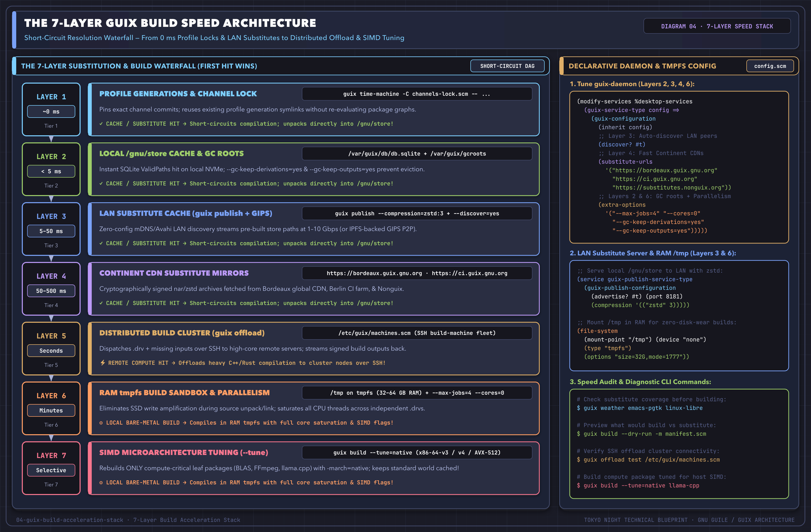

# GNU Guix 7-Layer Build & Substitute Acceleration Guide

Building or reconfiguring a GNU Guix system from source without optimization can take hours; with the **7-Layer Build Acceleration Stack** configured by `guix-platform-install` (`GUIX_PLATFORM=generic` and `postinstall/recipes/add/build-acceleration.scm`), system reconfigures and package installations drop from **30-90 minutes to 15-90 seconds**.



---

## Layer 1: Deterministic Channel Lockfiles (`channels-pinned.scm` -> ~0 ms Hit Rate)

The #1 hidden cause of unexpected 45-minute local compilations (like `linux-libre`, `gcc-toolchain`, `rust`, or `ungoogled-chromium`) is **moving past the substitute farm's build frontier**. When you run an unpinned `guix pull` to the bleeding-edge `master` tip, Cuirass (`ci.guix.gnu.org` and `bordeaux.guix.gnu.org`) may still be compiling that commit's package graph.

- **Rule**: Pin your channels to a commit that already has >95% substitute coverage:
  ```bash
  # Check substitute coverage BEFORE reconfiguring:
  guix weather $(awk '/\(packages/,/\)/' /etc/config.scm | tr -d '()')
  # Export your working channel lockfile:
  guix describe --format=channels > /etc/channels-pinned.scm
  # Use time-machine for guaranteed substitute hits:
  guix time-machine -C /etc/channels-pinned.scm -- system reconfigure /etc/config.scm
  ```

---

## Layer 2: Multi-Mirror Substitute Redundancy & Fast Decompression

GNU Guix operates two independent official build farms with different network paths and queue depths:
1. **`https://bordeaux.guix.gnu.org`** (Bordeaux coordinator — highest availability and `zstd`/`lzip` throughput)
2. **`https://ci.guix.gnu.org`** (Berlin coordinator)
3. **Regional mirrors**: `https://mirror.sjtu.edu.cn/guix/` (Asia/Middle East low-latency mirror)

Place `https://bordeaux.guix.gnu.org` first in `substitute-urls`:
```scheme
(modify-services %base-services
  (guix-service-type config =>
    (guix-configuration
     (inherit config)
     (substitute-urls
      (append (list "https://bordeaux.guix.gnu.org"
                    "https://ci.guix.gnu.org")
              %default-substitute-urls)))))
```

---

## Layer 3: LAN Peer Discovery (`guix publish --advertise` + `--discover`)

If you run more than one Guix machine on your LAN (or a workstation + laptop), never download or compile the same store item twice:
- **On the primary workstation (Hub)**:
  ```scheme
  (service guix-publish-service-type
           (guix-publish-configuration
            (host "0.0.0.0")
            (port 8181)
            (advertise? #t) ; Broadcasts via Avahi mDNS (_guix_publish._tcp)
            (compression '(("zstd" 3)))
            (cache "/var/cache/guix/publish")
            (ttl (* 90 24 3600))))
  ```
- **On every LAN client (Spoke)**:
  Add `(discover? #t)` to `guix-configuration` and `avahi-service-type` to your system services. The `guix-daemon` automatically discovers LAN peers and fetches `.nar.zst` archives at 1–10 Gbps LAN wire speed (`5–20 ms`).

---

## Layer 4: GIPS (Guix IPFS Peer-to-Peer Substitute Mesh)

For machines across different networks (e.g., an always-on Oracle Cloud ARM/x86 builder and a roaming laptop), `postinstall/recipes/add/gips.scm` configures a decentralized IPFS + GNUnet GNS substitute mesh (`docs/GIPS_MULTI_MACHINE_SYNC.md`).

---

## Layer 5: Daemon Parallelism & GC Derivation Retention (`extra-options`)

By default, `guix-daemon` is conservative and garbage collection discards `.drv` build plans and intermediate outputs. Configure `extra-options` in `guix-configuration`:
```scheme
(extra-options
 (list "--cores=0"                 ; Use all logical CPU cores per derivation
       "--max-jobs=4"              ; Build up to 4 independent derivations concurrently
       "--gc-keep-derivations=yes" ; Keep .drv files so rollbacks/rebuilds don't re-evaluate
       "--gc-keep-outputs=yes"))   ; Keep build-time dependencies of live store roots
```
- **RAM Sizing Formula**: Each heavy C++/Rust derivation (`llvm`, `rust`, `webkitgtk`) consumes ~2 GiB per core or ~4–8 GiB per job.
  - **8 GiB RAM**: `--max-jobs=2 --cores=4`
  - **16–32 GiB RAM**: `--max-jobs=4 --cores=0`
  - **64–128 GiB RAM**: `--max-jobs=8 --cores=0`

---

## Layer 6: RAM-Backed Build Scratch (`TMPDIR` on `tmpfs`)

When `guix-daemon` builds a package from source, it unpacks hundreds of thousands of small source files and object files inside its build directory (`/tmp/guix-build-*`). Putting `/tmp` on `tmpfs` (on machines with >= 16 GiB RAM) eliminates SSD write amplification and speeds up configure/unpack/link phases by **2x–4x**:
```scheme
(file-system
  (mount-point "/tmp")
  (device "none")
  (type "tmpfs")
  (check? #f)
  (options "mode=1777,size=50%"))
```
*(Note: During live ISO installation on low-RAM VPS instances, `guix-platform-install` intentionally sets `TMPDIR=/mnt/var/tmp` on disk so small RAM disks never overflow).*

---

## Layer 7: Distributed `guix offload` Cluster & Selective `--tune=native`

1. **Distributed SSH Offloading (`/etc/guix/machines.scm`)**:
   Offload heavy builds from a laptop to a high-core workstation or cloud server:
   ```scheme
   (list (build-machine
          (name "builder.lan")
          (systems (list "x86_64-linux"))
          (user "guix-offload")
          (host-key "ssh-ed25519 AAAAC3NzaC1lZDI1NTE5AAAAI...")
          (private-key "/etc/guix/offload-key")
          (parallel-builds 4)
          (speed 4.0)))
   ```
   Test your offload topology with:
   ```bash
   guix offload test /etc/guix/machines.scm
   guix offload status
   ```
2. **Selective Package Micro-Architecture Tuning (`--tune=native`)**:
   Instead of recompiling your entire operating system with custom `CFLAGS` (which invalidates 100% of binary substitutes!), Guix's `--tune` transformation selectively rebuilds only performance-critical packages (`blas`, `fftw`, `ffmpeg`, `llama-cpp`) optimized for your exact CPU SIMD ISA (`x86-64-v3`, `x86-64-v4`, `znver4`, `apple-m1`) while keeping 99% of your OS on fast binary substitutes:
   ```bash
   guix install --tune=native ffmpeg openblas
   ```
