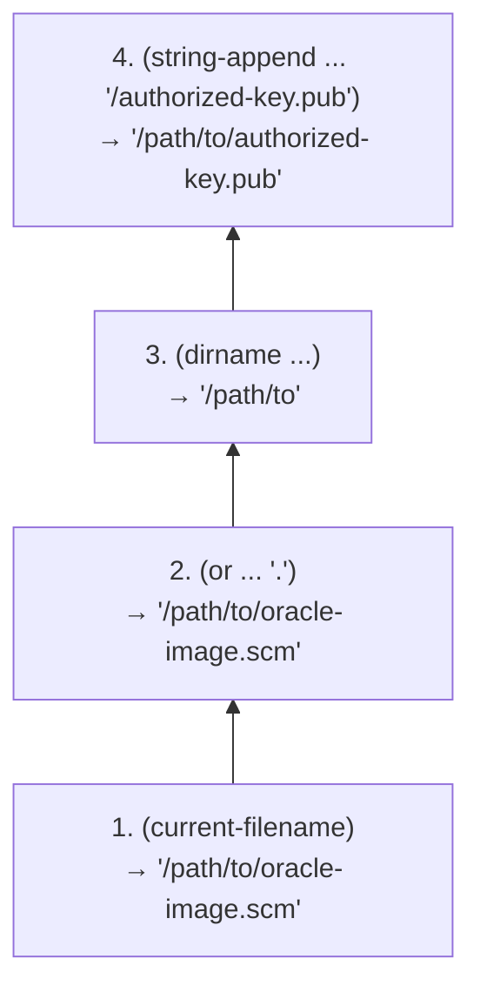
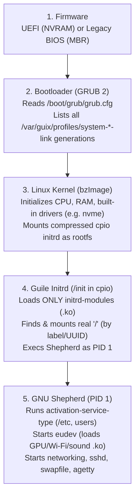
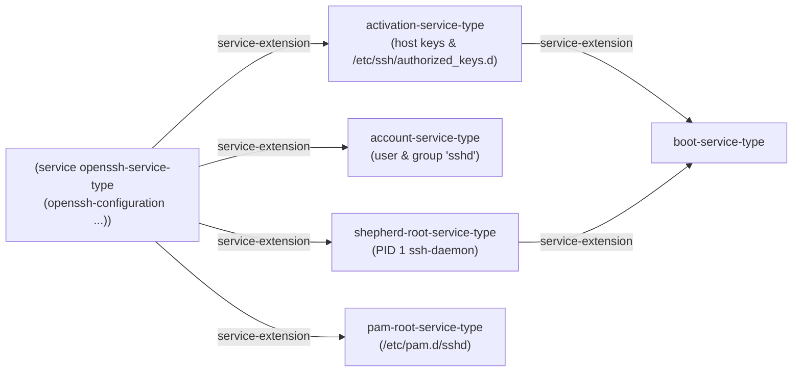

# The Guile Scheme, GNU Guix, Emacs, Org-Mode & Linux Internals Masterclass
### A Complete Illustrated Systems Engineering Curriculum (Built from `guix-platform-install`)

> **Course Overview**: This 6-module textbook and hands-on engineering course takes you from zero Lisp/Org experience to building, accelerating, and operating declarative GNU Guix and Linux systems using Guile Scheme, GNU Emacs (Geiser + Structural Editing), and Org-Mode Literate Programming.

---

## Visual Architecture Gallery (Course Blueprints)

### 1. How Lisp Thinks: S-Expressions, Cons Cells (`car`/`cdr`) & AST


### 2. Guix G-Expressions (`#~`, `#$`, `#$@`): Host Evaluation vs Target Store Builder


### 3. Linux & GNU Guix Boot Pipeline to Shepherd PID 1 & Atomic Generations


### 4. The 7-Layer Guix Build & Substitute Acceleration Stack


### 5. The Literate Lisp Workstation Loop: Emacs + Geiser + Org-Babel Tangling


---

# Zero-to-Mastery: Guile Scheme, GNU Guix & Linux System Internals
## Part 1 (Modules 1–3): The Lisp Mindset, Systems Scripting in Guile, and Declarative Linux Architecture

> **Target Audience**: Experienced Linux / DevOps systems engineers (written for Omran "devo" Altunaiji) who think in kernel boot paths, file descriptors, process trees, and reproducible infrastructure, and want a rigorous, first-principles mastery of **Guile Scheme** and **GNU Guix** — starting from zero prior Lisp experience and scaling all the way to PID 1 Shepherd services, G-expression staging, and multi-tier build acceleration.

---

# Module 1: The Lisp Mindset — Demystifying Parentheses & Homoiconicity (For Lisp Newcomers)

If you have spent years writing Bash, Python, Go, or C, your first look at a GNU Guix system configuration feels like staring into a wall of nested parentheses. Your eyes instinctively hunt for operators (`=`, `+`, `&&`, `{`, `;`), keywords, and line breaks to anchor your mental parser — and find none.

Here is the secret that turns Lisp from an alien syntax into the sharpest systems-engineering tool you will ever use: **Lisp does not have syntax in the way C or Python does. When you read or write Scheme, you are directly reading and writing the compiler's Abstract Syntax Tree (AST).**


---

## 1.1 Why `(op arg1 arg2)` Has Zero Operator-Precedence Ambiguity

In C, Python, or Bash, the surface syntax is packed with infix operators, prefix unary operators, postfix calls, and implicit precedence tables. Consider what your brain has to memorize in C or Python just to parse a single line:

- Does `a + b * c` mean `(a + b) * c` or `a + (b * c)`?
- Does `x & y == 0` mean `(x & y) == 0` or `x & (y == 0)`? (In C, `==` binds tighter than bitwise `&` — a classic kernel bug!)
- In Bash, does `cmd1 && cmd2 || cmd3` group as `(cmd1 && cmd2) || cmd3` or `cmd1 && (cmd2 || cmd3)`?

When a C or Python compiler reads `a + b * c`, its lexer and parser immediately throw away the infix notation and build an in-memory tree where every internal node is an **operation** and its children are its **arguments**:

```text
      C / Python Infix                   Compiler AST                  Scheme S-Expression
      ----------------                   ------------                  -------------------
         a + b * c                            +                           (+ a (* b c))
                                             / \
                                            a   *
                                               / \
                                              b   c
```

Scheme eliminates the middleman. Instead of writing an ambiguous infix string that the parser converts into a tree, **you write the tree directly** using **S-expressions** (Symbolic Expressions).

### The Universal Rule of S-Expressions

Every parenthesized list in Scheme has one uniform shape:

```scheme
(operator arg1 arg2 arg3 ...)
```

1. **Slot 0 (the head)** is ALWAYS the operation — a function, a macro, or a core special form (`define`, `let`, `if`, `lambda`, `quote`).
2. **Slots 1..N (the tail)** are ALWAYS the operands passed to that operation.
3. **There are zero precedence rules.** Grouping is explicit, local, and 100% unambiguous. You never need a precedence table because every operation carries its own bounding parentheses.
4. **Variadic operations require no repeated operators:** Instead of `1 + 2 + 3 + 4` or `"a" + "b" + "c"`, you write:
   ```scheme
   (+ 1 2 3 4)                        ; => 10
   (string-append "/home/" user "/.ssh/authorized_keys")
   ```

### Reading S-Expressions: Inside-Out vs. Outside-In

Systems engineers new to Lisp often try to read a Scheme expression strictly left-to-right, counting parentheses `(((` as they go. **Never count parentheses.** Instead, use two complementary reading modes depending on your goal:

#### Mode A: Reading Outside-In (Top-Down Intent / Structural Reading)
Use **Outside-In** when reading declarations, control flow, or Guix system configs to understand *what* the code does at a high level. Look at the head of each outer form and follow indentation (which in Lisp always reflects tree depth):

```scheme
;; Read Outside-In:
;; 1. "If the file exists..."
;; 2. "...then return #t..."
;; 3. "...otherwise create the directory and chmod it to 0700."
(if (file-exists? dir)
    #t
    (begin
      (mkdir dir #o700)
      (chmod dir #o700)))
```

#### Mode B: Reading Inside-Out (Bottom-Up Dataflow / Execution Order)
Use **Inside-Out** when tracing how values are computed at runtime (just like tracing nested function calls `f(g(h(x)))` or a Unix pipeline ` h x | g | f`):

```scheme
;; From guix-platform-install/oracle/image/oracle-image.scm:
(string-append (dirname (or (current-filename) ".")) "/authorized-key.pub")
```

Trace it from the deepest leaf outward:

```text
Step 1 (deepest):  (current-filename)
                   => "/root/guix-platform-install/oracle/image/oracle-image.scm"

Step 2 (parent):   (or "/root/.../oracle-image.scm" ".")
                   => "/root/.../oracle-image.scm"   (fallback "." if run in REPL)

Step 3 (parent):   (dirname "/root/.../oracle-image.scm")
                   => "/root/guix-platform-install/oracle/image"

Step 4 (outer):    (string-append "/root/.../oracle/image" "/authorized-key.pub")
                   => "/root/guix-platform-install/oracle/image/authorized-key.pub"
```



---

## 1.2 Atoms, Symbols, and the Quoting System (`'`, `` ` ``, `,`, `,@`)

Every S-expression in Scheme is built from two kinds of building blocks: **Atoms** (indivisible values) and **Pairs / Lists** (compound structures built with parentheses).

### Atoms and Self-Evaluation vs. Symbols

When the Guile evaluator sees an atom, what does it do?

| Atom Type | Example Syntax | Evaluation Behavior | Systems Analogy |
| :--- | :--- | :--- | :--- |
| **Numbers** | `42`, `-3.14`, `#o700`, `#x1b`, `1/3` | **Self-evaluating** (`#o700` $\rightarrow$ `448`) | Integer/float literals (`#o` = octal for `chmod`!) |
| **Strings** | `"eth0"`, `"/gnu/store"` | **Self-evaluating** | `char*` / string literal |
| **Booleans** | `#t`, `#f` | **Self-evaluating** | `true` / `false` |
| **Characters** | `#\a`, `#\newline`, `#\:` | **Self-evaluating** (`#\: ` used in `string-split`) | C `'a'`, `'\n'`, `':'` |
| **Keywords** | `#:use-module`, `#:key`, `#:export` | **Self-evaluating** named flags | CLI `--flag` or Python kwargs |
| **Symbols** | `eth0`, `linux-libre`, `+`, `x` | **Evaluated as variable lookup!** | Identifier / variable name |

Notice the last row: an unquoted word like `eth0` or `swapfile` is a **Symbol**. If you type `swapfile` into Guile without quoting it, Guile looks up the variable named `swapfile` in the current lexical environment.

What if you want the literal symbol `'swapfile` itself — as an identifier or tag (like a Shepherd service name `(provision '(swapfile))`) — without looking it up as a variable? You **quote** it!

### Homoiconicity: Code Is Data, Data Is Code

Because Scheme code is written as S-expression lists, **a piece of Scheme code and a Scheme list data structure have the exact same representation**. This property is called **homoiconicity** (*homo* = same, *icon* = representation).

Watch what happens when we put a quote `'` in front of a function call:

```scheme
(+ 1 2)          ; Evaluates the call: applies procedure + to 1 and 2 => 3
'(+ 1 2)         ; Quotes the form: returns a 3-element list of data => (+ 1 2)
(list '+ 1 2)    ; Explicitly constructs the exact same 3-element list => (+ 1 2)
(equal? '(+ 1 2) (list '+ 1 2)) ; => #t
```

Look closely at `(equal? '(+ 1 2) (list '+ 1 2))`:
- In `(list '+ 1 2)`, the symbol `+` is quoted (`'+`) so its first element is the symbol `+`, followed by `1` and `2`.
- In `'(+ 1 2)`, the single quote `'` in front of the outer parenthesis freezes the entire tree inside it into literal data.

### The Four Quoting Operators (`'`, `` ` ``, `,`, `,@`)

When building configurations, macros, or system definitions, you constantly want a **template** that is 90% static data and 10% dynamically computed values. If you only had `'`, you would have to manually stitch lists together with `(list ...)` and `(cons ...)`.

Scheme solves this with **Quasiquote** (`` ` ``), **Unquote** (`,`), and **Unquote-Splicing** (`,@`):

| Operator | Reader Expands To | Meaning | Bash / Shell Analogy |
| :--- | :--- | :--- | :--- |
| `'expr` | `(quote expr)` | **Quote**: Everything inside `expr` is literal data. Nothing is evaluated. | Single quotes `'hello $USER'` |
| `` `expr `` | `(quasiquote expr)` | **Quasiquote**: Everything inside `expr` is literal data *unless* marked with `,` or `,@`. | Double quotes `"hello $USER"` |
| `,expr` | `(unquote expr)` | **Unquote**: Step back into evaluation mode, evaluate `expr`, and insert the single result here. | Variable expansion `"$USER"` |
| `,@expr` | `(unquote-splicing expr)` | **Unquote-Splicing**: Evaluate `expr` (which must return a list) and splice its elements inline without outer parens. | Array expansion `"${ EXTRA_ARGS[@]}"` |

Let's run a concrete side-by-side demonstration:

```scheme
(define interface "eth0")
(define dns-servers '("1.1.1.1" "8.8.8.8"))

;; 1. Regular quote (') ignores variables completely — everything is literal symbols:
'(network (device interface) (dns dns-servers))
;; => (network (device interface) (dns dns-servers))

;; 2. Quasiquote (`) with unquote (,) evaluates `interface` and `dns-servers` in place:
`(network (device ,interface) (dns ,dns-servers))
;; => (network (device "eth0") (dns ("1.1.1.1" "8.8.8.8")))
;; Notice `dns-servers` was inserted as a nested list ("1.1.1.1" "8.8.8.8").

;; 3. Quasiquote (`) with unquote-splicing (,@) splices the elements of `dns-servers` inline:
`(network (device ,interface) (dns ,@dns-servers))
;; => (network (device "eth0") (dns "1.1.1.1" "8.8.8.8"))
```

### Why This Is the Exact Mental Model for Guix G-Expressions (`#~`, `#$`, `#$@`)

Why did we just spend five minutes mastering `` ` ``, `,`, and `,@`? Because **GNU Guix G-Expressions (G-exps)** — the core mechanism Guix uses to write Shepherd services, initrd scripts, and package build phases — are literally **quasiquotation across time and `/gnu/store`!**

Look at the exact 1-to-1 correspondence:

| Standard Scheme Quoting | Guix G-Expression | What It Does |
| :--- | :--- | :--- |
| `` `(...) `` (`quasiquote`) | `#~(...)` (`gexp`) | Quote a code template for **Target Execution** (in a build container or at boot inside Shepherd). |
| `,val` (`unquote`) | `#$val` (`ungexp`) | Evaluate `val` **right now on the Host** (and if `val` is a package like `coreutils`, compile it into `/gnu/store/...-coreutils-9.1` and insert that store path string!). |
| `,@lst` (`unquote-splicing`) | `#$@lst` (`ungexp-splicing`) | Evaluate `lst` **right now on the Host** and splice its elements inline into the target code. |

Look at a real bug documented in `guix-platform-install/oracle/image/oracle-image.scm` (lines 270–284):

```scheme
;; From oracle/image/oracle-image.scm:
(authorized-keys
 (if %authorized-key
     `((,%user-name ,%authorized-key))
     '()))
```

Look at `` `((,%user-name ,%authorized-key)) ``:
- Without the commas (if you wrote `'((%user-name %authorized-key))`), Guix would try to configure SSH keys for a literal user named `"%user-name"`!
- With the commas, `%user-name` evaluates to `"guix"` and `%authorized-key` evaluates to the `<local-file>` object pointing to `authorized-key.pub`, producing `(("guix" #<local-file .../authorized-key.pub>))`.
- And why the `(if %authorized-key ...)` guard? As the comment in `oracle-image.scm` explains: when `authorized-key.pub` is absent, `%authorized-key` is `#f`. An unconditional `` `((,%user-name ,%authorized-key)) `` evaluates to `(("guix" #f))`, which passes evaluation cleanly and then crashes at image build time with `Wrong type (expecting string): #f`!

---

## 1.3 Cons Cells (`cons`, `car`, `cdr`), Proper vs. Dotted Lists & Structural Sharing

Under the hood, how does Scheme represent lists and trees? Every list in Scheme is built from a single two-pointer struct called a **cons cell** (or **pair**).

### `cons`, `car`, and `cdr`

A cons cell is a 2-word memory allocation containing two pointers:
- **`car`**: The first slot (historically *Contents of the Address part of Register* on the 1950s IBM 704). Think of `car` as **`head` / `first`**.
- **`cdr`** (pronounced *"could-er"*): The second slot (*Contents of the Decrement part of Register*). Think of `cdr` as **`tail` / `rest`**.
- **`cons`**: Allocates a new pair `(cons a b)` whose `car` points to `a` and whose `cdr` points to `b`.

```text
(cons 'a 'b)   ==>   +-------+-------+
                     |   a   |   b   |     Printed as: (a . b)
                     +-------+-------+
                        car     cdr
```

### Dotted Pairs vs. Proper Lists (Spine Diagrams)

Wait — why did `(cons 'a 'b)` print with a dot `(a . b)` instead of `(a b)`?

Because in Scheme:
1. A **Dotted Pair** is any pair whose `cdr` is a non-list atom (like `'b` or `42`). You write it `(a . b)`.
2. A **Proper List** is a chain of cons cells (called the **spine**) where:
   - Each cell's `car` points to an element of the list.
   - Each cell's `cdr` points to the **next cons cell** in the spine.
   - The final cell's `cdr` points to the special empty list constant **`'()`** (often drawn as `/` or `nil`).

```text
Proper List: (list 'a 'b 'c)  ===  (cons 'a (cons 'b (cons 'c '())))
Printed as:  (a b c)

   Spine Cell 1          Spine Cell 2          Spine Cell 3
  +-----+-----+        +-----+-----+        +-----+-----+
  | car | cdr |------->| car | cdr |------->| car | cdr |---> '()
  +--+--+-----+        +--+--+-----+        +--+--+-----+
     |                    |                    |
     v                    v                    v
    'a                   'b                   'c
```

What happens if the last `cdr` of a multi-cell chain is an atom instead of `'()`? You get an **improper (dotted) list**:

```scheme
(cons 'a (cons 'b 'c))        ; => (a b . c)
(cons* 'installed 1 '("ssh-ed25519 AAAA...")) ; => (installed 1 "ssh-ed25519 AAAA...")
```

> **Real-World Sighting (`metadata-ssh-keys.scm` line 40)**:
> In `oracle/image/metadata-ssh-keys.scm`, when `metadata-retry` succeeds on attempt `attempt` with a list of `keys`, it returns:
> ```scheme
> (cons* 'installed attempt keys)
> ```
> `cons*` chains `cons` calls onto `keys`. Since `keys` is already a proper list `("ssh-ed25519 ...")`, `(cons* 'installed attempt keys)` is equivalent to `(cons 'installed (cons attempt keys))`, producing the flat proper list `(installed 1 "ssh-ed25519 ...")`! And on line 120, the caller extracts `keys` using `(cddr result)` — which means `(cdr (cdr result))`, skipping past `'installed` and `attempt` in two pointer hops!

### Shorthand Accessors: `cadr`, `cddr`, `caddr`

Scheme provides composable shorthands for chaining up to four `car` (`a`) and `cdr` (`d`) operations (read the middle letters **right-to-left**, from inside out):

```scheme
(define result '(installed 3 "ssh-ed25519 AAA..." "ssh-rsa BBB..."))

(car result)    ; 1st element                        => 'installed
(cdr result)    ; Tail after 1st element             => '(3 "ssh-ed25519 AAA..." "ssh-rsa BBB...")
(cadr result)   ; (car (cdr result)) = 2nd element   => 3
(cddr result)   ; (cdr (cdr result)) = tail after 2  => '("ssh-ed25519 AAA..." "ssh-rsa BBB...")
(caddr result)  ; (car (cdr (cdr result))) = 3rd     => "ssh-ed25519 AAA..."
```

### Immutability & Structural Sharing (Why Guix Uses `cons` Everywhere)

In `oracle/image/oracle-image.scm`, look at how the system's file systems and user accounts are defined:

```scheme
(file-systems
 (cons (file-system
        (mount-point "/")
        (device (file-system-label "Guix_image"))
        (type "ext4"))
       %base-file-systems))

(users (cons (user-account
              (name %user-name)
              ...)
             %base-user-accounts))
```

Why does Guix write `(cons my-user %base-user-accounts)`?
Because cons cells in idiomatic Scheme are treated as **immutable**, `(cons my-user %base-user-accounts)` allocates **only ONE new 16-byte cons cell**:
- Its `car` points to `my-user`.
- Its `cdr` points directly to the first cell of `%base-user-accounts`.

```text
my-users ──► [ my-user | ──]──┐
                              ▼
%base-user-accounts ────────► [ root | ──]──► [ nobody | '() ]
```

Both `my-users` and `%base-user-accounts` remain 100% valid, independent lists! `%base-user-accounts` is never mutated, and zero elements of `%base-user-accounts` were copied. This is **structural sharing**: prepending with `cons` is $O(1)$ time and $O(1)$ memory.

By contrast, what does `(append list-a list-b)` do (as seen in `(services (append (list ...) %base-services))`)?
- `append` must walk `list-a` and allocate a **copied spine** for `list-a` so that the final cell of the copy can point its `cdr` to `list-b` without mutating `list-a`.
- `list-b` (`%base-services`) is STILL shared without copying! That is why in Guix you always put your small list of custom services *first* and `%base-services` *last* in `(append my-services %base-services)`: copying a 4-element spine is instant, whereas `%base-services` is shared in $O(1)$.

---

## 1.4 Tail-Call Optimization (TCO), Named `let`, and `(srfi srfi-1)`

If you search the entire GNU Guix codebase (over 1,000,000 lines of Scheme), you will virtually never see a `while` loop or a C-style `for (i = 0; i < n; i++)` loop with `set!` mutation. How do you write loops in a functional language without blowing the call stack?

### Proper Tail Calls & Tail-Call Optimization (TCO)

In Python, C (without optimization), or Bash, every recursive function call pushes a new stack frame onto the call stack because the caller has work left to do after the callee returns.

In Scheme, the language specification **guarantees Tail-Call Optimization (TCO)**: if a function call is in **tail position** (meaning it is the *very last action* performed before returning, with no outer computation waiting on its result), the Guile VM **reuses the current stack frame** and compiles the call into a direct `jmp` instruction!

Compare a non-tail call with a tail call:

```scheme
;; BAD (Non-Tail Recursive): The `+ 1` is waiting outside the recursive call!
;; Must keep every stack frame alive to add 1 on the way back up. O(N) stack!
(define (my-length-bad lst)
  (if (null? lst)
      0
      (+ 1 (my-length-bad (cdr lst))))) ; <-- NOT in tail position! (+ 1 ...) wraps it.

;; GOOD (Tail Recursive): Pass an accumulator `acc`.
;; Nothing wraps `(loop (cdr rem) (+ acc 1))` — it IS the final return value! O(1) stack!
(define (my-length lst)
  (let loop ((rem lst)
             (acc 0))
    (if (null? rem)
        acc
        (loop (cdr rem) (+ acc 1)))))   ; <-- IN TAIL POSITION! Compiles to a jump (loop).
```

```text
Stack-Growing (my-length-bad '(a b c)):       Tail-Recursive (my-length '(a b c)):
  Frame 1: (+ 1 (my-length-bad '(b c)))         Frame 1: (loop '(a b c) 0)
  Frame 2: (+ 1 (+ 1 (my-length-bad '(c))))     Frame 1: (loop '(b c)   1)  <-- same frame reused!
  Frame 3: (+ 1 (+ 1 (+ 1 0)))                  Frame 1: (loop '(c)     2)  <-- same frame reused!
  Unwind : 3                                    Frame 1: (loop '()      3)  => returns 3
```

### Named `let`: The Systems Engineer's Loop

Look closely at the syntax we just used:

```scheme
(let loop ((var1 init1)
           (var2 init2))
  body...)
```

Wait: an ordinary `let` binds local variables: `(let ((x 10) (y 20)) (+ x y))`.
When you put a symbol (`loop`) right after `let`, it becomes a **Named `let`**:
1. It defines a local tail-recursive function named `loop` with parameters `(var1 var2)`.
2. It immediately calls `(loop init1 init2)` with the initial values.
3. Inside `body`, calling `(loop new-var1 new-var2)` in tail position jumps back to the top of the `let` with updated state variables — **without a single mutable variable (`set!`)!**

Let's examine two real-world named `let` loops from `guix-platform-install`:

#### Real Example 1: Bounded Retry Policy (`oracle/image/metadata-ssh-keys.scm` lines 32–46)
```scheme
(define (metadata-retry fetch-lines wait! log! max-attempts retry-delay)
  (let loop ((attempt 1))
    (let* ((lines (or (fetch-lines) '()))
           (keys (metadata-usable-keys lines)))
      (cond ((not (null? keys))
             (cons* 'installed attempt keys))
            ((>= attempt max-attempts)
             (list 'exhausted attempt))
            (else
             (log! attempt max-attempts retry-delay)
             (wait! retry-delay)
             (loop (+ attempt 1))))))) ; <-- Tail-recursive jump to next attempt!
```
Notice how clean that is: `attempt` starts at `1`. If keys are found, it returns `(installed 1 ...)`. If `attempt >= max-attempts`, it returns `(exhausted 12)`. Otherwise it logs, sleeps, and tail-calls `(loop (+ attempt 1))`.

#### Real Example 2: Reading All Lines from a Port (`oracle/image/metadata-ssh-keys.scm` lines 48–55)
```scheme
(define (metadata-read-lines path)
  (call-with-input-file path
    (lambda (port)
      (let loop ((lines '()))
        (let ((line (read-line port)))
          (if (eof-object? line)
              (reverse lines)                 ; <-- Reverse once at the end!
              (loop (cons line lines))))))))  ; <-- O(1) prepend onto accumulator!
```
> **Crucial Idiom (`cons` + `reverse`)**: Why does `metadata-read-lines` do `(cons line lines)` on each iteration and `(reverse lines)` at the end, instead of `(append lines (list line))`?
> Because `(cons line lines)` is $O(1)$, so reading $N$ lines takes $O(N)$ time, and a single `(reverse lines)` at EOF takes $O(N)$ time — total $O(N)$! If you used `(append lines (list line))` inside the loop, it would re-copy the growing list on every line, turning a 10,000-line file read into an $O(N^2)$ disaster!

### Higher-Order List Pipelines with `(srfi srfi-1)`

Even better than writing a manual named `let` is expressing data transformations as declarative pipelines using `(use-modules (srfi srfi-1))` — Scheme Request for Implementation #1 (the standard list library imported at the top of `fix-network.scm`, `metadata-ssh-keys.scm`, and `gips.scm`).

Here are the five essential functions you will use every day in Guile and Guix:

```scheme
(use-modules (srfi srfi-1))

(define Raw-Lines '("  \"ssh-ed25519 AAAAC3Nza...\" "
                    "<html>404 Not Found</html>"
                    ""
                    "ssh-rsa AAAAB3Nza..."))

;; 1. map: Transform every element x -> f(x)  (1-to-1)
(map string-trim-both Raw-Lines)

;; 2. filter: Keep only elements where (pred x) is truthy
;; From oracle/image/metadata-ssh-keys.scm:
(define (metadata-usable-keys lines)
  (map metadata-unquote-value (filter metadata-key-line? lines)))

;; 3. remove: Opposite of filter — drop elements where (pred x) is truthy
;; Often used in Guix to strip a service or package from %base-packages / %base-initrd-modules:
(remove (lambda (pkg) (string=? (package-name pkg) "nano"))
        %base-packages)

;; 4. any / every: Short-circuiting existential / universal predicates
;; From postinstall/recipes/add/gips.scm (command-in-path?):
(any (lambda (dir)
       (file-exists? (string-append dir "/guix")))
     (string-split (getenv "PATH") #\:))

;; 5. fold: Reduce a list into any summary value: (fold (lambda (elem acc) ...) init lst)
;; Note: In SRFI-1 fold, the lambda takes (ELEMENT ACCUMULATOR) in that order!
(fold (lambda (n sum) (+ sum n)) 0 '(10 20 30 40)) ; => 100
```

---

## 1.5 Unmentioned Beginner Gems & Survival Guide

Every newcomer to Guile Scheme trips over the same three landmines because most tutorials forget to mention them. Memorize these three gems now and you will save yourself days of debugging.

### Gem 1: Debugging `Wrong type to apply` — The "Extra Parentheses" Trap

In C, Python, or Bash math, adding extra parentheses around an expression is harmless grouping: `((x))` is identical to `x`.

**In Lisp, parentheses are NEVER grouping. Every `(` means "call the first item inside as a function!"**

Watch what happens if you accidentally wrap a variable or expression in an extra pair of parentheses:

```scheme
(define count 42)

count    ; Evaluates variable `count` => 42
(count)  ; Tries to CALL 42 as a 0-argument function!
```

Guile immediately throws:
```text
ice-9/boot-9.scm:1685:16: In procedure raise-exception:
Wrong type to apply: 42
```

Whenever you see **`Wrong type to apply: <something>`**, translate it in your head as:
> *"I tried to call `<something>` as a function, which means I put an opening parenthesis `(` directly in front of `<something>` (or in front of an expression that evaluated to `<something>`)."*

The two most common places beginners trigger this:
1. **Wrapping a `cond` or `if` test in double parens:**
   ```scheme
   ;; WRONG: (zero? status) returns #t, and the outer parens try to call (#t) as a function!
   ;; Throws: Wrong type to apply: #t
   (if ((zero? status))
       (display "ok"))

   ;; RIGHT:
   (if (zero? status)
       (display "ok"))
   ```
2. **Writing C-style `cond` clauses without realizing `cond` already wraps each `[test body]` pair in parens:**
   ```scheme
   ;; In `cond`, each clause is (TEST RESULT-EXPR ...).
   ;; Here the outer parens belong to the clause, and the inner parens call `command-exists?`:
   (cond
    ((command-exists? "ip")       ; <-- Outer `(` starts the cond clause; inner `(` calls command-exists?
     (display "found ip\n"))
    (else
     (display "missing\n")))
   ```

### Gem 2: `#t` / `#f` vs. `'()` — In Scheme, `'()` and `0` Are Truthy!

If you come from Python, C, Bash, or even **Common Lisp / Emacs Lisp**, pay close attention:

| Value | Python | C | Emacs Lisp / Common Lisp | **Guile Scheme** |
| :--- | :--- | :--- | :--- | :--- |
| `#f` | `False` | `0` | `nil` (falsy) | **Falsy (the ONLY falsy value!)** |
| `'()` (empty list) | `[]` (falsy) | N/A | `nil` (falsy! `'()` == `nil`) | **TRUTHY!** |
| `0` (zero) | `0` (falsy) | `0` (falsy) | Truthy | **TRUTHY!** |
| `""` (empty string) | `""` (falsy) | Truthy ptr | Truthy | **TRUTHY!** |

**In Guile Scheme, `#f` is the ONLY falsy value in the entire universe.** Everything else — including the empty list `'()`, the number `0`, and the empty string `""` — is **truthy**!

```scheme
;; BUG in Scheme (works in Python/Elisp, ALWAYS takes the true branch in Scheme!):
(if '()
    "Empty list is TRUTHY in Scheme!"
    "Never reached")
;; => "Empty list is TRUTHY in Scheme!"

;; RIGHT in Scheme — always use explicit predicates:
(null? lst)         ; Is lst the empty list '()?
(pair? lst)         ; Is lst a non-empty cons cell?
(zero? n)           ; Is number n equal to 0?
(string-null? str)  ; Is string str equal to ""? (Used throughout fix-network.scm and gips.scm!)
```

> **Corollary — Why `(or (getenv "HOME") "/tmp")` works so cleanly:**
> Because `getenv` returns `#f` when an environment variable is unset (not `""`), `(or (getenv "HOME") "/tmp")` returns the first non-`#f` value. That is why `gips.scm` line 91 writes:
> ```scheme
> (define (user-home)
>   (or (getenv "HOME") "/tmp"))
> ```

### Gem 3: How to Read a Guile Backtrace Without Panic

When a Guile script or `guix system build` fails, it prints a backtrace ordered from **outermost caller (top, frame N)** down to **innermost crash site (bottom, frame 0)**, followed by the actual error message on the **very last line**.

Let's dissect a real Guile backtrace:

```text
Backtrace:
           3 (primitive-load "/tmp/broken-net.scm")
In ice-9/eval.scm:
   191:35  2 (_ #f)
In /tmp/broken-net.scm:
    14:12  1 (check-iface "eth0")
In unknown file:
           0 (string-append "ip addr show " #f)

ERROR: In procedure string-append:
In procedure string-append: Wrong type (expecting string): #f
```

How to read this in 3 seconds:
1. **Read the bottom two lines FIRST:**
   - **What crashed?** `In procedure string-append`
   - **Why did it crash?** `Wrong type (expecting string): #f` — someone passed `#f` instead of a string to `string-append`.
2. **Look at Frame `0` and Frame `1` just above the error:**
   - Frame `0` shows the exact call with evaluated arguments: `(string-append "ip addr show " #f)`.
   - Frame `1` gives you your exact source file, **line 14, column 12**: `In /tmp/broken-net.scm: 14:12 1 (check-iface "eth0")`.

---

## 1.6 Module 1 Hands-On Labs & Exercises

Run every exercise below in a terminal using `guile` (or `guile -c '(...)'`).

### Lab 1.1: Quasiquote & G-Exp Mental Model Drill
You are writing a helper function `(make-ssh-config user port extra-keys)` that takes:
- `user` (a string, e.g. `"om"`)
- `port` (an integer, e.g. `2222`)
- `extra-keys` (a list of public key strings, e.g. `'("ssh-ed25519 AAA..." "ssh-ed25519 BBB...")`)

Write `(make-ssh-config user port extra-keys)` using a single quasiquoted expression `` `(...) `` so that:
```scheme
(make-ssh-config "om" 2222 '("ssh-ed25519 AAA" "ssh-ed25519 BBB"))
```
evaluates to:
```scheme
(openssh-configuration
 (permit-root-login #f)
 (port-number 2222)
 (authorized-keys ("om" "ssh-ed25519 AAA" "ssh-ed25519 BBB")))
```
*(Notice that `extra-keys` is spliced inline after `"om"`, not nested as a sublist!)*

#### Solution 1.1
```scheme
#!/usr/bin/env -S guile --no-auto-compile -s
!#
(define (make-ssh-config user port extra-keys)
  `(openssh-configuration
    (permit-root-login #f)
    (port-number ,port)
    (authorized-keys (,user ,@extra-keys))))

(write (make-ssh-config "om" 2222 '("ssh-ed25519 AAA" "ssh-ed25519 BBB")))
(newline)
```

---

### Lab 1.2: Tail-Recursive Log Parser with Named `let` and `(srfi srfi-1)`
Suppose you have a list of raw `/proc/net/dev` interface lines:
```scheme
(define proc-lines
  '("Inter-|   Receive                                                |  Transmit"
    " face |bytes    packets errs drop fifo frame compressed multicast|bytes    packets"
    "    lo: 1420500   12040    0    0    0     0          0         0  1420500   12040"
    "  eth0: 9841200   84112    0    0    0     0          0         0  4129000   39100"
    "wlan0:       0       0    0    0    0     0          0         0        0       0"))
```
1. Write a pure function `(extract-interfaces lines)` using `(srfi srfi-1)` (`filter` and `map`) that keeps only lines containing `#\:` and extracts the trimmed interface name before the colon (`'("lo" "eth0" "wlan0")`).
2. Write a tail-recursive function `(count-active-lines lines)` using a **named `let`** (no `filter`, no `set!`) that counts how many lines contain a `#\:` character.

#### Solution 1.2
```scheme
#!/usr/bin/env -S guile --no-auto-compile -s
!#
(use-modules (srfi srfi-1)
             (srfi srfi-13)) ; string-contains, string-trim-both, string-index

(define proc-lines
  '("Inter-|   Receive                                                |  Transmit"
    " face |bytes    packets errs errs drop fifo frame compressed multicast|bytes    packets"
    "    lo: 1420500   12040    0    0    0     0          0         0  1420500   12040"
    "  eth0: 9841200   84112    0    0    0     0          0         0  4129000   39100"
    "wlan0:       0       0    0    0    0     0          0         0        0       0"))

;; Part 1: Functional pipeline with filter + map
(define (extract-interfaces lines)
  (map (lambda (line)
         (let ((colon-idx (string-index line #\:)))
           (string-trim-both (substring line 0 colon-idx))))
       (filter (lambda (line) (string-index line #\:))
               lines)))

;; Part 2: Tail-recursive named `let` with accumulator
(define (count-active-lines lines)
  (let loop ((rem lines)
             (count 0))
    (if (null? rem)
        count
        (loop (cdr rem)
              (if (string-index (car rem) #\:)
                  (+ count 1)
                  count)))))

(format #t "Interfaces: ~s~%" (extract-interfaces proc-lines))
(format #t "Active line count: ~a~%" (count-active-lines proc-lines))
```

---

### Lab 1.3: Spot the Three Beginner Bugs
Each snippet below has a bug that a C/Python/Elisp programmer commonly writes in Guile. Identify the bug and fix it:

```scheme
;; Bug A:
(define (has-items? lst)
  (if lst #t #f))

;; Bug B:
(define (first-or-default lst default-val)
  (if (null? lst)
      (default-val)
      (car lst)))

;; Bug C:
(define (prepend-item item lst)
  (append lst item))
```

#### Solution 1.3
- **Bug A**: In Scheme, `'()` is **truthy** (only `#f` is falsy), so `(if lst #t #f)` returns `#t` even when `lst` is `'()`!
  - **Fix**: `(define (has-items? lst) (not (null? lst)))` (or `(pair? lst)`).
- **Bug B**: `(default-val)` wraps the variable `default-val` in parentheses, which attempts to **call `default-val` as a function**, crashing with `Wrong type to apply`!
  - **Fix**: Remove the extra parentheses: `default-val`.
- **Bug C**: Two bugs: first, `append` puts `item` at the end, not the front, and expects all arguments except the last to be proper lists; second, prepending a single element to the front of a list in $O(1)$ time with structural sharing is done with `cons`!
  - **Fix**: `(define (prepend-item item lst) (cons item lst))`.

---
# Module 2: Guile Scheme for Systems Engineers (Using Real Code from `guix-platform-install`)

In Module 1 you learned to read S-expressions as direct ASTs. Now we transition from language fundamentals to **systems engineering in GNU Guile** — dissecting actual production scripts and system definitions from `guix-platform-install` (`lib/fix-network.scm`, `oracle/image/oracle-image.scm`, `oracle/image/metadata-ssh-keys.scm`, and `postinstall/recipes/add/gips.scm`).

---

## 2.1 The Guile Shebang Trap & String Escape Gotchas

Look at the first three lines of `lib/fix-network.scm` and `postinstall/recipes/add/gips.scm`:

```scheme
#!/run/current-system/profile/bin/guile \
--no-auto-compile -s
!#
```

Why is there a backslash `\` at the end of line 1, flags on line 2, and `!#` on line 3?

### How the Linux Kernel Parses `#!` (`fs/binfmt_script.c`)

When you run an executable script `./gips.scm --status`, the Linux kernel's `execve(2)` syscall inspects the first two bytes (`#!`). The kernel parser in `fs/binfmt_script.c` is deliberately primitive:
1. It reads the interpreter path up to the first whitespace (`/run/current-system/profile/bin/guile`).
2. It takes **everything else on line 1 after the whitespace as a SINGLE argument string (`argv[1]`)**, appends the script filename (`argv[2]`), and appends the user's CLI arguments (`argv[3...]`).

So if you write:
```scheme
;; BROKEN SHEBANG ON LINUX:
#!/run/current-system/profile/bin/guile --no-auto-compile -e main -s
```
The Linux kernel does **not** pass three flags (`"--no-auto-compile"`, `"-e"`, `"main"`, `"-s"`). It passes ONE giant string with spaces in it:
```text
argv[0] = "/run/current-system/profile/bin/guile"
argv[1] = "--no-auto-compile -e main -s"   <-- Guile fails: unrecognized switch!
argv[2] = "./my-script.scm"
```

### How Guile's Meta-Switch (`\` ... `!#`) Solves the Kernel Limit

Guile has a built-in **meta-switch** specifically engineered to bypass the kernel's single-argument `#!` limitation:
1. When line 1 ends with a space and a backslash (`#!/run/current-system/profile/bin/guile \`), the kernel passes `"\\"` as `argv[1]`.
2. When Guile sees `"\\"` as `argv[1]`, Guile opens the script file itself, reads **line 2**, splits line 2 on whitespace into proper multiple CLI flags (`--no-auto-compile`, `-e`, `main`, `-s`), and skips everything up to the closing `!#` token!
3. Even better: inside Guile, `#! ... !#` is treated as a multi-line block comment, so lines 1–3 are completely ignored when the Scheme evaluator loads the file.

Compare the two standard meta-switch patterns used in Guile scripts:

```scheme
;; Pattern A: Top-level script execution (-s)
;; Used in postinstall/recipes/add/gips.scm
#!/run/current-system/profile/bin/guile \
--no-auto-compile -s
!#
;; Runs top-level expressions in order; access CLI args via (command-line)

;; Pattern B: Explicit entry-point function (-e main -s)
#!/run/current-system/profile/bin/guile \
--no-auto-compile -e main -s
!#
(define (main args)
  ;; Guile loads the file first, then automatically calls (main (command-line))!
  (format #t "Script ~a called with args: ~s~%" (car args) (cdr args)))
```

> **Why `#!/run/current-system/profile/bin/guile` instead of `#!/bin/bash` or `#!/usr/bin/env`?**
> On GNU Guix, `/bin` contains **only** `/bin/sh` (to prevent impure hardcoding of FHS paths). System-wide binaries live under `/run/current-system/profile/bin/`. Using `/run/current-system/profile/bin/guile` (along with `--no-auto-compile` so root/ISO runs don't clutter `~/.cache/guile` with `.go` bytecode files) guarantees deterministic startup across live ISOs and installed systems.

### The Octal String Escape Trap (`\x1b` vs `\033`)

In Bash, Python, or C, you write ANSI terminal color escapes using octal `\033`: `"\033[1;32m[OK]\033[0m"`.
If you write `"\033[1;32m"` in Guile Scheme, **it will fail or print garbage** because Guile strings do not support `\033` octal character escapes!

Look at `postinstall/recipes/add/gips.scm` (lines 40–53):

```scheme
;;; Output & Formatting (ASCII Only, ANSI Escapes with \x1b)

(define (msg text)
  (format #t "\n\x1b[1;34m==> ~a\x1b[0m\n" text))

(define (ok text)
  (format #t "\x1b[1;32m[OK]\x1b[0m ~a\n" text))

(define (warn text)
  (format #t "\x1b[1;33m[WARN]\x1b[0m ~a\n" text))

(define (err text)
  (format #t "\x1b[1;31m[ERROR]\x1b[0m ~a\n" text))
```

Memorize the distinction between **String Escapes** and **Number Prefixes** in Guile:
- **Inside strings (`"..."`)**: Always use hexadecimal **`\x1b`** (2 hex digits) for ASCII `ESC` (27).
- **For integer literals (like UNIX file modes)**: Use the **`#o` octal number prefix**:
  - `#o700` = `448` (`rwx------`, used in `(mkdir dir #o700)`)
  - `#o600` = `384` (`rw-------`, used in `(chmod sec-file #o600)`)
  - `#o777` = `511` (permission mask in `(logand (stat:perms (stat dir)) #o777)`)

---

## 2.2 Modules (`define-module`, `#:use-module`) & Guix Records (`define-record-type*`)

### How Guile Modules Map to the Filesystem

In Guile and Guix, module names are lists of symbols that map 1-to-1 to directory paths on `$GUILE_LOAD_PATH`:

| Module Name | Filesystem Path | Purpose |
| :--- | :--- | :--- |
| `(ice-9 popen)` | `ice-9/popen.scm` | Pipe creation (`open-pipe*`, `open-input-pipe`, `close-pipe`) |
| `(ice-9 rdelim)` | `ice-9/rdelim.scm` | Delimited readers (`read-line`, `read-string`) |
| `(ice-9 match)` | `ice-9/match.scm` | Structural pattern matcher (`match`, `match-lambda`) |
| `(srfi srfi-1)` | `srfi/srfi-1.scm` | List library (`filter`, `remove`, `fold`, `any`, `every`) |
| `(srfi srfi-13)` | `srfi/srfi-13.scm` | String library (`string-trim-both`, `string-contains`, `string-prefix?`) |
| `(guix gexp)` | `guix/gexp.scm` | G-expressions (`#~`, `#$`, `local-file`, `plain-file`, `file-append`) |
| `(guix records)` | `guix/records.scm` | Declarative record macro (`define-record-type*`) |
| `(gnu services ssh)` | `gnu/services/ssh.scm` | `openssh-service-type`, `openssh-configuration` |

In Guix system configurations (`oracle-image.scm`), you also see convenience macros that expand into `(use-modules ...)`:
```scheme
(use-service-modules networking shepherd ssh)
;; Expands to:
;; (use-modules (gnu services networking)
;;              (gnu services shepherd)
;;              (gnu services ssh))

(use-package-modules base linux ssh wget)
;; Expands to:
;; (use-modules (gnu packages base)
;;              (gnu packages linux)
;;              (gnu packages ssh)
;;              (gnu packages wget))
```

### Creating Your Own Reusable Module (`define-module`)

In standalone scripts (`fix-network.scm`, `gips.scm`), you import modules with `(use-modules ...)`. When writing a library module that other files import, start the file with `(define-module ...)`:

```scheme
(define-module (my-infra net-check)
  #:use-module (ice-9 popen)
  #:use-module (ice-9 rdelim)
  #:use-module ((srfi srfi-1) #:select (filter any)) ; selective import
  #:export (interface-up?
            list-ipv4-addrs))
```

### Advanced Module Resolution: `module-ref` and `(@ ...)`

Look at `oracle/image/oracle-image.scm` lines 162–169 inside `%metadata-ssh-key-service`:

```scheme
;; The service is compiled before it runs. A direct call to a
;; name introduced dynamically by `load' compiles as an unbound
;; reference, so resolve it explicitly after loading the helper.
(load #$%metadata-key-helper)
((module-ref (current-module) 'metadata-install-from-oci!)
 #$%user-name
 #$(file-append wget "/bin/wget")
 #$(not %authorized-key))
```

Why did the author write `((module-ref (current-module) 'metadata-install-from-oci!) ...)` instead of simply `(metadata-install-from-oci! ...)`?
Because Guix **compiles** Shepherd service G-expressions before running them! At compile time, `(load "/gnu/store/...-metadata-ssh-keys.scm")` has not executed yet, so the compiler doesn't know `metadata-install-from-oci!` exists. By looking up the symbol `'metadata-install-from-oci!` in `(current-module)` at runtime via `module-ref` (and calling the returned procedure via the outer parens!), the code cleanly separates the testable helper file from the Shepherd service without compiler warnings or unbound variable failures.

Similarly, if you ever need to reach into a Guix module to grab an **unexported (private)** variable or function without modifying upstream Guix, use `@@` (private lookup) or `@` (public lookup):

```scheme
;; Public lookup without importing the whole module:
(@ (gnu packages ssh) openssh-sans-x)

;; Private (unexported) lookup inside a Guix module:
(@@ (gnu system image) root-label) ; => "Guix_image"
```

### Declarative Records with `(guix records)` and `define-record-type*`

When you write `(operating-system ...)`, `(file-system ...)`, `(user-account ...)`, or `(openssh-configuration ...)` in `oracle-image.scm`, what are those forms? They are **syntactic record constructors** generated by Guix's `(guix records)` macro `define-record-type*`!

Why doesn't Guix use hash tables or JSON/YAML dictionaries?
Because a typo in a dictionary key (`permit_root_login` instead of `permit-root-login`) is silent until runtime, whereas `define-record-type*` validates every field name at **macro-expansion (compile) time**!

Here is how `define-record-type*` works and how you can define your own Guix-style configuration records:

```scheme
(use-modules (guix records))

(define-record-type* <gips-node-config>
  gips-node-config make-gips-node-config
  gips-node-config?
  this-gips-node-config                   ; <-- Self-reference identifier for thunked fields!
  (role          gips-node-config-role    ;Required field (no default)
                 (default 'spoke))
  (listen-port   gips-node-config-port
                 (default 8080))
  (listen-addr   gips-node-config-addr
                 (thunked)                ; <-- Evaluated lazily; can read `this-gips-node-config`!
                 (default (format #f "127.0.0.1:~a"
                                  (gips-node-config-port this-gips-node-config))))
  (allow-unsigned? gips-node-config-allow-unsigned?
                   (default #f)))
```

Look at the three superpowers of `define-record-type*`:
1. **Order-independent keyword-like field syntax**:
   ```scheme
   (define my-spoke
     (gips-node-config
      (role 'spoke)
      (listen-port 9090)))
   ```
2. **`(thunked)` self-referential fields**: Notice that `listen-addr` uses `(gips-node-config-port this-gips-node-config)` in its default! Because `listen-addr` is marked `(thunked)`, its value is wrapped in a zero-argument lambda (a "thunk") and computed when read, so overriding `listen-port` to `9090` automatically changes `listen-addr` to `"127.0.0.1:9090"`!
3. **`(inherit ...)` for Pure Functional Record Cloning**:
   Want a Hub configuration identical to `my-spoke` except `role` is `'hub`? Use `inherit`:
   ```scheme
   (define my-hub
     (gips-node-config
      (inherit my-spoke)
      (role 'hub)))
   ```
   In Guix, `(inherit ...)` is how you customize any upstream package or service configuration without mutating global state.

---

## 2.3 Pattern Matching (`(ice-9 match)`), Processes, Ports & Hygienic Macros

### Structural Pattern Matching with `(ice-9 match)`

In `oracle/image/metadata-ssh-keys.scm`, `metadata-retry` returns either:
- `'(installed 1 "ssh-ed25519 AAAA..." "ssh-ed25519 BBBB...")`
- `'(exhausted 12)`

In Module 1 we saw how the caller inspected `result` using `(eq? (car result) 'installed)`, `(cadr result)`, and `(cddr result)`. While `car`/`cdr` works, Guile's `(ice-9 match)` library (imported in `gips.scm` line 31) lets you match and destructure arbitrary shapes in one declarative expression:

```scheme
(use-modules (ice-9 match))

(match result
  ;; Matches a list starting with literal symbol 'installed, followed by `attempt`,
  ;; followed by zero or more elements bound to list `keys`:
  (('installed attempt keys ...)
   (install! keys)
   #t)

  ;; Matches a 2-element list ('exhausted attempt):
  (('exhausted attempt)
   (emit (format #f "ERROR: no usable metadata key after ~a attempts" attempt))
   (not required?)))
```

Here is a cheat sheet of `(ice-9 match)` patterns you will see across Guix and `guix-platform-install`:

| Pattern | What It Matches | Bound Variables |
| :--- | :--- | :--- |
| `_` | Anything (wildcard, discards value) | None |
| `'foo` or `"bar"` or `#t` | Exact literal symbol `'foo`, string `"bar"`, boolean `#t` | None |
| `var` | Anything; binds it to `var` | `var` |
| `(a b c)` | Exact 3-element proper list | `a`, `b`, `c` |
| `(head . tail)` | Any non-empty pair (`car` $\rightarrow$ `head`, `cdr` $\rightarrow$ `tail`) | `head`, `tail` |
| `('tag id items ...)` | List starting with `'tag`, `id`, and rest list `items` | `id`, `items` |
| `(? string? s)` | Predicate guard: matches only if `(string? val)` is `#t` | `s` |

### Process Execution: `system*` vs `system` and `open-pipe*` vs `open-input-pipe`

As a Linux systems engineer, you know the difference between `os.system("cmd " + arg)` (which invokes `/bin/sh -c` and is vulnerable to shell injection and word-splitting bugs) and `execvp("cmd", ["cmd", arg])` (which executes the binary directly with an explicit `argv` array).

Guile provides both families — and you can see both in `guix-platform-install`:

| Function | Uses `/bin/sh -c`? | Arguments | Return Value | When to Use |
| :--- | :--- | :--- | :--- | :--- |
| `(system "cmd \| grep x")` | **YES** (Shell) | Single command string | `waitpid` status int | Only when you intentionally need shell pipes/redirections with fixed strings. |
| `(system* "ip" "addr" "show")` | **NO** (`fork`+`execvp`) | Separate string args | `waitpid` status int | **Default choice** for running commands (`chmod`, `herd`, `dd`, `mkswap`). |
| `(open-input-pipe "cmd")` | **YES** (Shell) | Single command string | Input port (close with `close-pipe`) | Quick shell pipelines (used in `lib/fix-network.scm`). |
| `(open-pipe* OPEN_READ prog arg1 ...)` | **NO** (`fork`+`execvp`) | Mode + separate string args | Pipe port (close with `close-pipe`) | **Default choice** for capturing stdout securely (used in `gips.scm`). |

> **Subtle Exit-Status Trap (`status:exit-val` vs `zero?`)**:
> Both `(system* ...)` and `(close-pipe port)` return the raw POSIX `waitpid(2)` status integer (where the exit code is in bits 8–15 and the terminating signal is in bits 0–6).
> - If a process exits cleanly with exit code `0`, the raw `waitpid` integer is `0`, so `(zero? (system* "which" cmd))` in `fix-network.scm` works!
> - However, if you want the actual exit code number (e.g., exit code `1` vs `2`), `(system* ...)` returns `256` (`1 << 8`)! Always extract the exit code with **`(status:exit-val status)`**, exactly as `gips.scm` line 273 does:
> ```scheme
> ;; From postinstall/recipes/add/gips.scm (lines 270-273):
> (let* ((port (open-pipe* OPEN_READ "curl" "-s" "-m" "2" "http://127.0.0.1:8080/status"))
>        (out (get-string-all port))
>        (status (close-pipe port)))
>   (if (and (zero? (status:exit-val status))
>            (string-contains out "\"status\":\"ok\""))
>       ...))
> ```

### Hygienic Macros (`define-syntax-rule` and `syntax-rules`)

Why do Lisp programmers rave about macros?
In a normal function `(check label condition)`, **all arguments are evaluated BEFORE the function is called**. What if you want to write a test assertion macro `(assert-ok expr)` that prints the **unevaluated source code** of `expr` alongside its result, or a `(with-temp-dir dir body ...)` macro that creates a temporary directory, runs `body ...`, and cleans it up afterwards?

In Guile, `define-syntax-rule` lets you write a hygienic AST transformation in 3 lines:

```scheme
;; Define a macro that prints the literal expression before evaluating it:
(define-syntax-rule (assert-true expr)
  (let ((result expr))
    (if result
        (format #t "  [OK]   ~s~%" 'expr)
        (format #t "  [FAIL] ~s evaluated to #f!~%" 'expr))))

;; Usage:
(assert-true (= (+ 2 2) 4))
;; Prints:   [OK]   (= (+ 2 2) 4)
```

Notice `'expr` inside the macro template: because `assert-true` is a **macro** (not a function), `expr` is substituted as raw AST before evaluation, so `'expr` quotes the exact source expression `(= (+ 2 2) 4)` while `expr` evaluates it! And because Scheme macros are **hygienic**, the temporary variable `result` introduced inside the macro can *never* accidentally shadow or collide with a variable named `result` in the caller's code!

---

## 2.4 Real Case Studies from `guix-platform-install`

Let's put everything together by walking through three production files from `guix-platform-install`.

### Case Study 1: `lib/fix-network.scm` — Live-System Triage & Command Piping

In `lib/fix-network.scm`, the script diagnoses and repairs networking on a freshly installed Guix machine:

```scheme
(use-modules (ice-9 popen)
             (ice-9 rdelim)
             (srfi srfi-1))

(define (run-command cmd)
  "Run a shell command and return the output as a string."
  (let* ((port (open-input-pipe cmd))
         (output (read-string port)))
    (close-pipe port)
    output))

(define (command-exists? cmd)
  "Check if a command exists in PATH."
  (zero? (system* "which" cmd)))
```

Look at the engineering trade-offs between `lib/fix-network.scm` and `postinstall/recipes/add/gips.scm`:
1. **`let*` vs `let`**: In `run-command`, `(let* ((port ...) (output (read-string port))) ...)` uses `let*` (sequential binding) because `output` depends on `port` being bound first. In standard `(let ((a 1) (b 2)) ...)`, all right-hand sides are evaluated in parallel outside the scope of the new bindings.
2. **Pure-Guile `PATH` Lookup vs `which`**: In `fix-network.scm`, `(command-exists? cmd)` spawns `which`. What if `which` is not installed in a minimal container or initrd? Look at how `gips.scm` (lines 105–114) solves this in pure Scheme + `test -x` (or `access?`):
   ```scheme
   ;; From postinstall/recipes/add/gips.scm:
   (define (command-in-path? cmd)
     (let ((path (getenv "PATH")))
       (if (not path)
           #f
           (let ((dirs (string-split path #\:)))
             (any (lambda (d)
                    (let ((full (string-append d "/" cmd)))
                      (and (file-exists? full)
                           (access? full X_OK)))) ; <-- Pure POSIX access(2) check!
                  dirs)))))
   ```

### Case Study 2: `oracle/image/metadata-ssh-keys.scm` — Testable Systems Engineering

Why is `oracle/image/metadata-ssh-keys.scm` one of the best-designed files in `guix-platform-install`?
Because cloud boot scripts are notoriously hard to test: they talk to `169.254.169.254`, sleep for 36 seconds, and write to `/home/guix/.ssh/authorized_keys` as `root`.

Look at how `metadata-ssh-keys.scm` isolates the **pure state machine** from the **impure side effects**:
1. **Sanitizing untrusted HTTP responses (`metadata-key-line?`)**:
   If the OCI metadata endpoint returns a `404` HTML error page (`<html>...</html>`) or JSON-quoted strings (`"ssh-ed25519 ..."`), blindly writing the response to `authorized_keys` would silently break SSH login while logging "success". So `metadata-unquote-value` strips surrounding `"` quotes and `metadata-key-line?` enforces a strict prefix allowlist (`ssh-`, `ecdsa-`, `sk-ssh-`, `sk-ecdsa-`).
2. **Dependency-injected retry loop (`metadata-retry`)**:
   Instead of hardcoding `wget` and `(sleep 3)` inside the retry loop, `metadata-retry` accepts `(fetch-lines wait! log! max-attempts retry-delay)` as higher-order function arguments!
   - In production (line 112), it passes `(metadata-retry fetch-lines sleep log-fn 12 3)`.
   - In unit tests, the test suite passes a mock `fetch-lines` lambda and a no-op `(lambda (_) #t)` for `wait!`, testing all 12 retry transitions in **0.001 seconds offline**!

### Case Study 3: `postinstall/recipes/add/gips.scm` — Production CLI & Security Engineering

In `postinstall/recipes/add/gips.scm`, we see five patterns every Guile systems tool should copy:
1. **Reading interactive prompts from `/dev/tty` (lines 59–71)**:
   ```scheme
   (let* ((tty (open-file "/dev/tty" "r+"))
          (_ (format tty "~a " prompt))
          (line (read-line tty)))
     (close-port tty) ...)
   ```
   By opening `/dev/tty` directly instead of reading `stdin`, the script works even when piped over SSH (`ssh host 'guile -s -' < gips.scm`).
2. **Keyword arguments with defaults via `define*` (lines 189 & 383)**:
   Using `(define* (run-setup-spoke #:key (config-dir (gips-config-dir)) (hub-key #f) (dry-run? #f)) ...)`, the exact same function is called interactively from the CLI and non-interactively with custom temporary directories inside `(run-self-tests)`!
3. **Bitwise permission auditing with `stat` and `logand` (lines 251–255)**:
   `(stat dir)` returns a POSIX `stat` vector. `(stat:perms (stat dir))` returns the full `st_mode` integer (which includes file-type bits like `S_IFDIR = #o040000`). Masking with `(logand (stat:perms (stat dir)) #o777)` isolates the lower 9 permission bits (`#o700` or `#o600`) for exact security verification.

---

## 2.5 Module 2 Hands-On Labs & Exercises

### Lab 2.1: Harden `fix-network.scm` with `open-pipe*` and `(ice-9 match)`
Write a standalone executable Guile script `/tmp/net-audit.scm` (using the proper 3-line meta-switch shebang) that:
1. Defines a record type `<iface-info>` using `(guix records)` (or `(srfi srfi-9)` if running outside Guix) with fields `name`, `state`, and `mtu`.
2. Runs `ip -o link show` (or on macOS/BSD fallback, `ifconfig -l`) using `open-pipe*` (**no shell!**) and reads all lines.
3. Uses a `define-syntax-rule` macro `(with-timing label body ...)` that measures and prints how many milliseconds `body ...` took using `(get-internal-real-time)`.

#### Solution 2.1
```scheme
#!/usr/bin/env -S guile --no-auto-compile -e main -s
!#
(use-modules (ice-9 popen)
             (ice-9 rdelim)
             (ice-9 match)
             (ice-9 format)
             (srfi srfi-1)
             (srfi srfi-9)
             (srfi srfi-13))

;; 1. Hygienic timing macro
(define-syntax-rule (with-timing label body ...)
  (let* ((start (get-internal-real-time))
         (result (begin body ...))
         (elapsed-ms (* 1000.0 (/ (- (get-internal-real-time) start)
                                  internal-time-units-per-second))))
    (format #t "\x1b[1;34m[TIME]\x1b[0m ~a completed in ~,2f ms~%" label elapsed-ms)
    result))

;; 2. Record definition
(define-record-type <iface-info>
  (make-iface-info name status)
  iface-info?
  (name   iface-info-name)
  (status iface-info-status))

;; 3. Safe subprocess execution via open-pipe* (no /bin/sh)
(define (capture-lines prog . args)
  (let* ((port (apply open-pipe* OPEN_READ prog args))
         (lines (let loop ((acc '()))
                  (let ((line (read-line port)))
                    (if (eof-object? line)
                        (reverse acc)
                        (loop (cons line acc))))))
         (status (close-pipe port)))
    (if (zero? (status:exit-val status))
        lines
        '())))

(define (main args)
  (with-timing "Interface Audit"
    (let ((lines (if (access? "/sbin/ip" X_OK)
                     (capture-lines "/sbin/ip" "-br" "link" "show")
                     (capture-lines "ifconfig" "-l"))))
      (for-each
       (lambda (line)
         (match (filter (negate string-null?) (string-split line #\space))
           ((name state _ ...)
            (let ((info (make-iface-info name state)))
              (format #t "\x1b[1;32m[OK]\x1b[0m Interface: ~12a State: ~a~%"
                      (iface-info-name info) (iface-info-status info))))
           (tokens
            (format #t "\x1b[1;32m[OK]\x1b[0m Detected interfaces: ~{~a ~}~%" tokens))))
       lines))))
```

---
# Module 3: Linux Internals & GNU Guix System Architecture (G-Exps, Shepherd, Store & Build Speed)

Now that you can read and write Guile Scheme with confidence, we open the hood on **how Linux boots into a GNU Guix system**, how `/gnu/store` achieves transactional atomic upgrades, how **G-expressions (`#~`, `#$`, `#$@`)** bridge build-time and run-time, how **GNU Shepherd (PID 1)** replaces `systemd` with a pure Scheme dependency graph, and how to accelerate Guix builds across **7 distinct engineering layers**.

---

## 3.1 Linux Boot Internals: UEFI vs. BIOS, Initrd vs. Kernel Modules

When a machine powers on, how does it get from motherboard firmware to a running Guix system? And why does a single wrong string in `(bootloader ...)`, `(initrd-modules ...)`, or `(file-systems ...)` drop you into a Guile rescue REPL?

### Stage-by-Stage Boot Pipeline: UEFI/GPT vs. BIOS/MBR



Compare the two boot architectures side-by-side, using `oracle/image/oracle-image.scm` and `oracle-image_purpose.txt` as our concrete reference:

| Boot Aspect | Modern UEFI + GPT (`grub-efi-bootloader`) | Legacy BIOS / Paravirtualized (`grub-bootloader`) |
| :--- | :--- | :--- |
| **Partition Table** | **GPT** (GUID Partition Table) | **MBR** or **GPT with 1–40 MiB `bios_grub` partition** (`sda1` in OCI) |
| **Boot Partition** | **ESP** (FAT32 EFI System Partition mounted at `/boot/efi`) | Raw sectors in MBR gap / `bios_grub` partition (no filesystem!) |
| **Guix Bootloader** | `(bootloader grub-efi-bootloader)` + `(targets '("/boot/efi"))` | `(bootloader grub-bootloader)` + `(targets '("/dev/sda"))` |
| **OCI Launch Mode** | `NATIVE` with `qcow2-gpt` image type | `PARAVIRTUALIZED` with `qcow2` (hybrid MBR) image type |

Look at `oracle/image/oracle-image.scm` (lines 199–231) to see three load-bearing Linux boot rules in action:

```scheme
(kernel-arguments
 (append '("console=tty0" "console=ttyS0,115200n8")
         %default-kernel-arguments))

(bootloader
 (bootloader-configuration
  (bootloader grub-bootloader)
  (targets '("/dev/sda"))
  (terminal-outputs '(console serial_0))
  (terminal-inputs '(console serial_0))
  (serial-unit 0)
  (serial-speed 115200)
  (timeout 3)))

(file-systems
 (cons (file-system
        (mount-point "/")
        (device (file-system-label "Guix_image"))
        (type "ext4"))
       %base-file-systems))
```

1. **Why `console=ttyS0,115200n8` MUST come AFTER `console=tty0`**:
   When you pass multiple `console=` parameters to the Linux kernel, the kernel prints boot messages to *all* of them, but binds `/dev/console` (where PID 1 Shepherd and kernel panic traces go!) to the **LAST `console=` listed**. Furthermore, Guix's `%base-services` configures `agetty` with `(tty #f)`, which inspects `/proc/cmdline` at boot and automatically spawns a serial login prompt on `ttyS0`!
2. **Why `(file-system-label "Guix_image")` cannot be renamed when using `guix system image`**:
   When you build a disk image via `guix system image -t qcow2`, Guix's image builder (`gnu/system/image.scm`) formats the root ext4 partition with the hardcoded volume label `"Guix_image"`. If your `operating-system` config asks for `(file-system-label "GUIX_ROOT")`, the image builds without error, boots the kernel, enters the Guile initrd, searches `/dev/disk/by-label/GUIX_ROOT`, fails, and drops you to the initrd rescue REPL!
3. **Why `dd` is used instead of `fallocate` for `/swapfile` on `ext4` (lines 100–110)**:
   In `%swapfile-service`, why did the author run `dd if=/dev/zero of=/swapfile bs=1M count=2048` instead of the instantaneous `fallocate -l 2G /swapfile`? Because `fallocate` on `ext4` allocates *unwritten extents* (preallocated blocks flagged as uninitialized metadata), and the Linux kernel's `swapon(2)` syscall rejects files with unwritten extents (`swapon: /swapfile: skipping - it appears to have holes`) to avoid corrupting filesystem metadata during low-memory page-outs!

### Kernel Built-ins vs. `initrd-modules` vs. `udev` (The `docs/NVME_MODULE_FIX.md` Post-Mortem)

One of the most common mistakes systems engineers make when writing a Guix configuration is stuffing every hardware driver (`"nvme"`, `"amdgpu"`, `"iwlwifi"`, `"i2c_piix4"`) into `(initrd-modules ...)`.

To understand why that breaks builds or boots, trace **who loads kernel modules and when**:

1. **Built-in Drivers (`CONFIG_...=y` inside `bzImage`)**:
   Compiled directly into the kernel binary. They are active the millisecond the kernel decompresses. They **do not** have `.ko` files under `/lib/modules/<ver>/`.
2. **Early-Boot Modules (`initrd-modules`, loaded by `/init` inside `initrd.cpio.gz`)**:
   Before the root filesystem `/` is mounted, the kernel cannot read `/gnu/store/...-linux/lib/modules` on disk! So Guix copies a tiny subset of `.ko` files into the RAM disk (`initrd`).
   - **Rule**: `initrd-modules` ONLY needs the storage controller (`ahci`, `virtio_scsi`, `virtio_blk`, `usb-storage`), filesystem (`ext4`, `btrfs`), and encryption (`dm-crypt`) modules required to **locate and mount `/`**.
   - **Trap 1 (from `docs/NVME_MODULE_FIX.md`)**: In Guix's default `linux-libre` and `linux` kernels, the NVMe driver (`nvme`) is **compiled built-in (`=y`)**, NOT as a loadable module! If you add `"nvme"` to `initrd-modules`, Guix searches the kernel package for `nvme.ko*`, fails to find it, and aborts `guix system build` with:
     ```text
     guix system: error: kernel module not found "nvme"
     ```
   - **Trap 2**: Putting `"amdgpu"` in `initrd-modules` forces the GPU driver to initialize *before* the root filesystem and firmware store paths are mounted, causing black-screen boot hangs if GPU firmware blobs aren't also bundled into the initrd.
3. **Post-Mount Hardware Probing (`eudev`, started by Shepherd after `/` is mounted)**:
   As soon as the initrd mounts `/` and hands control to Shepherd (PID 1), Shepherd starts the `udev` daemon (`eudev`). `udev` walks `/sys/bus/*` modalias files and automatically loads `amdgpu`, `iwlwifi`, audio, Bluetooth, and sensor `.ko` modules directly from `/run/current-system/kernel/lib/modules`!

How to check whether a driver like `nvme` or `virtio_scsi` is built-in or modular on Guix:
```bash
# 1. Search for a loadable .ko(.gz/.zst) module in the running or built kernel:
find /run/current-system/kernel/lib/modules -name 'nvme.ko*'
# Empty output => Either built-in (=y) or disabled (=n).

# 2. Verify in the kernel's config.gz / config file:
zgrep CONFIG_BLK_DEV_NVME= /proc/config.gz
# CONFIG_BLK_DEV_NVME=y   <-- Built-in! Do NOT list in initrd-modules.
```

---

## 3.2 `/gnu/store`, Derivations (`.drv`), Profiles, Generations & Atomic Rollbacks


Why can `apt upgrade` or `dnf update` leave a Linux server half-broken if power dies mid-upgrade, whereas `guix system reconfigure` or `guix package -u` is mathematically incapable of corrupting your running system?

### Anatomy of `/gnu/store` and Content-Addressed Inputs

Every package, configuration file, initrd, Shepherd script, and full operating system generation in Guix lives inside `/gnu/store` under a path of the form:

```text
/gnu/store/72f4k9v3m1x8q2p5w6z0r1y4c9b8n7m2-openssh-sans-x-9.8p1
           \______________________________/ \__________________/
            32-char Nix-base32 SHA-256 hash    name + version
```

What is hashed to compute that 32-character prefix?
It is a cryptographic hash of the **complete dependency graph (the `.drv` derivation)**:
- The SHA-256 hashes of all source tarballs and patches.
- The exact `/gnu/store` hashes of the compiler (`gcc`), `glibc`, `openssl`, `zlib`, and every transitive build input.
- The exact build script (G-expression), configure flags, and environment variables.
- The target CPU architecture (`x86_64-linux`, `aarch64-linux`).

Change **one byte** of a patch, **one** compiler flag, or **one** transitive library deep in the dependency tree, and the 32-character hash changes — producing a brand-new directory in `/gnu/store` alongside the old one. Nothing is ever overwritten in place!

### Derivations (`.drv`) and the Hermetic Build Sandbox

When you evaluate a Guix package or `(operating-system ...)` in Scheme, Guix does **not** build the software inside your user process. Instead:

```text
+---------------------------+        RPC over Unix Socket        +----------------------------------+
|  Client: guix build /     |  ------------------------------->  |  Daemon: guix-daemon (runs root) |
|  guix system reconfigure  |  /var/guix/daemon-socket/socket    |  Spawns guixbuilder01..N inside  |
|  1. Evaluates Scheme AST  |                                    |  isolated Linux namespaces:      |
|  2. Writes .drv file to   |                                    |  - CLONE_NEWNS (chroot /tmp)     |
|     /gnu/store/xxx.drv    |                                    |  - CLONE_NEWNET (no network!)    |
+---------------------------+                                    |  - Remounts /gnu/store RO!       |
                                                                 +----------------------------------+
```

1. **Evaluation Phase**: Your Guile process evaluates the Scheme code and lowers it to a **Derivation file** (`/gnu/store/<hash>-<name>.drv`) — a low-level build specification listing exact input `.drv`s, environment variables, and the builder script.
2. **Build / Substitution Phase**: `guix-daemon`:
   - First checks if a signed pre-built binary (**substitute**) for `/gnu/store/<output-hash>-<name>` already exists on a substitute server (`ci.guix.gnu.org`, `bordeaux.guix.gnu.org`, or your local GIPS daemon).
   - If no substitute is found, `guix-daemon` spawns an unprivileged build user (`guixbuilder01`) inside a **hermetic Linux namespace container** (`CLONE_NEWNS`, `CLONE_NEWPID`, `CLONE_NEWNET`, `CLONE_NEWIPC`, `CLONE_NEWUTS`):
     - There is **no network access** (only fixed-output source downloads with a known SHA-256 hash can access the network).
     - There is **no `/usr`, `/lib`, or `/etc/passwd`** outside the declared inputs.
     - All timestamps are reset to UNIX epoch `1` (`1970-01-01 00:00:01 UTC`) for bit-for-bit reproducibility.
     - Once the build succeeds, `guix-daemon` strips write permissions (`chmod -R a-w`) and remounts `/gnu/store` **read-only**.

### Profiles, Generations, and How `rename(2)` Makes Upgrades Atomic

If `/gnu/store` contains thousands of hashed directories, how does your shell find `wget` or `guile` without typing `/gnu/store/72f4k9...-wget-1.21.4/bin/wget`?

Through **Profiles** and **Generations** — a chain of POSIX symlinks!

```text
USER PROFILE SYMLINK CHAIN:
~/.guix-profile
  └──► /var/guix/profiles/per-user/om/guix-profile
         ├──► guix-profile-42-link  (Current Generation) ──► /gnu/store/abc...-profile/bin/...
         ├──► guix-profile-41-link  (Previous Generation)──► /gnu/store/def...-profile/bin/...
         └──► guix-profile-40-link  (Older Generation)   ──► /gnu/store/ghi...-profile/bin/...

SYSTEM PROFILE SYMLINK CHAIN:
/run/current-system  (and /var/guix/profiles/system)
  ├──► /var/guix/profiles/system-15-link ──► /gnu/store/999...-system (kernel, initrd, boot, etc)
  └──► /var/guix/profiles/system-14-link ──► /gnu/store/888...-system
```

How does Guix switch from Generation 41 to Generation 42 **atomically**?
1. Guix builds the union symlink tree `/gnu/store/abc...-profile` in the background (while your system continues using Generation 41 undisturbed).
2. Guix creates `/var/guix/profiles/per-user/om/guix-profile-42-link` pointing to `/gnu/store/abc...-profile`.
3. Guix creates a temporary symlink `.new-guix-profile` pointing to `guix-profile-42-link`.
4. Guix calls the POSIX `rename(".new-guix-profile", "guix-profile")` syscall.
   Because `rename(2)` on the same filesystem is guaranteed by the Linux kernel VFS to be an **atomic single-inode pointer swap**, any process resolving `~/.guix-profile/bin/foo` sees *either* Generation 41 in its entirety *or* Generation 42 in its entirety — never an inconsistent half-state!
5. And what is `guix package --roll-back` or `guix system roll-back`? It simply atomically swings the symlink back to `guix-profile-41-link` (or `system-14-link`) in less than 1 millisecond!

---

## 3.3 G-Expressions (`#~`, `#$`, `#$@`): Complete Step-by-Step Guide to Staging Code


If there is one concept that separates casual Guix users from true Guix architects, it is **G-Expressions (G-exps)** from `(guix gexp)`.

### Why Standard Quasiquote (`` ` ``) Isn't Enough for an OS Builder

Suppose you are writing a Shepherd service on your laptop (**Stage 1: Host Evaluation**) that will run at boot time on an Oracle Cloud server (**Stage 2: Target Execution**). Inside that boot script, you want to run `mkswap /swapfile` using the `util-linux` package.

If you used standard Scheme quasiquote:
```scheme
;; BROKEN: `util-linux` is a <package> record in memory on the Host!
`(system* (string-append ,util-linux "/sbin/mkswap") "/swapfile")
```
This fails immediately because `util-linux` is an in-memory `<package>` struct (`#<package util-linux@2.39>`), not a string! Even if you somehow got its store path string, nothing would tell `guix-daemon` that the resulting Shepherd service script *depends* on building and copying `util-linux` into the target disk image's `/gnu/store`!

### How G-Expressions (`#~`, `#$`, `#$@`) Solve Both Problems Simultaneously

A **G-expression** (`#~(...)`) is a first-class Scheme object (`<gexp>`) that bundles together:
1. **A quoted Scheme AST** destined to run in Stage 2 (inside a builder or Shepherd service).
2. **An automatic dependency list** of every `<package>`, `<local-file>`, `<plain-file>`, or `<computed-file>` unquoted inside it with `#$` or `#$@`!

Let's trace the three G-exp operators side-by-side:

| Operator | Reader Macro For | Stage 1 (Host Evaluation Time) | Stage 2 (Target Execution Time) |
| :--- | :--- | :--- | :--- |
| **`#~expr`** | `(gexp expr)` | Packages `expr` as a staged `<gexp>` object and collects all `#$` references as build dependencies. | Evaluates `expr` inside the builder / Shepherd daemon. |
| **`#$val`** | `(ungexp val)` | Evaluates `val` on the Host. If `val` is a package/file-like object, adds it to the dependency graph and lowers it to its `/gnu/store/...` string! | Sees the literal `/gnu/store/...` string (or primitive value) in that AST slot. |
| **`#$@lst`** | `(ungexp-splicing lst)` | Evaluates `lst` (a list of values/packages) on the Host, lowers each item, and splices them inline. | Sees the spliced sequence of store path strings / values without outer parens. |

### Line-by-Line Dissection of `%swapfile-service` (`oracle/image/oracle-image.scm`)

Look at lines 95–111 of `oracle/image/oracle-image.scm`:

```scheme
;; Defined on the Host (Stage 1):
(define %swapfile "/swapfile")
(define %swapfile-size-mib 2048)

;; Inside %swapfile-service:
(start
 #~(lambda _                                                   ; [1] Start of staged G-exp
     (define (run . args)
       (zero? (apply system* args)))
     (and (or (file-exists? #$%swapfile)                       ; [2] Splice host string "/swapfile"
              (and (run #$(file-append coreutils "/bin/dd")    ; [3] Lower coreutils -> /gnu/store/.../bin/dd
                        "if=/dev/zero"
                        (string-append "of=" #$%swapfile)
                        "bs=1M"
                        #$(string-append                       ; [4] Compute "count=2048" at Host build time!
                           "count=" (number->string %swapfile-size-mib)))
                   (begin (chmod #$%swapfile #o600) #t)
                   (run #$(file-append util-linux "/sbin/mkswap")
                        #$%swapfile)))
          (run #$(file-append util-linux "/sbin/swapon") #$%swapfile))))
```

Look at what happens at each numbered marker when `guix system image` compiles this G-exp:
- **`[1] #~(lambda _ ...)`**: Everything inside `#~(...)` is staged to be written into the Shepherd service configuration file `/gnu/store/...-shepherd-swapfile.scm` that PID 1 will load at boot.
- **`[2] #$%swapfile`**: Evaluates `%swapfile` on the Host right now $\rightarrow$ inserts the literal string `"/swapfile"`.
- **`[3] #$(file-append coreutils "/bin/dd")`**:
  - `(file-append coreutils "/bin/dd")` creates a file-like object referencing the `coreutils` package plus suffix `"/bin/dd"`.
  - Because it is prefixed with `#$`, Guix records `coreutils` as a mandatory runtime dependency of the image (so `guix gc` will never delete it, and `guix system image` copies it into the QCOW2 image!) and replaces `#$(file-append ...)` with the exact string `"/gnu/store/8a9b...-coreutils-9.1/bin/dd"`.
- **`[4] #$(string-append "count=" (number->string %swapfile-size-mib))`**:
  - Notice where `#$` is placed: in front of `(string-append ...)`!
  - That means `(string-append "count=" (number->string 2048))` executes **at Host build time**, and the pre-computed string `"count=2048"` is baked directly into the target code!

When you inspect the actual generated Shepherd file in `/gnu/store/...-shepherd-swapfile.scm`, here is what Stage 1 produced for Stage 2:

```scheme
;; The actual compiled code that PID 1 Shepherd runs at boot (Stage 2):
(lambda _
  (define (run . args)
    (zero? (apply system* args)))
  (and (or (file-exists? "/swapfile")
           (and (run "/gnu/store/8a9b...-coreutils-9.1/bin/dd"
                     "if=/dev/zero"
                     (string-append "of=" "/swapfile")
                     "bs=1M"
                     "count=2048")
                (begin (chmod "/swapfile" 384) #t)
                (run "/gnu/store/3c4d...-util-linux-2.39/sbin/mkswap"
                     "/swapfile")))
       (run "/gnu/store/3c4d...-util-linux-2.39/sbin/swapon" "/swapfile")))
```

Look at that generated code: **zero unbound variables, zero reliance on `$PATH`, and every binary (`dd`, `mkswap`, `swapon`) pinned by cryptographic hash in `/gnu/store`!**

### Essential File-Like Helpers Used with `#$`

In `oracle/image/oracle-image.scm`, you saw three file-like constructors from `(guix gexp)` that pair with `#$`:

| Constructor | Example from `oracle-image.scm` | What It Does at Build Time |
| :--- | :--- | :--- |
| **`(local-file path)`** | `(local-file "authorized-key.pub")` | Copies a file from your local git checkout into `/gnu/store/<hash>-authorized-key.pub` and evaluates to that store path. |
| **`(plain-file name str)`** | `(plain-file "sudoers" "root ALL=...\n")` | Writes string `str` directly into `/gnu/store/<hash>-sudoers` without spawning a build container. |
| **`(file-append pkg suffix)`** | `(file-append wget "/bin/wget")` | Appends string `suffix` to the lowered store path of `pkg` (`"/gnu/store/...-wget-1.21/bin/wget"`). |
| **`(program-file name gexp)`** | `(program-file "my-tool" #~(...))` | Compiles `gexp` into an executable Guile script `/gnu/store/<hash>-my-tool` with a `#!/gnu/store/.../bin/guile` shebang! |
| **`(computed-file name gexp)`** | `(computed-file "data.json" #~(...))` | Runs `gexp` inside a build container where `#$output` is the target path `/gnu/store/<hash>-data.json` to create. |

---

## 3.4 GNU Shepherd (PID 1) vs. `systemd`: Services as Scheme Objects

On most Linux distributions, `systemd` is PID 1, configured via thousands of static INI files (`/lib/systemd/system/*.service`) and shell scripts.
On GNU Guix, **PID 1 is the GNU Shepherd** — a service manager written in Guile Scheme where every service is a first-class Scheme object (`<shepherd-service>`) and the entire operating system is assembled via a **Service Extension Directed Acyclic Graph (DAG)**.

### `systemd` vs. GNU Shepherd Comparison

| Feature | `systemd` (Debian / RHEL / Arch) | **GNU Shepherd (GNU Guix)** |
| :--- | :--- | :--- |
| **PID 1 Language** | C binary (`systemd`) | Guile Scheme daemon (`shepherd`) |
| **Service Definition** | INI text files (`[Unit]`, `[Service]`) | `<shepherd-service>` Scheme records with `#~` G-exps |
| **Dependencies** | `After=`, `Requires=`, `Wants=` | `(provision '(my-svc))` and `(requirement '(networking file-systems))` |
| **One-Shot Tasks** | `Type=oneshot` + `RemainAfterExit=yes` | `(one-shot? #t)` (used by `%swapfile-service` & `%metadata-ssh-key-service`) |
| **Long-Running Daemons** | `ExecStart=...` + `Restart=always` | `(make-forkexec-constructor ...)` + `(respawn? #t)` |
| **Control CLI** | `systemctl status/start/stop/restart` | `herd status`, `herd start <svc>`, `herd stop <svc>`, `herd restart <svc>` |
| **User Services** | `systemctl --user` | **Shepherd User Instance** (`herd status` run as non-root user via Guix Home!) |

### How Guix's `service-extension` Graph Works (System Service vs. Shepherd Service)

Newcomers to Guix often ask: *"Wait — what is the difference between `(service openssh-service-type ...)` and a `shepherd-service`?"*

In Guix, thinking that a "service" only means a background daemon is too narrow. Installing OpenSSH on a Linux machine requires **four** completely different system subsystems to cooperate:
1. `/etc/passwd` and `/etc/group` need an unprivileged `sshd` user and group (`account-service-type`).
2. `/etc/pam.d/sshd` needs PAM authentication rules (`pam-root-service-type`).
3. At boot/reconfigure time, an activation script must generate `/etc/ssh/ssh_host_*_key` and populate `/etc/ssh/authorized_keys.d/` (`activation-service-type`).
4. PID 1 needs to start and supervise the `/gnu/store/.../sbin/sshd` daemon (`shepherd-root-service-type`).

In Guix, `openssh-service-type` is a **System Service Type** that declares **Service Extensions** into all four targets simultaneously:



> **Real-World Insight from `oracle/image/oracle-image.scm` (lines 46–51)**:
> Remember why `%metadata-ssh-key-service` writes dynamic cloud SSH keys to `~guix/.ssh/authorized_keys` instead of `/etc/ssh/authorized_keys.d/guix`?
> Because `openssh-service-type` extends `activation-service-type` with a G-exp that calls `(delete-file-recursively "/etc/ssh/authorized_keys.d")` and rebuilds it from scratch on **every** boot and `guix system reconfigure`! By understanding how `openssh-service-type` extends `activation-service-type`, the author avoided a catastrophic bug where `guix system reconfigure` would wipe out a live cloud user's SSH key!

### Writing Custom Shepherd Services: One-Shot vs. Long-Running Daemon

When you only need to add a PID 1 Shepherd service (without extending PAM or accounts), use `(simple-service 'my-name shepherd-root-service-type (list (shepherd-service ...)))`.

Compare the two patterns side-by-side:

```scheme
;; Pattern 1: One-Shot Boot Task (from oracle/image/oracle-image.scm)
(define %swapfile-service
  (simple-service
   'oracle-swapfile shepherd-root-service-type
   (list
    (shepherd-service
     (provision '(swapfile))
     (requirement '(file-systems))
     (one-shot? #t)
     (start #~(lambda _ ...))   ; Returns #t on success, #f on failure
     (stop  #~(lambda _ ... #f))))))

;; Pattern 2: Long-Running Supervised Daemon (e.g., GIPS daemon `gipsd`)
(define %gipsd-service
  (simple-service
   'gips-daemon shepherd-root-service-type
   (list
    (shepherd-service
     (provision '(gipsd))
     (requirement '(networking user-processes))
     (documentation "Run the GIPS P2P substitute daemon.")
     (respawn? #t)
     (start #~(make-forkexec-constructor
               (list #$(file-append gips "/bin/gipsd")
                     "--config" "/etc/gips/gipsd.toml")
               #:user "gips"
               #:group "gips"
               #:log-file "/var/log/gipsd.log"))
     (stop  #~(make-kill-destructor))))))
```

### Managing Shepherd Services with `herd`

On a running Guix system (as seen in `lib/fix-network.scm` and `diagnose-guix-build.sh`), you inspect and control PID 1 with `herd`:

```bash
herd status                      # Overview of all started, stopped, and one-shot services
herd status guix-daemon          # Detailed PID, recent log lines, and status of guix-daemon
herd start network-manager       # Start a service and its dependencies
herd restart guix-daemon         # Restart a running daemon
herd graph | dot -Tpng > dag.png # Export the entire Shepherd dependency graph as a diagram!
```

---

## 3.5 The Guix Build Acceleration Masterclass (All 7 Layers of Speed)


A stock Guix installation can feel slow if it misses a binary substitute and starts compiling `llvm`, `rust`, or `webkitgtk` from source on a single disk with default settings. By stacking the **7 acceleration layers** below, you can turn Guix from a slow source builder into a blistering-fast, cluster-accelerated infrastructure platform.

```text
+-----------------------------------------------------------------------------------+
| LAYER 1: Multi-Mirror Official & Community Substitutes (ci + bordeaux + nonguix)  |
+-----------------------------------------------------------------------------------+
| LAYER 2: Local LAN Binary Cache (`guix publish` + Avahi mDNS `--discover=yes`)    |
+-----------------------------------------------------------------------------------+
| LAYER 3: GIPS P2P IPFS Mesh Substitutes (`gips.scm --hub` / `--spoke`)            |
+-----------------------------------------------------------------------------------+
| LAYER 4: Distributed Cluster Offloading (`guix offload` via `/etc/guix/machines`) |
+-----------------------------------------------------------------------------------+
| LAYER 5: Parallelism Tuning (`--max-jobs=M` x `--cores=N` sized for RAM)          |
+-----------------------------------------------------------------------------------+
| LAYER 6: In-Memory `tmpfs` Build Sandbox (`/tmp` in RAM = zero SSD I/O bottleneck)|
+-----------------------------------------------------------------------------------+
| LAYER 7: CPU Microarchitecture Tuning (`--tune=native` for SIMD-critical leaves)  |
+-----------------------------------------------------------------------------------+
```

### Layer 1: Multi-Mirror Substitute Servers & Pre-Flight `guix weather`

Before compiling *anything*, make sure `guix-daemon` queries both official build farms (`ci.guix.gnu.org` in Berlin and `bordeaux.guix.gnu.org` in Bordeaux) and has their public signing keys authorized in `/etc/guix/acl`:

```scheme
;; Inside (operating-system ... (services ...)):
(modify-services %base-services
  (guix-service-type config =>
    (guix-configuration
     (inherit config)
     (substitute-urls
      (append (list "https://bordeaux.guix.gnu.org"
                    "https://ci.guix.gnu.org")
              %default-substitute-urls)))))
```

Before running a heavy `guix system reconfigure` or `guix package -m`, run `guix weather` (as seen in `diagnose-guix-build.sh` line 21) to check binary substitute coverage:
```bash
guix weather -m manifest.scm
```

### Layer 2: Parallelism Tuning (`--cores` vs. `--max-jobs`)

`guix-daemon` controls two orthogonal parallelism knobs:
- **`--max-jobs=M` (`-M`)**: How many **independent derivations (`.drv`)** `guix-daemon` may build simultaneously in separate containers.
- **`--cores=N` (`-c`)**: What value of `-jN` (`OMP_NUM_THREADS` / `make -jN` / `ninja -jN`) is passed inside **each** build container.

> **The Golden Sizing Formula**:
> Worst-case concurrent threads $= M \times N$. Worst-case RAM consumption during C++/Rust LTO linking is roughly **$2\text{–}3\text{ GiB per thread}$**.
> - **On a 128 GB workstation (32 threads)**: Set `max-jobs = 4`, `cores = 8` ($4 \times 8 = 32$ threads; finishes small leaf packages 4x faster while giving giant builds 8 cores each).
> - **On an 8 GB laptop (8 threads)**: Set `max-jobs = 1`, `cores = 4` (prevents two heavy C++ links from running simultaneously and triggering the Linux OOM killer!).
> - **On a 1 GB cloud micro VM (`oracle-image.scm`)**: Ensure the 2 GiB `%swapfile-service` is active and pass `--cores=1 --max-jobs=1`.

Declarative configuration in `guix-configuration`:
```scheme
(guix-configuration
 (inherit config)
 (max-jobs 4)
 (cores 8))
```

### Layer 3: Mounting `/tmp` on `tmpfs` (In-Memory Build Directory)

When `guix-daemon` builds a package from source, it unpacks the source tarball, writes thousands of `.o` object files, and runs test suites inside `$TMPDIR` (which defaults to `/tmp/guix-build-<pkg>.drv-0`).
On a machine with 32 GB–128 GB of RAM, mounting `/tmp` as an **in-memory `tmpfs`** eliminates SSD write wear and speeds up unpack, configure, and link phases by **2x–4x**:

```scheme
;; Add to (file-systems ...) in your operating-system declaration:
(file-system
  (mount-point "/tmp")
  (device "none")
  (type "tmpfs")
  (check? #f)
  (options "mode=1777,size=50%")) ; Uses up to 50% of RAM only when needed!
```

### Layer 4: Local LAN Binary Cache (`guix publish` + mDNS Discovery)

If you have multiple Guix machines on the same LAN (e.g., a fast workstation and a laptop or VM), never build or download the same store item twice!
1. On your fast builder machine, enable `guix-publish-service-type` with fast `zstd` compression and Avahi mDNS advertisement:
   ```scheme
   (service avahi-service-type)
   (service guix-publish-service-type
            (guix-publish-configuration
             (host "0.0.0.0")
             (port 8080)
             (advertise? #t)                      ; Broadcasts over LAN via mDNS!
             (compression '(("zstd" 3)))          ; Fast high-ratio zstd compression
             (cache "/var/cache/guix/publish")))
   ```
2. On every client machine on the LAN, enable automatic discovery in `guix-configuration`:
   ```scheme
   (guix-configuration
    (inherit config)
    (discover? #t)                                ; Automatically discovers LAN guix publish!
    (authorized-keys
     (cons (local-file "keys/builder-signing-key.pub")
           %default-authorized-guix-keys)))
   ```

### Layer 5: Distributed Cluster Builds (`guix offload` over SSH)

What if your laptop needs to build a custom package or kernel, and your workstation hasn't built it yet? With **`guix offload`**, your laptop's `guix-daemon` transparently ships the `.drv` derivation over SSH to your fast build server, builds it remotely in `/gnu/store`, and streams the signed output back!

Configure `/etc/guix/machines.scm` (or via `(build-machines ...)` in `guix-configuration`):
```scheme
(list (build-machine
       (name "build-titan.lan")
       (systems '("x86_64-linux" "aarch64-linux")) ; Can also offload via QEMU binfmt!
       (user "guix-offload")
       (host-key "ssh-ed25519 AAAAC3NzaC1lZDI1NTE5AAAAI... root@build-titan")
       (private-key "/etc/guix/offload-key")
       (parallel-builds 4)
       (speed 4.0))) ; 4x faster preference weight than local builds
```
Verify your offload cluster at any time with:
```bash
guix offload test
guix offload status
```

### Layer 6: Decentralized P2P Substitutes with GIPS (`postinstall/recipes/add/gips.scm`)

When your machines aren't on the same local LAN (for example, a Framework laptop, a Cloudzy VPS, and an Oracle Cloud instance across continents), **GIPS (GNU Guix IPFS Package Substitutes)** — configured by `postinstall/recipes/add/gips.scm` — creates a zero-trust, peer-to-peer binary substitute mesh over **IPFS (`kubo`)** and **GNUnet GNS (`gnunet-gns`)**:

1. **On the Producer / Builder Node (Hub)**:
   ```bash
   guile --no-auto-compile -s postinstall/recipes/add/gips.scm --hub
   make gips-start
   make gips-push GNS_NAME=cluster.gnu
   ```
   `gips.scm --hub` creates `~/.config/gips` (`#o700`), generates a `0600` Ed25519/RSA signing key pair (`signing-key.sec` / `signing-key.pub`), writes `gipsd.toml` (`127.0.0.1:8080`), and prints the public key S-expression for your Spokes.
2. **On Consumer Nodes (Spokes)**:
   ```bash
   guile --no-auto-compile -s postinstall/recipes/add/gips.scm --spoke --hub-key-file=hub.pub
   ```
   `gips.scm --spoke` configures `gipsd` on `127.0.0.1:8080`, authorizes the Hub's public key in `/etc/guix/acl` via `guix archive --authorize`, and lets `guix` pull signed NARs peer-to-peer over IPFS (`--substitute-urls="http://127.0.0.1:8080 https://bordeaux.guix.gnu.org https://ci.guix.gnu.org"`) while checking `/fraud-proof/list` for revoked keys!

### Layer 7: Microarchitectural Tuning (`--tune=native`)

By default, Guix compiles `x86_64-linux` binaries for the baseline `x86-64` ISA so substitutes run on any CPU from 2005 onward. What about SIMD-heavy workloads (`blas`, `ffmpeg`, `llama-cpp`, `python-numpy`) where AVX2 / AVX-512 / NEON matters?

Guix supports **package transformations** that recompile only packages marked `tunable? #t` for your exact host CPU microarchitecture (`-march=native`, e.g., `znver4`, `skylake-avx512`, `x86-64-v3`):

```bash
# Build or install a package tuned specifically for your local CPU's SIMD capabilities:
guix install ffmpeg --tune=native
# Or pin a specific psABI microarchitecture level so substitutes can be shared across a homogeneous cluster:
guix build --tune=x86-64-v3 openblas
```

---

## 3.6 Module 3 Hands-On Labs & Exercises

### Lab 3.1: Write a Complete Custom Shepherd Service with G-Expressions
Write a Guix Shepherd service definition `%boot-health-service` using `simple-service` and `shepherd-root-service-type` that:
1. Provides `'boot-health` and requires `'(file-systems networking)`.
2. Runs as a `(one-shot? #t)` service at boot.
3. Uses a staged G-expression `#~(lambda _ ...)` that invokes `ip` (from the `iproute` package via `#$(file-append iproute "/sbin/ip")`) with arguments `"addr"` `"show"` and redirects/writes a timestamp + status line to `"/var/log/boot-health.log"`.

#### Solution 3.1
```scheme
(use-modules (gnu)
             (guix gexp))
(use-service-modules shepherd)
(use-package-modules linux) ; provides `iproute`

(define %boot-health-log "/var/log/boot-health.log")

(define %boot-health-service
  (simple-service
   'boot-health-check shepherd-root-service-type
   (list
    (shepherd-service
     (provision '(boot-health))
     (requirement '(file-systems networking))
     (documentation "Record network interface state at boot completion.")
     (one-shot? #t)
     (start
      #~(lambda _
          (let ((status (system* #$(file-append iproute "/sbin/ip")
                                 "-br" "addr" "show")))
            (call-with-output-file #$%boot-health-log
              (lambda (port)
                (format port "boot-health check completed at ~a (ip exit=~a)~%"
                        (strftime "%Y-%m-%d %H:%M:%S" (localtime (current-time)))
                        (status:exit-val status))))
            (zero? (status:exit-val status)))))
     (stop #~(lambda _ #f))))))
```

---

### Lab 3.2: Dissecting Two-Stage Evaluation (Host vs. Target Quiz)
Look at the following G-expression snippet:
```scheme
(define %retry-count 5)

(define my-gexp
  #~(begin
      (display #$(string-append "Retries configured: "
                                (number->string %retry-count)))
      (newline)
      (display (string-append "Running on PID: "
                              (number->string (getpid))))
      (newline)))
```
Answer the following two questions:
1. Which `string-append` call executes on the **Host** during `guix system build`, and which executes on the **Target** at boot?
2. What would happen if you accidentally put `#$` in front of `(string-append "Running on PID: " (number->string (getpid)))`?

#### Solution 3.2
1. **First `string-append` (`#$(string-append "Retries configured: " ...)`):** Because it is prefixed with `#$` (`ungexp`), it executes during **Stage 1 (Host Evaluation)** when `guix system build` runs. The target code simply receives the literal string `"Retries configured: 5"`.
   **Second `string-append` (`(string-append "Running on PID: " ...)`):** Because it has no `#$`, it remains inside the `#~` template and executes during **Stage 2 (Target Execution)** when the service runs at boot.
2. **If you put `#$` in front of the second `string-append`:** `(getpid)` would be evaluated **on the Host during `guix system build`**! That would hardcode the PID of the `guix` CLI process that built the image into the target script, instead of reporting the actual runtime PID on the booted machine!

---

### Lab 3.3: Designing a 7-Layer High-Speed Guix Server Block
Write the `(services ...)` and `(file-systems ...)` configuration fragment for a 64 GB RAM Guix build server (`"guix-hub"`) that:
1. Mounts a `tmpfs` of `32G` on `/tmp`.
2. Configures `guix-service-type` with `max-jobs = 4`, `cores = 6`, both official substitute servers (`bordeaux` and `ci`), and LAN substitute discovery enabled (`discover? #t`).
3. Publishes its own `/gnu/store` to the LAN on port `8080` with `zstd` level `3` compression and mDNS advertisement (`advertise? #t`).

#### Solution 3.3
```scheme
(use-modules (gnu))
(use-service-modules avahi base networking shepherd ssh)

;; 1. In-memory tmpfs for /tmp inside (file-systems ...):
(define %fast-build-filesystems
  (cons (file-system
          (mount-point "/tmp")
          (device "none")
          (type "tmpfs")
          (check? #f)
          (options "mode=1777,size=32G"))
        %base-file-systems))

;; 2 & 3. Tuned guix-daemon + LAN guix publish inside (services ...):
(define %fast-build-services
  (append
   (list
    (service avahi-service-type)
    (service guix-publish-service-type
             (guix-publish-configuration
              (host "0.0.0.0")
              (port 8080)
              (advertise? #t)
              (compression '(("zstd" 3)))
              (cache "/var/cache/guix/publish"))))
   (modify-services %base-services
     (guix-service-type config =>
       (guix-configuration
        (inherit config)
        (max-jobs 4)
        (cores 6)
        (discover? #t)
        (substitute-urls
         (append (list "https://bordeaux.guix.gnu.org"
                       "https://ci.guix.gnu.org")
                 %default-substitute-urls)))))))
```


---

# Part 2: GNU Emacs, Org-Mode, Literate Systems Engineering & Production Mastery

> **Audience & Scope**: Modules 4, 5, and 6 of the *Guile, Guix, Emacs, Org & Linux Systems Masterclass*. Every configuration snippet, Scheme module, Emacs Lisp form, and shell pipeline in this text is complete, self-contained, and adheres strictly to Free Software (FSDG-compliant GNU Guix) and suckless declarative principles.

---

# Module 4: GNU Emacs for Lisp & Guix Engineers (From First Principles to REPL Nirvana)

## 4.1 The Emacs Mental Model: A Live Lisp Machine, Not a Text Editor

**[Concept]** Most programmers approach GNU Emacs expecting an editor like Vim or VS Code—a compiled C/Rust/Electron binary that loads text files into memory and optionally runs plugins on the side. That mental model will fight you at every step. **GNU Emacs is a bytecode- and native-compiled Lisp virtual machine whose user interface happens to be text buffers.** Only the lowest-level primitives (garbage collection, terminal/window display, subprocess spawning, and basic string/buffer storage) are written in C; the remaining ~85% of Emacs—including every keystroke handler, window splitter, file manager, Git porcelain, and Scheme IDE—is live Emacs Lisp (`elisp`) executing inside a single shared address space.

Because there is no wall between "the application" and "your configuration," every keystroke invokes a Lisp function (`self-insert-command` when you type the letter `a`). You can inspect, redefine, advise, or trace any function in the running editor without restarting it.

```
+-----------------------------------------------------------------------------------+
|                        FRAME (OS Window / Terminal Screen)                        |
|  +--------------------------------------+--------------------------------------+  |
|  | WINDOW 1 (Viewport onto Buffer A)    | WINDOW 2 (Viewport onto Buffer B)    |  |
|  |                                      |                                      |  |
|  | (define-module (my-system)           | GNU Guile 3.0.9                      |  |
|  |   #:use-module (gnu)                 | scheme@(guile-user)> (+ 2 3)         |  |
|  |   #:use-module (guix gexp))          | $1 = 5                               |  |
|  |                                      | scheme@(guile-user)> |               |  |
|  | (operating-system                    |                                      |  |
|  |   (host-name |"tuf")                 |                                      |  |
|  |   ...)                               |                                      |  |
|  |                                      |                                      |  |
|  | [Mode Line: config.scm (Scheme/G)]   | [Mode Line: *Guile REPL* (Geiser)]   |  |
|  +--------------------------------------+--------------------------------------+  |
|  | ECHO AREA / MINIBUFFER: C-M-x => $2 = #<operating-system tuf>               |  |
+-----------------------------------------------------------------------------------+
                                       ^
                                       | Views into
+--------------------------------------+--------------------------------------------+
|                        EMACS LISP VM HEAP (Buffers in RAM)                        |
|   [ Buffer: config.scm ]   [ Buffer: *Guile REPL* ]   [ Buffer: *Messages* ]      |
|   [ Buffer: *scratch*  ]   [ Buffer: init.el      ]   [ Buffer: *Guix Packages* ] |
+-----------------------------------------------------------------------------------+
```

### The Seven Core Primitives of the Emacs UI and Runtime

| Primitive | What It Actually Is | Common Newcomer Misconception | Essential Keys |
| :--- | :--- | :--- | :--- |
| **Buffer** | An in-memory Lisp object holding text, local variables, a syntax table, a keymap, and a mark ring. A buffer *may* be visiting a file on disk (`config.scm`), or it may be purely ephemeral (`*scratch*`, `*Messages*`, `*Guile REPL*`). | Thinking "closing a tab closes the file." Killing a window only hides the viewport; the buffer remains alive in memory until `kill-buffer` (`C-x k`). | `C-x b` (`switch-to-buffer`), `C-x C-b` (`ibuffer`), `C-x k` (`kill-buffer`), `C-x C-s` (`save-buffer`) |
| **Window** | A tiled rectangular viewport displaying one buffer at a specific scroll offset and cursor position. Multiple windows can view different regions of the *exact same buffer* simultaneously. | Calling an OS desktop window a "window." What macOS/X11/Wayland calls a window, Emacs calls a **Frame**. | `C-x 2` (split below), `C-x 3` (split right), `C-x 1` (keep only this window), `C-x 0` (delete this window), `C-x o` (`other-window`) |
| **Frame** | An X11, Wayland, macOS Cocoa, or TTY top-level window containing one or more Emacs Windows plus ashared Minibuffer at the bottom. An Emacs daemon (`emacs --daemon`) can serve graphical and TTY frames simultaneously from the same Lisp image. | Starting a fresh `emacs` process for every file instead of connecting via `emacsclient -c` or `emacsclient -t`. | `C-x 5 2` (`make-frame-command`), `C-x 5 0` (`delete-frame`) |
| **Minibuffer & Echo Area** | The single bottom line of a frame. When idle, it acts as the **Echo Area** (printing return values and messages). When a command prompts for input (`M-x`, `C-x C-f`), it activates as the **Minibuffer**—a full Emacs buffer where you can use history (`M-p`/`M-n`) and editing keys. | Getting trapped in the minibuffer when a prompt is open. Always press `C-g` (`keyboard-quit`) to cancel an active minibuffer prompt. | `M-x` (`execute-extended-command`), `C-g` (`keyboard-quit`), `M-p` / `M-n` (previous/next history item) |
| **Point & Mark (The Region)** | **Point** is the exact integer character offset (1-indexed!) where the cursor sits—conceptually *between* two characters. **Mark** is a saved integer position in the buffer. The contiguous span between Point and Mark is the **Region**. | Expecting Shift-arrow selection to be the only way to select text. In Emacs, you drop a Mark with `C-SPC`, move Point with any navigation command (including search or sexp motion!), and operate on the Region. | `C-SPC` (`set-mark-command`), `C-x C-x` (`exchange-point-and-mark`), `M-w` (copy region), `C-w` (kill/cut region), `C-y` (yank/paste) |
| **Major Mode** | Every buffer has **exactly one** Major Mode (`scheme-mode`, `emacs-lisp-mode`, `org-mode`, `dired-mode`, `magit-status-mode`). It defines the buffer's specialized keymap, syntax table, indentation rules, and font-lock (syntax highlighting). | Expecting global keys to do everything. Major modes bind domain-specific commands under the `C-c` prefix. | `C-h m` (`describe-mode` — lists the active major and minor modes and their keybindings) |
| **Minor Mode** | Zero or more optional, composable feature layers toggled per-buffer or globally (`geiser-mode`, `paredit-mode`, `flycheck-mode`, `rainbow-delimiters-mode`, `visual-line-mode`). | Not realizing why a keybinding changed: minor mode keymaps take precedence over the major mode keymap! | `M-x <mode-name>` toggles any minor mode on or off. |

### Key Notation Survival Table

Before writing a line of code, lock in Emacs key chord notation:
- `C-<chr>`: Hold **Control** and press `<chr>` (e.g., `C-x` is Control+x).
- `M-<chr>`: Hold **Meta** (**Alt** or **Option** on modern keyboards, or press and release `ESC` once) and press `<chr>` (e.g., `M-x` is Alt+x).
- `C-M-<chr>`: Hold **both Control and Meta** and press `<chr>` (e.g., `C-M-x` evaluates the top-level Lisp definition around point).
- `S-<chr>`: Hold **Shift** (e.g., `S-TAB` cycles global Org outline visibility).
- **Prefix Keymaps**: Emacs groups commands into trees:
  - `C-x ...` — Global core commands (files, buffers, windows, frames).
  - `C-c ...` — Mode-specific commands and user bindings (`C-c C-<letter>` belongs to the major/minor mode; `C-c <letter>` is reserved for *your* personal bindings!).
  - `C-h ...` — The self-documenting Help system (`C-h f` describe function, `C-h v` describe variable, `C-h k` describe key, `C-h m` describe mode, `C-h i` Info manuals).

---

## 4.2 Emacs Lisp (Elisp) vs. Guile Scheme: The 5 Critical Differences

**[Concept]** As a Guix engineer, you write system configurations and packages in **Guile Scheme** (an R6RS/R7RS Scheme dialect) while configuring your editor and Org-Babel workflows in **Emacs Lisp** (a cousin of Maclisp and Common Lisp). Their surface syntax looks identical—both use parenthesized prefix S-expressions—which lures newcomers into writing Scheme idioms in `init.el` or Elisp idioms in `config.scm`. Memorize these five structural differences on Day 1 and you will never be bitten by cross-dialect confusion.

| Dimension | Emacs Lisp (Elisp) | GNU Guile Scheme | The Classic Newcomer Trap |
| :--- | :--- | :--- | :--- |
| **1. Truthiness, Falsiness & the Empty List** | `nil` and `'()` are **identical** (`(eq nil '())` $\rightarrow$ `t`). `nil` is the **only** false value; everything else (including `0` and `""`) is truthy (`t`). | `#f` and `'()` are **completely distinct** (`(eq? #f '())` $\rightarrow$ `#f`). **Only `#f` is false**; `'()` (the empty list), `0`, and `""` are all **truthy** (`#t`)! | Writing `(if my-list ...)` in Guile Scheme thinking an empty list `'()` will take the false branch. In Scheme, `'()` is truthy! You **must** use `(if (null? my-list) ...)` or `(pair? my-list)`. |
| **2. Namespace Architecture (Lisp-2 vs. Lisp-1)** | **Lisp-2**: Every symbol has a *separate* value cell and function cell. A variable named `list` does not shadow the function `list`. Passing a function as a value requires `#'fn` (sharp-quote), and calling a function stored in a variable `f` requires `(funcall f arg)` or `(apply f args)`. | **Lisp-1**: Every symbol has a *single* unified binding in lexical scope. Functions are ordinary first-class values. Passing a function is just `fn`, and calling a function stored in variable `f` is simply `(f arg)`. | Naming a local variable `list` in Guile Scheme (`(let ((list '(1 2 3))) (list 4 5))`) — this shadows the `list` procedure and crashes with `Wrong type to apply: (1 2 3)`! Conversely, writing `(map (lambda (x) ...) xs)` in Elisp instead of `(mapcar (lambda (x) ...) xs)`. |
| **3. Variable Scoping (Dynamic vs. Lexical)** | **Historically Dynamic by default!** Unless the file's **very first line** contains `;;; -*- lexical-binding: t; -*-`, local variables bound by `let` or `defun` are dynamically scoped across the call stack. | **Lexically scoped by default** since the birth of Scheme (1975). Dynamic parameters require explicit `make-parameter` and `parameterize`. | Omitting `;;; -*- lexical-binding: t; -*-` on line 1 of an `.el` file, causing closures (`lambda`) returned from functions or passed to hooks/timers to fail with `Symbol's value as variable is void`. |
| **4. Definition Syntax (`defun` vs. `define`)** | Separate macros for functions vs. variables: `(defun foo (x y) "Doc." (+ x y))`, `(defvar *bar* 42 "Doc.")`, `(defconst +baz+ 99)`, and `(setq x 10)` for assignment. | Unified `define` for both values and procedures: `(define bar 42)` and `(define (foo x y) "Doc." (+ x y))` (shorthand for `(define foo (lambda (x y) ...))`). Mutation uses `(set! x 10)`. | Writing `(define (my-func x) ...)` in an Emacs `init.el` (which throws `(void-function define)`), or writing `(setq x 1)` in Guile Scheme instead of `(set! x 1)` (or better, lexical `let`). |
| **5. Tail-Call Optimization (TCO) & Iteration** | **No guaranteed general TCO** (only explicit self-tail-recursion via `named-let` in Emacs 28+). Deep recursion overflows `max-lisp-eval-depth`. Idiomatic Elisp uses imperative loops (`dolist`, `dotimes`, `while`, `cl-loop`) or `mapcar`/`seq-filter`. | **Mandatory proper Tail-Call Optimization** guaranteed by the language standard. Tail-recursive calls compile to direct jumps (`goto`) consuming $O(1)$ stack frames. Idiomatic Scheme uses named `let`, `fold`, `map`, and `filter`. | Translating a 50,000-iteration recursive Scheme loop directly into Elisp without `dolist`/`while`, hitting `Lisp nesting exceeds 'max-lisp-eval-depth'`. |

**[Script/Config]** Side-by-side Rosetta Stone demonstrating all five differences in runnable code:

```elisp
;;; elisp-vs-scheme-demo.el --- Emacs Lisp side -*- lexical-binding: t; -*-
;; 1. First line MUST enable lexical-binding so closures capture lexical env!

(defun demo-elisp-filter-map (pred-fn transform-fn items)
  "Filter ITEMS with PRED-FN and apply TRANSFORM-FN (Lisp-2: needs `funcall')."
  ;; In Elisp, `nil' IS the empty list `()'. An empty list is falsy!
  (if (null items) ; or simply `(if (not items) ...)'
      nil
    (let ((result nil))
      ;; Idiomatic Elisp uses `dolist' instead of deep recursion:
      (dolist (item items (nreverse result))
        ;; Lisp-2: `pred-fn' is in the value cell, so we MUST use `funcall'!
        (when (funcall pred-fn item)
          (push (funcall transform-fn item) result))))))

;; Calling in Elisp: sharp-quote `#'evenp' looks up the function cell
(demo-elisp-filter-map #'cl-evenp (lambda (x) (* x 10)) '(1 2 3 4 5 6))
;; => (20 40 60)
```

```scheme
;;; scheme-side-demo.scm --- GNU Guile Scheme side
(use-modules (srfi srfi-1))

(define (demo-scheme-filter-map pred-fn transform-fn items)
  "Filter ITEMS with PRED-FN and apply TRANSFORM-FN (Lisp-1: direct call)."
  ;; Named `let' compiles to a zero-allocation tail-recursive loop:
  (let loop ((rest items)
             (acc '()))
    ;; CRITICAL: In Scheme, `'()' is TRUTHY! Always test with `(null? rest)'.
    (if (null? rest)
        (reverse acc)
        (let ((head (car rest)))
          ;; Lisp-1: `pred-fn' is called directly in operator position!
          (if (pred-fn head)
              (loop (cdr rest) (cons (transform-fn head) acc))
              (loop (cdr rest) acc))))))

;; Calling in Guile Scheme: functions are ordinary values, no `#'` needed
(demo-scheme-filter-map even? (lambda (x) (* x 10)) '(1 2 3 4 5 6))
;; => (20 40 60)
```

---

## 4.3 Structural Editing: The Secret to Loving Parentheses

**[Concept]** Beginners hate Lisp parentheses because they edit Lisp as a sequence of raw characters—manually typing `(`, counting closing `)))` at the end of a form, and accidentally deleting a delimiter with Backspace. **Experienced Lisp engineers never edit characters; they edit the Abstract Syntax Tree (AST) directly.** With structural editing (`paredit-mode`, `smartparens-strict-mode`, or `evil-cleverparens-mode` for Evil/Vim users), parentheses are always inserted in balanced pairs, Backspace refuses to delete an unmatched paren, and you reshape code by expanding, shrinking, splicing, or raising entire S-expressions (`sexps`).

### The Complete Visual Guide to Structural Editing

In every diagram below, the vertical bar `|` represents **Point** (your cursor position) before and after the keystroke.

#### 1. Balanced Sexp Navigation (`C-M-f`, `C-M-b`, `C-M-d`, `C-M-u`)

Stop holding down arrow keys. Move across whole AST nodes in a single keystroke:

```
BEFORE:  |(service openssh-service-type (openssh-configuration (port-number 2222)))
PRESS:   C-M-f  (forward-sexp: jump across the entire balanced form!)
AFTER:   (service openssh-service-type (openssh-configuration (port-number 2222)))|

BEFORE:  |(service openssh-service-type (openssh-configuration (port-number 2222)))
PRESS:   C-M-d  (down-list: step INSIDE the opening parenthesis)
AFTER:   (|service openssh-service-type (openssh-configuration (port-number 2222)))

BEFORE:  (service openssh-service-type (openssh-configuration |(port-number 2222)))
PRESS:   C-M-u  (backward-up-list: climb OUT to the enclosing parent list)
AFTER:   (service openssh-service-type |(openssh-configuration (port-number 2222)))
```

#### 2. Forward Slurp (`C-)` or `C-<right>` in Paredit/Smartparens, `>` in `evil-cleverparens`)

**What it does**: Pulls the next sibling S-expression to the right *inside* the current enclosing list. Use this when you wrote `(cons* a b) c` and want `c` inside the `cons*` call.

```
BEFORE:  (cons* btrfs-progs |lvm2) git %base-packages
PRESS:   C-)   (paredit-forward-slurp-sexp / sp-forward-slurp-sexp)
AFTER:   (cons* btrfs-progs |lvm2 git) %base-packages
PRESS:   C-)   (again!)
AFTER:   (cons* btrfs-progs |lvm2 git %base-packages)
```

#### 3. Forward Barf (`C-}` or `C-<left>` in Paredit/Smartparens, `<` in `evil-cleverparens`)

**What it does**: Pushes the last element of the current list *out* to the right (the exact inverse of Forward Slurp).

```
BEFORE:  (cons* btrfs-progs |lvm2 git %base-packages)
PRESS:   C-}   (paredit-forward-barf-sexp / sp-forward-barf-sexp)
AFTER:   (cons* btrfs-progs |lvm2 git) %base-packages
```

#### 4. Wrap Round (`M-(`) & Splice (`M-s`)

**What it does**: `M-(` wraps the S-expression at point in a fresh pair of parentheses and places point at the head so you can type the function name. `M-s` dissolves the enclosing parentheses around point, leaving all inner elements in place.

```
--- WRAP (M-() ---
BEFORE:  (packages |(cons* git vim %base-packages))
PRESS:   M-(   (paredit-wrap-round / sp-wrap-round)
AFTER:   (packages (|(cons* git vim %base-packages)))

--- SPLICE (M-s) ---
BEFORE:  (let ((x 1)) |(begin (display x) (newline)))
PRESS:   M-s   (paredit-splice-sexp / sp-splice-sexp: dissolves `(begin ...)'!)
AFTER:   (let ((x 1)) |(display x) (newline))
```

#### 5. Raise S-Expression (`M-r`) — The Ultimate Refactoring Move

**What it does**: Replaces the **entire enclosing parent form** with the single S-expression at point, deleting the parent and all siblings! Suppose you wrapped a package in a temporary transformation or conditional `(if debug? |(list strace gdb) '())` and now just want `(list strace gdb)` to replace the whole `if` form:

```
BEFORE:  (append |(list btrfs-progs lvm2) (if use-debug? (list strace) '()))
         ;; Wait: let's say point is on `btrfs-progs' inside `(if test |btrfs-progs vim)':
BEFORE:  (cons* (if (host-is-laptop?) |tlp-package powertop) %base-packages)
PRESS:   M-r   (paredit-raise-sexp / sp-raise-sexp)
AFTER:   (cons* |tlp-package %base-packages)
```

#### 6. Kill Balanced Sexp (`C-M-k` or `C-k` in Paredit)

**What it does**: `C-M-k` (`kill-sexp`) cuts the entire balanced S-expression after point—whether it is a single symbol or a 60-line `(operating-system ...)` record—onto the kill ring without ever leaving a dangling parenthesis.

```
BEFORE:  (services (cons* |(service openssh-service-type
                                    (openssh-configuration
                                     (permit-root-login 'prohibit-password)))
                          %base-services))
PRESS:   C-M-k (kill-sexp)
AFTER:   (services (cons* |
                          %base-services))
```

---

## 4.4 Geiser, Interactive Guile REPL & Live Guix System Inspection

**[Concept]** Static edit-compile-run cycles belong to C and Go. When engineering Guix packages, G-expressions, or system services in Emacs, your `.scm` buffer is wired over a socket or pipe to a live Guile process via **Geiser** (`geiser` + `geiser-guile`). You evaluate definitions in place (`C-M-x`), inspect record types, expand hygienic macros (`#%`, `#~`, `modify-services`) inline, and even attach Emacs to `guix repl` so the full `(gnu ...)` and `(guix ...)` package graph is live in memory.

### Essential Geiser Workflow & Keybindings

| Key Chord | Geiser Command | What Happens Under the Hood |
| :--- | :--- | :--- |
| `M-x run-guile` (or `C-c C-z`) | `run-guile` / `geiser-mode-switch-to-repl` | Starts a background Guile subprocess (if not already running) and switches between your `.scm` buffer and `*Guile REPL*`. |
| `C-M-x` | `geiser-eval-definition` | Sends the top-level `(define ...)` or `(define-public ...)` enclosing point to the Guile REPL, compiles it into the current module, and flashes the result in the echo area. |
| `C-x C-e` | `geiser-eval-last-sexp` | Evaluates the S-expression immediately preceding point and prints `$N = <value>` in the echo area. |
| `C-c C-b` | `geiser-eval-buffer` | Evaluates and loads the entire buffer into the running Guile image. |
| `C-c C-d C-d` | `geiser-doc-symbol-at-point` | Opens a dedicated help buffer displaying the procedure signature, docstring, and module of the symbol at point. |
| `C-c C-d C-i` | `geiser-doc-look-up-manual` | Jumps directly to the official GNU Guile or GNU Guix Info manual node for the symbol at point! |
| `M-.` / `M-,` | `xref-find-definitions` / `xref-go-back` | Jumps directly to the source file and line where the Guix package, service, or Guile procedure at point is defined, then pops back. |
| `C-c C-m C-e` | `geiser-expand-last-sexp` | Runs `(macroexpand ...)` in Guile on the form before point—indispensable for debugging `syntax-rules`, `modify-services`, or record constructors. |

### Connecting Geiser to `guix repl` (The Superpower Workflow)

A plain `guile` process does not have the Guix channel modules (`(gnu packages ...)`, `(gnu services ...)`, `(guix gexp)`) on its `%load-path` unless started through `guix repl`. There are two ways to run Geiser with full Guix awareness:

1. **Method A: Local Unix Domain Socket or TCP Listener (Recommended for System/Package Dev)**
   In a terminal (or Emacs `M-x shell` / `eat`), launch `guix repl` listening on a local socket or localhost TCP port:
   ```bash
   # Option 1: Listen on localhost TCP port 37146
   guix repl --listen=tcp:37146

   # Option 2: Listen on a Unix domain socket (safer on multi-user hosts)
   guix repl --listen=unix:/tmp/guix-repl.sock
   ```
   Then inside Emacs:
   - For TCP: Run `M-x geiser-connect`, select `guile`, host `localhost`, port `37146`.
   - For Unix socket: Run `M-x geiser-connect-local`, select `guile`, and enter `/tmp/guix-repl.sock`.

2. **Method B: Inspecting Live Packages and Derivations in the Connected REPL**
   Once connected to `guix repl`, open any `.scm` file and evaluate forms with `C-x C-e`:
   ```scheme
   ;; Evaluate each form below with C-x C-e inside your Geiser-connected buffer:
   ,use (gnu packages base)
   ,use (guix packages)
   ,use (guix store)
   ,use (guix derivations)

   ;; 1. Inspect a package record at runtime:
   (package-Full-name glibc) ; or:
   (list (package-name glibc)
         (package-version glibc)
         (package-home-page glibc))
   ;; => ("glibc" "2.39" "https://www.gnu.org/software/libc/")

   ;; 2. Compute the exact /gnu/store derivation path of a package without building it:
   (with-store store
     (derivation-file-name (package-derivation store hello)))
   ;; => "/gnu/store/8z9...-hello-2.12.1.drv"
   ```

> **Pro Trap — The `(ice-9 readline)` Geiser Hang**: Never load `(use-modules (ice-9 readline))` unconditionally inside `~/.guile`! Geiser communicates with Guile over an asynchronous pipe/socket prompt protocol; activating GNU Readline inside a non-TTY subprocess scrambles prompt detection and hangs Emacs when opening `.scm` files. Always set `(setq geiser-guile-load-init-file nil)` in your Emacs configuration, or guard `~/.guile` with `(when (isatty? (current-input-port)) ...)`.

---

## 4.5 `guix.el` (`emacs-guix`), `guix-devel-mode` & Magit

**[Concept]** Because GNU Guix is written in Scheme and Emacs is a Lisp machine, the **`emacs-guix`** package (`guix.el`) turns Emacs into a graphical control plane for the `/gnu/store` daemon, system generations, and package definitions, while **Magit** manages your channel repositories and declarative config commits.

### High-Leverage `emacs-guix` Commands

| Command | What It Gives You Inside Emacs | Interactive Keys in the Buffer |
| :--- | :--- | :--- |
| `M-x guix` | Opens the master `emacs-guix` popup dashboard (Transient menu) for packages, profiles, generations, services, and store inspection. | `p` (packages), `g` (generations), `s` (services), `S` (store items) |
| `M-x guix-packages-by-name` | Interactive table of Guix packages matching your query. Press `RET` on any row to view its inputs, outputs, license, location in the channel tree, and store path. | `i` (mark install), `d` (mark delete), `u` (mark upgrade), `x` (execute marks), `e` (jump directly to the `.scm` package definition!) |
| `M-x guix-generations` | Lists all profile generations with timestamps and package counts. Compare any two generations with `D` (`guix-generations-diff`) or switch/delete generations. | `RET` (list packages in generation), `D` (diff two generations), `s` (switch to generation), `d` (mark for deletion) |
| `M-x guix-system-generations` | Same as `guix-generations`, but inspects `/var/guix/profiles/system-*-link` OS generations—showing kernel, bootloader, and Shepherd service diffs! | `RET` (inspect OS generation details), `D` (diff two OS generations) |
| `M-x guix-store-live-items` | Queries `guix-daemon` for live `/gnu/store` items, showing referrers (what keeps an item alive), requisites (its closure), and derivers (`.drv` files). | `r` (show referrers), `R` (show requisites), `d` (show derivers) |
| `M-x guix-devel-mode` | Minor mode for buffers visiting Guix channel `.scm` files. Automatically sets the Geiser REPL module to match the file's `(define-module ...)` header! | `C-c . b` (`guix-devel-build-package-definition` — builds the package at point!), `C-c . l` (`guix-devel-lint-package`), `C-c . u` (`guix-devel-download-package-source` — fetches tarball and inserts new `base32` hash!) |

### Complete, Production-Ready Emacs Configuration for Guile, Guix & Structural Editing

**[Script/Config]** Save or tangle this self-contained configuration to `~/.config/emacs/lisp/init-guix-ide.el` (or load it directly from `~/.config/emacs/init.el`). Every line is real, byte-compilable Emacs Lisp with `lexical-binding: t`.

```elisp
;;; init-guix-ide.el --- Complete Guile, Guix & Structural Lisp IDE -*- lexical-binding: t; -*-
;;; Commentary:
;; Provides:
;;   1. Balanced structural editing via `paredit' + `rainbow-delimiters'
;;   2. Interactive Guile Scheme evaluation via `geiser' + `geiser-guile'
;;   3. Inline macro expansion via `macrostep-geiser'
;;   4. On-the-fly bytecode compiler warnings via `flycheck-guile' (`guild compile')
;;   5. Native Guix package/generation/store management via `guix' (`emacs-guix')

;;; Code:

(require 'use-package)

;;;; 1. Locate Guile and Guix binaries reliably --------------------------------
(defconst my/guile-binary
  (or (executable-find "guile")
      "/run/current-system/profile/bin/guile"
      "/var/guix/profiles/per-user/root/current-guix/bin/guile"
      "guile")
  "Resolved path to the GNU Guile executable.")

;;;; 2. Scheme Major Mode ------------------------------------------------------
(use-package scheme
  :ensure nil
  :mode (("\\.scm\\'"   . scheme-mode)
         ("\\.sld\\'"   . scheme-mode)
         ("\\.guile\\'" . scheme-mode)
         ("\\.drv\\'"   . scheme-mode)))

;;;; 3. Structural Editing: Paredit + Rainbow Delimiters -----------------------
(use-package paredit
  :hook ((emacs-lisp-mode
          eval-expression-minibuffer-setup
          ielm-mode
          lisp-mode
          lisp-interaction-mode
          scheme-mode
          geiser-repl-mode) . enable-paredit-mode)
  :bind (:map paredit-mode-map
              ;; Keep M-s for search prefix if desired, or bind splice to M-S:
              ("C-)" . paredit-forward-slurp-sexp)
              ("C-}" . paredit-forward-barf-sexp)
              ("C-(" . paredit-backward-slurp-sexp)
              ("C-{" . paredit-backward-barf-sexp)
              ("M-r" . paredit-raise-sexp)
              ("M-(" . paredit-wrap-round)))

(use-package rainbow-delimiters
  :hook ((prog-mode geiser-repl-mode) . rainbow-delimiters-mode))

;; Highlight matching parentheses immediately without delay:
(use-package paren
  :ensure nil
  :custom
  (show-paren-delay 0.0)
  (show-paren-style 'parenthesis)
  (show-paren-context-when-offscreen 'overlay)
  :config
  (show-paren-mode 1))

;;;; 4. Geiser + Geiser-Guile (Live REPL) --------------------------------------
(use-package geiser
  :custom
  (geiser-default-implementation 'guile)
  (geiser-active-implementations '(guile))
  (geiser-mode-start-repl-p t)           ; auto-start REPL when opening .scm
  (geiser-repl-query-on-kill-p nil)      ; don't nag on exit
  (geiser-repl-use-other-window t)
  (geiser-repl-history-size 5000)
  (geiser-mode-autodoc-p t)              ; live procedure arglists in echo area
  (geiser-repl-add-project-paths t))

(use-package geiser-guile
  :after geiser
  :custom
  (geiser-guile-binary my/guile-binary)
  ;; CRITICAL: Do not load ~/.guile in Geiser subprocesses!
  ;; If ~/.guile activates (ice-9 readline), Geiser's prompt parser hangs.
  (geiser-guile-load-init-file nil)
  (geiser-guile-manual-lookup-other-window t)
  :config
  ;; Automatically add ~/.config/guix/current to Geiser's load path if present
  ;; so (gnu ...) and (guix ...) modules resolve even in plain `run-guile':
  (let ((guix-Load-dir (expand-file-name "~/.config/guix/current/share/guile/site/3.0"))
        (guix-go-dir   (expand-file-name "~/.config/guix/current/lib/guile/3.0/site-ccache")))
    (when (file-directory-p guix-Load-dir)
      (add-to-list 'geiser-guile-load-path guix-Load-dir))
    (when (file-directory-p guix-go-dir)
      (setenv "GUILE_LOAD_COMPILED_PATH"
              (concat guix-go-dir ":" (or (getenv "GUILE_LOAD_COMPILED_PATH") ""))))))

(use-package macrostep-geiser
  :after geiser
  :hook ((geiser-mode geiser-repl-mode) . macrostep-geiser-setup)
  :bind (:map geiser-mode-map
              ("C-c C-m x" . macrostep-expand)))

;;;; 5. On-the-fly Static Analysis with `guild compile' ------------------------
(use-package flycheck
  :hook (scheme-mode . flycheck-mode)
  :custom
  (flycheck-display-errors-delay 0.25))

(use-package flycheck-guile
  :after (flycheck geiser-guile)
  :demand t)

;;;; 6. Native GNU Guix Integration (`emacs-guix') -----------------------------
(use-package guix
  :commands (guix
             guix-packages-by-name
             guix-generations
             guix-system-generations
             guix-store-live-items
             guix-devel-mode)
  :hook (scheme-mode . guix-devel-mode)
  :bind (("C-c g g" . guix)
         ("C-c g p" . guix-packages-by-name)
         ("C-c g s" . guix-system-generations)
         ("C-c g l" . guix-store-live-items)))

;;;; 7. Magit: Git Porcelain for Channels & Config Repos -----------------------
(use-package magit
  :bind (("C-x g" . magit-status)
         ("C-x M-g" . magit-dispatch))
  :custom
  (magit-diff-refine-hunk 'all)          ; word-level diff highlighting
  (magit-save-repository-buffers 'dontask))

(provide 'init-guix-ide)
;;; init-guix-ide.el ends here
```

**[Commands/Exercise]** Hands-On Lab 4: Structural Refactoring & Live `guix repl` Inspection
1. Start a local Guix REPL server in your terminal:
   `guix repl --listen=unix:/tmp/guix-lab.sock`
2. Open `/tmp/lab4.scm` in Emacs (`C-x C-f /tmp/lab4.scm RET`) and connect Geiser with `M-x geiser-connect-local RET guile RET /tmp/guix-lab.sock RET`.
3. Insert the following broken S-expression:
   ```scheme
   (use-modules (gnu) (gnu packages base) (guix packages))
   (define my-pkgs (list hello) coreutils grep)
   ```
4. Place your cursor on `hello` inside `(list hello)`, press `C-)` (`paredit-forward-slurp-sexp`) **twice** so `coreutils` and `grep` are pulled inside `(list hello coreutils grep)`.
5. Press `C-M-x` (`geiser-eval-definition`) to compile `my-pkgs` into the live REPL, then type `(map package-full-name my-pkgs)` and press `C-x C-e` after the closing paren to verify the evaluated output `("hello-2.12.1" "coreutils-9.1" "grep-3.11")` in the echo area.


---

# Module 5: Org-Mode & Literate Systems Engineering (From Zero to Tangled OS)

## 5.1 Org-Mode from Scratch: Outlines, Structural Motion, Lists, Links & Live Tables

**[Concept]** Plain Markdown is passive presentation syntax: you can render it to HTML, but it has no computable AST, no spreadsheet engine, no queryable task database, and no native code-extraction (tangling) pipeline. **GNU Emacs Org-mode (`.org`) is a structured plain-text AST** (`org-element`) that combines hierarchical outlining, GTD project management, a live spreadsheet (`org-table`), an atomic Zettelkasten graph (`org-roam`), and an executable polyglot notebook and system configuration generator (`org-babel`).

### 1. Outlines, Visibility Cycling & Structural Tree Editing

An Org document is a tree of headings prefixed by one or more asterisks (`*` at column 0):

```org
#+title: Workstation Engineering Notebook
#+author: Omran
#+startup: content

* Level 1 Heading: Storage Architecture
** Level 2 Heading: LUKS2 & Btrfs Subvolumes
*** Level 3 Heading: Mount Options & Compression
```

Never copy-paste headings manually to reorganize a document. Org treats every heading and all text/children beneath it as a **Subtree** that moves and folds as a single atomic unit:

```
+-------------------------------------------------------------------------+
| VISIBILITY CYCLING STATE MACHINE                                        |
|                                                                         |
| 1. Local Subtree Cycling (Press `TAB` on a heading):                    |
|    [FOLDED: * Heading...] ---> [CHILDREN: ** Child 1] ---> [SUBTREE]    |
|            ^                                                   |        |
|            +---------------------------------------------------+        |
|                                                                         |
| 2. Global Buffer Cycling (Press `S-TAB` anywhere):                      |
|    [OVERVIEW: Top-level * only] -> [CONTENTS: All headings] -> [SHOW ALL]|
+-------------------------------------------------------------------------+
```

| Key Chord | Org Command | Tree Operation Performed |
| :--- | :--- | :--- |
| `TAB` | `org-cycle` | Cycles visibility of the **current subtree** (`FOLDED` $\rightarrow$ `CHILDREN` $\rightarrow$ `SUBTREE`). |
| `S-TAB` | `org-shifttab` | Cycles visibility of the **entire buffer** (`OVERVIEW` $\rightarrow$ `CONTENTS` $\rightarrow$ `SHOW ALL`). |
| `M-RET` | `org-meta-return` | Inserts a new heading (or plain list item) at the **same level** as the current line. |
| `C-RET` | `org-insert-heading-respect-content` | Inserts a new same-level heading at the **very end** of the current subtree without splitting its body text. |
| `M-UP` / `M-DOWN` | `org-metaup` / `org-metadown` | Swaps the **entire current subtree** (heading + body + children) with the sibling subtree above or below it! |
| `M-LEFT` / `M-RIGHT` | `org-metaleft` / `org-metaright` | Promotes (`**` $\rightarrow$ `*`) or demotes (`*` $\rightarrow$ `**`) the **single heading** at point. |
| `M-S-LEFT` / `M-S-RIGHT` | `org-shiftmetaleft` / `org-shiftmetaright` | Promotes or demotes the **entire subtree** (heading + all descendant headings). |
| `C-x n s` / `C-x n w` | `org-narrow-to-subtree` / `widen` | Narrows the Emacs buffer view exclusively to the current subtree so you can focus with zero distraction; `C-x n w` restores the full buffer. |

### 2. Plain Lists, Checkboxes & Progress Cookies (`[/]` and `[%]`)

Unordered lists start with `-` or `+`; ordered lists start with `1.` or `1)`. Adding `[ ]` right after the bullet turns the item into a three-state checkbox (`[ ]` unchecked, `[-]` partial/in-progress, `[X]` complete). Placing `[/]` or `[%]` in the parent heading or parent list item creates a live progress cookie that updates automatically every time you press `C-c C-c` on a child checkbox!

```org
* Pre-Reconfigure Verification Checklist [2/3] [66%]
- [X] Run =guix time-machine -C channels.scm -- system build config.scm=
- [X] Verify EFI System Partition is mounted at =/boot/efi= (not =/boot=)
- [-] Inspect Shepherd service graph [1/2]
  - [X] Check =guix system shepherd-graph config.scm=
  - [ ] Verify =sshd= and =elogind= dependencies
```
- **Keys**: `M-S-RET` (`org-insert-todo-heading`) inserts a new `- [ ]` checkbox item; `C-c C-c` toggles `[ ]` $\leftrightarrow$ `[X]` and recomputes `[/]` and `[%]` upward through the tree; `C-u C-c C-c` sets the intermediate `[-]` state.

### 3. Hyperlinks (`[[target][description]]`)

Org links unify web URLs, local files with exact line numbers or search strings, Info manual nodes, and immutable UUIDs:
- **Syntax**: `[[TARGET][DESCRIPTION]]` (or `[[TARGET]]` with no description).
- **Essential Link Types for Guix Engineers**:
  - `[[https://guix.gnu.org/manual/en/html_node/index.html][GNU Guix Reference Manual]]`
  - `[[file:/etc/config.scm::42][ Jump to line 42 of /etc/config.scm ]]`
  - `[[file:~/.config/guix/home.scm::(define home-packages][Jump to home-packages definition]]`
  - `[[info:guix#Operating System Reference][Open Guix Info Manual directly inside Emacs]]`
  - `[[id:6f8e4a12-9b30-4d1c-811e-77a910c3e201][Atomic Org-Roam Note Link]]`
- **Keys**:
  - `C-c l` (`org-store-link`): Remembers a link to the exact file/line/heading/commit where your cursor currently sits.
  - `C-c C-l` (`org-insert-link`): Prompts for (or selects from stored links) a target and description, or edits the existing link at point.
  - `C-c C-o` (`org-open-at-point`, or simply `RET` when `org-return-follows-link` is `t`): Opens the link in Emacs or your browser.

### 4. Tables & The Live Spreadsheet Engine (`#+TBLFM:`)

Type `| Component | RAM (MiB) | Notes |` and press `TAB`—Org immediately aligns the columns. Press `| - TAB` on a new row to expand a horizontal separator rule (`|---+---+---|`). Better still, every Org table is backed by Emacs Calc and Emacs Lisp via `#+TBLFM:` (Table Formulas):

```org
#+NAME: tbl-partition-budget
| Subvolume / Mount | Quota (GiB) | Quota (MiB) | Purpose                           |
|-------------------+-------------+-------------+-----------------------------------|
| /gnu/store        |          80 |       81920 | Immutable content-addressed store |
| /var/guix         |           5 |        5120 | Daemon SQLite DB & GC roots       |
| /home             |         120 |      122880 | User profiles & project worktrees |
| /tmp              |           8 |        8192 | In-RAM tmpfs build scratchpad     |
|-------------------+-------------+-------------+-----------------------------------|
| TOTAL             |         213 |      218112 | Verified allocation               |
#+TBLFM: $3=$2*1024::@6$2=vsum(@I..@II)::@6$3=vsum(@I..@II)
```

**Understanding `#+TBLFM:` Coordinates**:
- `$1`, `$2`, `$3`: Column 1, Column 2, Column 3 of the current row.
- `@2$3`: Row 2, Column 3 (counting data rows from the top; horizontal separator lines `|---+---|` are skipped in `@N` numbering!).
- `@I` and `@II`: The **first** and **second** horizontal separator lines (`|---+---|`). Thus `@I..@II` means *"all data rows between the header rule and the totals rule"*—so you can insert new rows in the middle without breaking your sum formula!
- `::` separates multiple formulas on a single `#+TBLFM:` line.
- **Emacs Lisp in Table Formulas**: Prefix a formula with `'(...)` to evaluate arbitrary Elisp:
  `#+TBLFM: $3='(* (string-to-number $2) 1024)`
- **Keys**: Press `C-c *` (`org-table-recalculate`) on a row, or `C-u C-c *` (or `C-c C-c` directly on the `#+TBLFM:` line) to recompute the entire spreadsheet!

---

## 5.2 Task & Project Management: States, Schedules, Properties & `org-capture`

**[Concept]** Systems engineering requires tracking multi-stage migrations, channel upgrades, and hardware diagnostics right alongside your documentation. Org-mode turns any heading into a state-machine task item indexed across your entire `org-agenda-files` list.

### 1. The GTD State Machine (`TODO` $\rightarrow$ `NEXT` $\rightarrow$ `WAIT` $\rightarrow$ `DONE`)

In our `init-org.el`, we configure two parallel state sequences:
```elisp
(setq org-todo-keywords
      '((sequence "TODO(t)" "NEXT(n)" "WAIT(w@/!)" "|" "DONE(d!)" "CANCELLED(c@)")
        (sequence "PROJ(p)" "|" "COMPLETED(C!)"))
      org-log-done 'time
      org-log-into-drawer t)
```
- The vertical bar `"|"` separates **incomplete** states (which show up as active work in your Agenda) from **terminal/completed** states.
- `(w@/!)` means: when entering `WAIT` (`w`), prompt for a note explaining *who/what* you are waiting on (`@`), and when leaving `WAIT`, log a timestamp (`!`) inside the `:LOGBOOK:` drawer.
- **Key**: Press `C-c C-t` (`org-todo`) on any heading followed by `t`, `n`, `w`, `d`, or `c` to transition state.

### 2. `SCHEDULED:`, `DEADLINE:`, Tags & Properties Drawers

```org
* PROJ Migrate Workstation to Pure GNU Guix System              :@computer:guix:
:PROPERTIES:
:ID:         8a31f422-1c4b-4e9a-b820-9f12c304e550
:CREATED:    [2026-11-14 Sat 09:00]
:COOKIE_DATA: todo recursive
:END:
** NEXT Pin channels.scm and verify guix system build
SCHEDULED: <2026-11-14 Sat> DEADLINE: <2026-11-16 Mon>
:PROPERTIES:
:EFFORT:   1:30
:END:
:LOGBOOK:
- State "NEXT"       from "TODO"       [2026-11-14 Sat 09:15]
:END:
```
- **`SCHEDULED:` (`C-c C-s`)**: The date you plan to **start working** on the task.
- **`DEADLINE:` (`C-c C-d`)**: The date the task **must be finished** (warns you in the agenda `org-deadline-warning-days` in advance).
- **Active `<...>` vs. Inactive `[...]` Timestamps**:
  - `<2026-11-14 Sat>` (**Active**, inserted with `C-c .`): Appears on your daily/weekly `M-x org-agenda` calendar.
  - `[2026-11-14 Sat]` (**Inactive**, inserted with `C-c !`): Records when a note or state change occurred *without* cluttering your agenda calendar.
- **Tags (`C-c C-q`)**: Context labels (`:@computer:`, `:guix:`) aligned on the right of the heading. Inherited down the subtree!
- **Properties Drawer (`:PROPERTIES:` ... `:END:`, set via `C-c C-x p`)**: Key-value metadata attached to a subtree (`:ID:` for `org-roam`, `:EFFORT:` for time estimates, `:header-args:` for Org-Babel execution/tangle defaults).

### 3. Frictionless Capture (`C-c c` / `org-capture`) & Refile (`C-c C-w` / `org-refile`)

When you are deep inside a Scheme debugging session and spot a latent bug in a Shepherd service, never break flow by hunting for a notes file. Press `C-c c` (`org-capture`), hit `l` ("Todo with link to here"), type a one-line description, and press `C-c C-c`. Org automatically records a task in `~/org/inbox.org` containing a clickable `[[file:...]]` link back to the exact line of `.scm` code you were editing, then restores your window layout! Later, in `inbox.org`, press `C-c C-w` (`org-refile`) to move the subtree into the appropriate project in `projects.org`.

---

## 5.3 Org-Babel (`ob-scheme`, `ob-shell`) & Literate Systems Programming

**[Concept]** Donald Knuth coined *Literate Programming* in 1984: instead of writing source code with occasional comments for humans, you write an explanatory engineering narrative for humans that contains embedded source code blocks. From that single literate `.org` document, Org-Babel performs two orthogonal operations:
1. **Weaving / Interactive Execution (`C-c C-c`)**: Running code blocks live in the document, passing outputs from one block (e.g., `sh`) as inputs to another block (e.g., `scheme` or `python`), and rendering tables or results inline.
2. **Tangling (`C-c C-v t` / `org-babel-tangle`)**: Extracting and assembling code blocks (resolving `<<noweb>>` macro references) into their target system paths (`/etc/config.scm`, `~/.config/guix/channels.scm`, `~/.config/guix/home.scm`).

### 1. `:results value` vs. `:results output` & Persistent `:session`

Every newcomer to Org-Babel trips over `:results value` vs. `:results output`. Memorize the distinction:

| Header Argument | What Org-Babel Captures | When to Use It |
| :--- | :--- | :--- |
| `:results value` *(Default!)* | Wraps your block in a function, executes it, and captures the **return value of the very last expression** in the block. Anything printed to `stdout` (`display`, `format #t`, `echo`) is ignored! | Pure functional calculations in Guile Scheme, returning lists/alists that Org automatically formats into an Org Table! |
| `:results output` | Captures everything written to **standard output (`stdout`)** during block execution and ignores the final return value. | Shell scripts (`sh`/`bash`), CLI tools (`guix describe`), or Scheme blocks that use `(display ...)` / `(format #t ...)`. |
| `:session *guile*` | Runs the block inside a persistent named Emacs REPL buffer (`*guile*`) instead of spawning a fresh subprocess that dies after the block finishes. | Defining helper procedures or importing `(guix ...)` modules in one block and reusing them in later blocks! |

```org
#+begin_src scheme :session *guix-calc* :results value table :colnames '("Package" "Outputs" "Synopsis")
(use-modules (gnu packages base)
             (gnu packages version-control)
             (gnu packages admin)
             (guix packages))

(map (lambda (pkg)
       (list (package-full-name pkg)
             (string-join (package-outputs pkg) ",")
             (package-synopsis pkg)))
     (list glibc coreutils git shepherd))
#+end_src

#+RESULTS:
| Package        | Outputs          | Synopsis                                     |
|----------------+------------------+----------------------------------------------|
| glibc-2.39     | debug,out,static | The GNU C Library                            |
| coreutils-9.1  | debug,out        | Core GNU utilities (file, text, shell)       |
| git-2.45.2     | gui,out,send-email,svn | Distributed version control system     |
| shepherd-0.10.4| out              | System service manager                       |
```

### 2. Polyglot Data Pipelines with `:var` (Bash $\rightarrow$ Python $\rightarrow$ Guile Scheme)

Org-Babel can pass the output of any block (or any `#+NAME:` Org table!) into a block written in a **completely different language** via `:var name=source-block-name`. Org automatically serializes 2D tables into native lists-of-lists in Python (`[[...], [...]]`) and Guile Scheme (`'(("..." ...) ...)`):

```org
#+NAME: sh-disk-usage
#+begin_src sh :results value table
df -Pm / /tmp | awk 'NR>1 {print $6, $2, $3, $4}'
#+end_src

#+RESULTS: sh-disk-usage
| /    | 102400 | 41200 | 61200 |
| /tmp |   8192 |   128 |  8064 |

#+NAME: py-normalize-mounts
#+begin_src python :var rows=sh-disk-usage :results value
# Python receives `rows` from the Bash block as a native list of lists!
return [
    [mount, int(total_mb), round((int(used_mb) / int(total_mb)) * 100.0, 1)]
    for mount, total_mb, used_mb, _free_mb in rows
]
#+end_src

#+RESULTS: py-normalize-mounts
| /    | 102400 | 40.2 |
| /tmp |   8192 |  1.6 |

#+begin_src scheme :var metrics=py-normalize-mounts :results output
;; Guile Scheme receives `metrics` from Python as a quoted list of lists!
(use-modules (ice-9 format))
(for-each
 (lambda (row)
   (let ((mount (car row))
         (total (cadr row))
         (pct   (caddr row)))
     (format #t "Mount ~a (~d MiB): ~,1f% used -> Status: ~a~%"
             mount total pct (if (> pct 85.0) "CRITICAL" "HEALTHY"))))
 metrics)
#+end_src

#+RESULTS:
: Mount / (102400 MiB): 40.2% used -> Status: HEALTHY
: Mount /tmp (8192 MiB): 1.6% used -> Status: HEALTHY
```

---

## 5.4 Tangling (`C-c C-v t`) & Complete Working `guix-workstation.org`

**[Concept]** Instead of scattering system state across `/etc/config.scm`, `~/.config/guix/channels.scm`, `~/.config/guix/home.scm`, and dozens of dotfiles, you maintain **one declarative Org document** (`guix-workstation.org`). Using `:tangle <path>`, `:mkdirp yes` (automatically create parent directories), and `:noweb yes` (modular composition via `<<block-name>>`), pressing `C-c C-v t` (`org-babel-tangle`) generates the entire operating system and home environment.

```
                      +-------------------------------+
                      |     guix-workstation.org      |
                      |   (Single Source of Truth)    |
                      +---------------+---------------+
                                      |
                        C-c C-v t  OR  make tangle
                                      |
        +-----------------------------+-----------------------------+
        |                             |                             |
        v                             v                             v
+-----------------------+   +-----------------------+   +-----------------------+
| ~/.config/guix/       |   | /etc/config.scm       |   | ~/.config/guix/       |
|   channels.scm        |   | (Noweb-assembled OS)  |   |   home.scm            |
+-----------+-----------+   +-----------+-----------+   +-----------+-----------+
            |                           |                           |
            v                           v                           v
      guix pull /               sudo guix system            guix home
   guix time-machine               reconfigure             reconfigure
```

### Complete, Self-Contained `guix-workstation.org` (Pure FSDG GNU Guix)

**[Script/Config]** Save the following complete literate document to `~/guix-workstation.org` (or `/tmp/guix-course-assets/guix-workstation.org`) and press `C-c C-v t` inside Emacs (or run `emacs --batch -Q --eval "(require 'ob-tangle)" --eval '(org-babel-tangle-file "guix-workstation.org")'`). Notice how `:noweb yes` assembles `/etc/config.scm` and `~/.config/guix/home.scm` cleanly from modular, documented sub-blocks!

````org
#+title: Declarative GNU Guix Workstation (System, Channels & Home)
#+author: Omran
#+startup: overview
#+property: header-args :mkdirp yes :comments no

* 1. Channel Pinning (~/.config/guix/channels.scm)
To guarantee bit-for-bit reproducibility across machines, we pin the official
FSDG-compliant =guix= channel to an exact Git commit and OpenPGP introduction.

#+begin_src scheme :tangle ~/.config/guix/channels.scm :tangle-mode (identity #o644)
;; Generated from guix-workstation.org — do not edit by hand.
(list (channel
        (name 'guix)
        (url "https://git.guix.gnu.org/guix.git")
        (branch "master")
        (commit
          "230aa373f315f247852ee07dff34146e9b480aec")
        (introduction
          (make-channel-introduction
            "9edb3f66fd807b096b48283debdcddccfea34bad"
            (openpgp-fingerprint
              "BBB0 2DDF 2CEA F6A8 0D1D  E643 A2A0 6DF2 A33A 54FA")))))
#+end_src

* 2. Operating System Components (Noweb Building Blocks)
Instead of writing a monolithic 300-line =/etc/config.scm=, we define each
subsystem in its own named block (=#+NAME:=) and compose them via =:noweb yes=.

** 2.1 Storage: LUKS2 + Btrfs Subvolumes + EFI at /boot/efi
Note: Always mount the EFI System Partition at =/boot/efi= (not =/boot=) on
LVM/LUKS setups so GRUB automatically includes its storage modules (Guix bug#44877).

#+NAME: os-storage-spec
#+begin_src scheme :tangle no
(define %crypt-root
  (mapped-device
    (source (uuid "11111111-2222-3333-4444-555555555555"))
    (target "cryptroot")
    (type luks-device-mapping)))

(define (btrfs-subvol subvol-name mount-target)
  (file-system
    (device "/dev/mapper/cryptroot")
    (mount-point mount-target)
    (type "btrfs")
    (flags '(no-atime))
    (options (string-append "compress=zstd:3,ssd,subvol=" subvol-name))
    (needed-for-boot? (member mount-target '("/" "/gnu/store")))
    (dependencies (list %crypt-root))))

(define %workstation-file-systems
  (cons* (btrfs-subvol "@root"  "/")
         (btrfs-subvol "@store" "/gnu/store")
         (btrfs-subvol "@home"  "/home")
         (file-system
           (device (file-system-label "ESP"))
           (mount-point "/boot/efi")
           (type "vfat")
           (options "umask=0077"))
         (file-system
           (device "none")
           (mount-point "/tmp")
           (type "tmpfs")
           (flags '(no-suid no-dev))
           (options "size=8G,mode=1777")
           (check? #f))
         %base-file-systems))
#+end_src

** 2.2 System Services: SSH, Networking, Zram & Periodic Btrfs Scrub
We use a G-expression (=#~=) to schedule a weekly Btrfs scrub via =mcron=,
referencing the exact =btrfs-progs= store path via =#$(file-append ...)=.

#+NAME: os-services-spec
#+begin_src scheme :tangle no
(define %weekly-btrfs-scrub
  #~(job "0 3 * * 1"
         (string-append #$(file-append btrfs-progs "/bin/btrfs")
                        " scrub start -B /")))

(define %workstation-services
  (cons* (service openssh-service-type
                  (openssh-configuration
                    (permit-root-login 'prohibit-password)
                    (password-authentication? #f)))
         (service zram-device-service-type
                  (zram-device-configuration
                    (size "8G")
                    (compression-algorithm 'zstd)
                    (priority 10)))
         (service fstrim-service-type)
         (simple-service 'workstation-btrfs-scrub
                         mcron-service-type
                         (list %weekly-btrfs-scrub))
         (simple-service 'workstation-sysctl
                         sysctl-service-type
                         '(("vm.swappiness" . "100")
                           ("vm.vfs_cache_pressure" . "50")))
         %desktop-services))
#+end_src

** 2.3 Assembled System Configuration (/etc/config.scm)
This block pulls in =<<os-storage-spec>>= and =<<os-services-spec>>= at tangle time!

#+begin_src scheme :noweb yes :tangle /etc/config.scm :tangle-mode (identity #o644)
;; /etc/config.scm — Tangled from guix-workstation.org (Pure GNU Guix / linux-libre)
(use-modules (gnu)
             (gnu system)
             (gnu system file-systems)
             (gnu system mapped-devices)
             (gnu services base)
             (gnu services desktop)
             (gnu services linux)
             (gnu services mcron)
             (gnu services networking)
             (gnu services ssh)
             (gnu services sysctl)
             (gnu packages admin)
             (gnu packages certs)
             (gnu packages emacs)
             (gnu packages file-systems)
             (gnu packages linux)
             (gnu packages shells)
             (gnu packages suckless)
             (gnu packages version-control)
             (guix gexp))

<<os-storage-spec>>

<<os-services-spec>>

(operating-system
  (host-name "guix-workstation")
  (timezone "Asia/Dubai")
  (locale "en_US.utf8")
  (keyboard-layout (keyboard-layout "us" #:options '("ctrl:nocaps")))

  ;; Pure FSDG-compliant GNU Linux-libre kernel (default in operating-system):
  (kernel linux-libre)
  (kernel-arguments
    (cons* "nowatchdog" "nmi_watchdog=0" %default-kernel-arguments))

  (bootloader
    (bootloader-configuration
      (bootloader grub-efi-bootloader)
      (targets '("/boot/efi"))
      (keyboard-layout keyboard-layout)
      (timeout 3)))

  (mapped-devices (list %crypt-root))
  (file-systems %workstation-file-systems)

  (users (cons (user-account
                 (name "om")
                 (comment "Omran")
                 (group "users")
                 (home-directory "/home/om")
                 (shell (file-append zsh "/bin/zsh"))
                 (supplementary-groups '("wheel" "netdev" "audio" "video" "kvm")))
               %base-user-accounts))

  (packages (cons* btrfs-progs
                   cryptsetup
                   emacs-pgtk
                   git
                   htop
                   st
                   dwm
                   dmenu
                   slock
                   %base-packages))

  (services %workstation-services))
#+end_src

* 3. Declarative User Environment (~/.config/guix/home.scm)
Guix Home manages user packages, XDG dotfiles, environment variables, and Shepherd
user daemons (like =emacs --fg-daemon=) with the same atomic rollback guarantees as
=guix system=.

** 3.1 Emacs & Guile IDE Packages for Guix Home
#+NAME: home-packages-spec
#+begin_src scheme :tangle no
(define %user-packages
  (map specification->package
       '("guile"
         "guile-readline"
         "guile-colorized"
         "emacs-pgtk"
         "emacs-geiser"
         "emacs-geiser-guile"
         "emacs-paredit"
         "emacs-rainbow-delimiters"
         "emacs-macrostep-geiser"
         "emacs-flycheck"
         "emacs-flycheck-guile"
         "emacs-guix"
         "emacs-magit"
         "emacs-org-roam"
         "emacs-vertico"
         "emacs-consult"
         "emacs-orderless"
         "emacs-marginalia"
         "emacs-corfu"
         "ripgrep"
         "fd"
         "git"
         "gnupg"
         "openssh")))
#+end_src

** 3.2 Assembled Guix Home Configuration (~/.config/guix/home.scm)
#+begin_src scheme :noweb yes :tangle ~/.config/guix/home.scm :tangle-mode (identity #o644)
;; ~/.config/guix/home.scm — Tangled from guix-workstation.org
(use-modules (gnu home)
             (gnu home services)
             (gnu home services shells)
             (gnu home services shepherd)
             (gnu packages)
             (gnu packages emacs)
             (gnu services)
             (guix gexp))

<<home-packages-spec>>

(define %emacs-daemon-service
  (shepherd-service
    (provision '(emacs-daemon))
    (documentation "Run GNU Emacs as a persistent background Lisp daemon.")
    (start #~(make-forkexec-constructor
              (list #$(file-append emacs-pgtk "/bin/emacs") "--fg-daemon")
              #:log-file (string-append (getenv "HOME") "/.local/state/log/emacs-daemon.log")))
    (stop  #~(make-kill-destructor))))

(home-environment
  (packages %user-packages)
  (services
    (list
      (service home-zsh-service-type
               (home-zsh-configuration
                 (xdg-flavor? #t)
                 (environment-variables
                   '(("EDITOR" . "emacsclient -t")
                     ("VISUAL" . "emacsclient -c -a emacs")
                     ("GUILE_AUTO_COMPILE" . "0")))
                 (aliases
                   '(("e"   . "emacsclient -t")
                     ("ec"  . "emacsclient -c -n")
                     ("gsr" . "sudo guix system reconfigure /etc/config.scm")
                     ("ghr" . "guix home reconfigure ~/.config/guix/home.scm")))))
      (service home-shepherd-service-type
               (home-shepherd-configuration
                 (services (list %emacs-daemon-service))))
      (simple-service 'guile-repl-init
                      home-files-service-type
                      `((".guile"
                         ,(plain-file "guile-init.scm"
                                      ;; Guard readline behind isatty? so Geiser never hangs!
                                      "(when (isatty? (current-input-port))\n  (use-modules (ice-9 readline) (ice-9 colorized))\n  (activate-readline)\n  (activate-colorized))\n")))))))
#+end_src
````

### Production Pro Lesson: Why `org-babel-tangle` Corrupts Patches & How to Write a Byte-Exact Batch Tangler (`tangle.el`)

**[Concept]** Built-in `org-babel-tangle` trims leading/trailing blank lines and strips trailing whitespace inside source blocks. That sounds harmless until you store a unified `diff -u` patch block inside an Org file (where an empty context line *must* contain a single space character `" "` or a trailing blank line) or when adeleted block in the Org file leaves a stale orphaned file behind in the build directory.

Here is the production `tangle.el` pattern (used in real-world declarative Org-OS trees) that wipes `build/` clean first so deleted blocks vanish, parses the Org AST with `org-element-parse-buffer`, and writes every `:tangle` block **byte-for-byte verbatim**:

```elisp
;;; tangle.el --- Byte-exact batch tangler for Org-declared OS trees -*- lexical-binding: t; -*-
;; Usage: emacs --batch -Q -l ./tangle.el system.org home.org
(require 'org)
(require 'org-element)
(require 'ob-core)

(defun my/tangle-mode (spec)
  "Parse octal file mode SPEC like \"o755\" or \"0644\"; default to #o644."
  (if (and spec (string-match "\\`o?\\([0-7]\\{3,4\\}\\)\\'" (format "%s" spec)))
      (string-to-number (match-string 1 (format "%s" spec)) 8)
    #o644))

(defun my/tangle-org-file (org-file out-root)
  "Write every :tangle block in ORG-FILE below OUT-ROOT byte-for-byte verbatim."
  (let ((count 0)
        (seen (make-hash-table :test #'equal)))
    (with-temp-buffer
      (insert-file-contents org-file)
      (delay-mode-hooks (org-mode))
      (org-element-map (org-element-parse-buffer) 'src-block
        (lambda (block)
          (let* ((params (org-babel-parse-header-arguments
                          (or (org-element-property :parameters block) "")))
                 (dest   (alist-get :tangle params)))
            (when (and dest (not (member dest '("no" "nil"))))
              (let ((target (expand-file-name dest out-root))
                    (body   (org-element-property :value block)))
                (when (gethash target seen)
                  (error "Duplicate :tangle target %s in %s" dest org-file))
                (puthash target t seen)
                (make-directory (file-name-directory target) t)
                (let ((coding-system-for-write 'utf-8-unix))
                  (write-region body nil target nil 'silent))
                (set-file-modes target (my/tangle-mode (alist-get :tangle-mode params)))
                (setq count (1+ count))))))))
    count))

(let* ((root  default-directory)
       (files (or command-line-args-left '("guix-workstation.org")))
       (total 0))
  (setq command-line-args-left nil)
  (dolist (f files)
    (setq total (+ total (my/tangle-org-file (expand-file-name f root) root))))
  (message "[OK] Tangled %d files byte-exact from %S" total files))
```

---

## 5.5 Exporting Org (`C-c C-e`) & Atomic Knowledge Graphs with `org-roam`

**[Concept]** The same `.org` file that tangles your OS can be exported to publication-grade PDF via LaTeX, HTML5, or Markdown, and cross-linked into an atomic Zettelkasten knowledge graph using **`org-roam`**.

### 1. Exporting Documents (`C-c C-e` / `org-export-dispatch`)

Press `C-c C-e` inside any Org buffer to open the interactive export dispatcher:
- `l p` — Export to LaTeX and compile to **PDF** (`ox-latex`, invoking `latexmk -pdf`).
- `l l` — Export to a standalone `.tex` file.
- `h o` — Export to **HTML5** (`ox-html`) and open in browser.
- `m m` — Export to **Markdown** (`ox-md`, once `(require 'ox-md)` is loaded).

Document-level export headers go at the top of your `.org` file:
```org
#+title: GNU Guix Production Runbook
#+author: Omran
#+options: toc:2 num:t ^:nil
#+latex_class: article
#+latex_header: \usepackage[margin=2.2cm]{geometry}
```
*(Pro Tip: Always include `#+options: ^:nil` in technical Org files so underscores in variable and file names like `xorg_server` are not misinterpreted as LaTeX subscripts!)*

### 2. `org-roam`: Atomic Knowledge Graphs with `[[id:...]]` Links

Hierarchical folder trees fail for engineering notes because a single note on *"Guix Shepherd Socket Activation"* belongs simultaneously under `Guix/`, `Linux-Init/`, and `Networking/`. **Org-roam** solves this by giving every note node (a file or any heading with an `:ID:` property) a globally unique UUID stored inside a `:PROPERTIES:` drawer, indexing all nodes and links into a local SQLite database (`~/.config/emacs/var/org-roam.db` via `org-roam-db-autosync-mode`), and displaying a live **Backlinks Buffer** showing every note that links *to* the current concept.

```org
:PROPERTIES:
:ID:       f47ac10b-58cc-4372-a567-0e02b2c3d479
:END:
#+title: Guix G-Expressions (Gexps)
#+filetags: :guix:scheme:store:

* Core Concept
A G-expression (=#~=) is an S-expression paired with its =/gnu/store= build
dependencies, staged for execution in another stratum (e.g., =shepherd= or
a derivation builder). See [[id:9b1deb4d-3b7d-4bad-9bdd-2b0d7b3dcb6d][Guix Derivations and the Store]].
```

| Key Chord | `org-roam` Command | Purpose |
| :--- | :--- | :--- |
| `C-c n f` | `org-roam-node-find` | Fuzzy-search all existing note titles and tags; opens the note if it exists, or creates a new UUID-stamped note if it doesn't. |
| `C-c n i` | `org-roam-node-insert` | Searches for a node (or creates one on the fly) and inserts an immutable `[[id:UUID][Node Title]]` link at point—renaming the target file never breaks the link! |
| `C-c n l` | `org-roam-buffer-toggle` | Opens the side-window **Backlinks Panel** showing every note in your vault that references the current node, complete with surrounding context. |
| `C-c n d` | `org-roam-dailies-capture-today` | Appends a timestamped engineering log entry to today's `daily/YYYY-MM-DD.org` file. |


---

# Module 6: Unmentioned Pro Tips, Pitfalls, Cheat Sheets & 7-Day Capstone Curriculum

## 6.1 The "Seven Gates That Passed By Not Looking" (Verification Engineering from `guix-platform-install`)

**[Concept]** In systems and cloud-image engineering—where building a Guix image, uploading it, importing it, and booting a remote instance takes 30 to 60 minutes—a faulty assumption is not discovered in two seconds; it is discovered half an hour later on a headless machine you cannot log into.

During the engineering of `guix-platform-install`, **seven separate pre-commit and CI verification gates were discovered over two days that reported `[PASS]` while inspecting almost nothing**. Not one bug repeated seven times, but seven distinct mechanisms of false-green verification—three of them living inside the repository's primary `lib/validate-before-deploy.sh` gate. Every single one remained invisible for months *precisely because it was green*: a red check gets fixed immediately, whereas a green check that inspects nothing is trusted indefinitely.

### Anatomy of the Seven False-Green Gates

| Gate # | The Gate | What It Actually Did (Why It Passed By Not Looking) | The Engineering Fix |
| :--- | :--- | :--- | :--- |
| **Gate 1** | **The Shebang Rule** | **Nothing enforced it.** Eight scripts carried `#!/bin/bash`, which cannot execute on a Guix System because `/bin` contains only `/bin/sh` (Bash lives in `/gnu/store/.../bin/bash` or `/run/current-system/profile/bin/bash`). Worse, `run-tests.sh` *itself* had `#!/bin/bash`, making the mandated pre-commit command unrunnable directly on Guix! Nobody noticed because developers typed `bash run-tests.sh`, bypassing the kernel's `execve` shebang loader. | Scan every executable file's first two bytes (`#!`) and fail if any Guix-targeted script uses `#!/bin/bash` instead of `#!/run/current-system/profile/bin/bash` or `#!/usr/bin/env bash`. Execute test scripts directly (`./run-tests.sh`), never via `bash run-tests.sh`. |
| **Gate 2** | **The Manifest Hash Check** | **Hashed 1 file out of 54.** The loop checked a single entry and allowed the remaining 53 tracked files to drift silently forever. Even worse, on mismatch it printed `[WARN]` and exited `0`, so it never actually gated deployment. | Verify all $N$ manifest entries, assert the count (`54/54 files verified`), and exit non-zero (`exit 1`) on any mismatch or missing file. |
| **Gate 3** | **The ASCII / Unicode Check** | **Scanned 1 file and crashed silently on macOS.** The script invoked GNU-specific `grep -P '[^\x00-\x7F]'` and redirected stderr to `/dev/null` (`2>/dev/null`). On BSD/macOS `grep`, `-P` is an invalid flag that immediately exits with status `2`. Because the script treated "no output from grep" as "zero non-ASCII characters found," a crashed `grep` reported a clean `[PASS]` without reading a single byte! | Never suppress `stderr` across a pipeline whose exit code you invert! Distinguish exit code `0` (match found), `1` (no match found), and `>=2` (tool error = immediate **FAIL**), and print the exact count of scanned files. |
| **Gate 4** | **The Unit-Test Gate** | **Piped `go test ./...` into `grep -q "ok"`.** `grep -q "ok"` succeeds as soon as *one* package passes—or if any file path contains the substring `ok`—even when five other packages fail! A partially failing test suite reported a green `[PASS]`. | **Gate on exit status, never on reassuring text.** Run `if output=$(go test ./... 2>&1); then ...` so the gate succeeds if and only if the test runner's exit code is `0`. |
| **Gate 5** | **The Test Runner (`run-tests.sh`)** | **`set -e` aborted on the first deliberately tolerated failure.** Three lines above a loop explicitly annotated `# Don't fail the entire test suite on legacy converted scripts`, an active `set -e` caused the shell to terminate immediately on the first non-zero return, silently skipping all subsequent test suites! | Understand `set -e` interaction with subshells and conditionals: capture non-gating command status explicitly (`rc=0; run_optional_check || rc=$?`) while keeping mandatory gates strict. |
| **Gate 6** | **Device-Detection Tests** | **Asserted the container environment rather than the contract.** The test asserted "no block devices found," which passed inside an empty Docker container and failed on every real Linux workstation. Worse, one boolean condition was inverted so the success case was reported as failure. | Test deterministic parser/contract behavior against injected fixture inputs (`lsblk` mock trees), never the host machine's accidental hardware state. |
| **Gate 7** | **Evaluation vs. Build Tests** | **Confused Scheme evaluation with derivation building.** Both code paths were reported as "verified" because `guix system` evaluated the `.scm` file without error. However, a `#f` value inside `authorized-keys` (and an unbound `read-line` inside a Shepherd G-expression) only executes inside the **derivation builder at build/boot time**, crashing a real 40-minute cloud image build. | **Name the phase your evidence comes from:** *Evaluated* $\neq$ *Built* $\neq$ *Booted* $\neq$ *Logged In*. Gate G-expressions by actually building the derivation (`guix system build` / `guix system vm`) and exercising the runtime Shepherd service. |

### Crossing Unverified Boundaries: Why Smart Engineers Get Bitten

Every expensive failure in `guix-platform-install` came from a confident mental model of *another layer's* behavior that had not been tested across the boundary:

| What Was Assumed | The Boundary That Was Not Crossed | How to Verify Across the Boundary in < 60 Seconds |
| :--- | :--- | :--- |
| *"The `.scm` config evaluates without error $\Rightarrow$ the system builds."* | **Evaluation Time $\rightarrow$ Build Time** (G-expression builders only run when `guix-daemon` realizes the `.drv`). | Run `guix system build config.scm` (or build the specific `computed-file` / service derivation in `guix repl`). |
| *"`read-line` is in Guile core $\Rightarrow$ my Shepherd service G-exp can call `(read-line port)`."* | **Guile Interactive Env $\rightarrow$ Shepherd G-exp Module Scope** (`read-line` requires `(ice-9 rdelim)`!). | Always declare `(use-modules (ice-9 rdelim))` explicitly inside the `#~(begin ...)` G-expression body and compile-check it. |
| *"A flag accepted by `oci compute image import` is accepted by `oci compute instance launch`."* | **API Verb A $\rightarrow$ API Verb B** | Run `--help` or `--generate-full-command-json-input` on the exact target subcommand before scripting it. |
| *"My test image is pure if it has no baked SSH key."* | **Purity $\rightarrow$ Diagnosability** (When metadata injection failed, no baked key meant no login $\rightarrow$ no logs $\rightarrow$ failure reason stranded inside the dead VM). | **Design the test so failure teaches:** keep a fallback diagnostic console or emergency key during staging so a failure tells you `Unbound variable: read-line` on the first run. |

### The Three Iron Laws of Verification Gates

1. **Law 1: A gate that cannot say what it looked at is not a gate.** Every check must print an explicit count (`54/54 manifest hashes verified`, `21 scripts scanned for shebang compliance`). If a glob matches zero files (`*.scm` in the wrong directory), `0 files scanned` must trigger an immediate **FAIL**.
2. **Law 2: Gate on exit status, never on matching text.** Never pipe a test runner into `grep -q "ok"` or `grep -v "ERROR"`. Capture the command's exit status directly.
3. **Law 3: A check that cannot run must FAIL, never PASS.** If a required tool or flag is missing, or a file is unreadable, exit non-zero immediately. And whenever you write or modify a gate, **break the target on purpose first**, watch the gate turn red, and only then restore it.

**[Script/Config]** Complete, runnable pre-deploy verification script (`verify-guix-repo.sh`) implementing all three Iron Laws:

```bash
#!/usr/bin/env bash
# verify-guix-repo.sh --- Fail-closed verification gate for Guix + Org repositories
# Implements the Three Iron Laws from `guix-platform-install`:
#   1. Reports exact counts of inspected files (0 files = FAIL).
#   2. Gates strictly on command exit status, never `grep -q "ok"`.
#   3. Fails closed if any tool or portable flag fails.
set -euo pipefail

REPO_ROOT="${1:-$(pwd)}"
cd "$REPO_ROOT"

FAILURES=0
pass() { printf '[OK]   %s\n' "$1"; }
fail() { printf '[FAIL] %s\n' "$1" >&2; FAILURES=$((FAILURES + 1)); }

# --- Gate 1: Shebang Compliance (No #!/bin/bash on Guix targets) -------------
sh_count=0
bad_shebangs=0
while IFS= read -r -d '' script; do
  sh_count=$((sh_count + 1))
  first_line=$(head -n 1 "$script" || true)
  if [[ "$first_line" == "#!/bin/bash"* ]]; then
    fail "Forbidden shebang '#!/bin/bash' in $script (use #!/usr/bin/env bash or /run/current-system/profile/bin/bash)"
    bad_shebangs=$((bad_shebangs + 1))
  fi
done < <(find . -maxdepth 3 -type f \( -name "*.sh" -o -perm -u+x \) -not -path "./.git/*" -print0)

if (( sh_count == 0 )); then
  fail "Shebang gate inspected 0 files — refusing false-green pass!"
elif (( bad_shebangs == 0 )); then
  pass "Shebang gate: $sh_count executable/shell files verified clean."
fi

# --- Gate 2: Portable ASCII Check (No silent grep -P crash!) -----------------
scm_count=0
non_ascii=0
while IFS= read -r -d '' file; do
  scm_count=$((scm_count + 1))
  # Portable POSIX/Perl-free check using LC_ALL=C and tr:
  if [[ -n $(LC_ALL=C tr -d '[:print:][:space:]' < "$file") ]]; then
    fail "Non-ASCII bytes detected in $file"
    non_ascii=$((non_ascii + 1))
  fi
done < <(find . -maxdepth 3 -type f \( -name "*.scm" -o -name "*.sh" \) -not -path "./.git/*" -print0)

if (( scm_count == 0 )); then
  fail "ASCII gate inspected 0 .scm/.sh files — refusing false-green pass!"
elif (( non_ascii == 0 )); then
  pass "ASCII gate: $scm_count files scanned byte-by-byte."
fi

# --- Gate 3: Guile Syntax & Unbound-Variable Compilation Check ---------------
if command -v guild >/dev/null 2>&1; then
  compiled_count=0
  while IFS= read -r -d '' scm; do
    compiled_count=$((compiled_count + 1))
    if ! guild compile -Wunbound-variable -Warity-mismatch -o /dev/null "$scm"; then
      fail "guild compile failed on $scm"
    fi
  done < <(find . -maxdepth 2 -type f -name "*.scm" -not -path "./.git/*" -print0)
  pass "Guile compilation gate: $compiled_count Scheme files verified with guild compile."
else
  fail "Required tool 'guild' not found on PATH (Law 3: missing tool = FAIL)."
fi

if (( FAILURES > 0 )); then
  printf '\n[ERROR] Verification failed with %d broken gate(s).\n' "$FAILURES" >&2
  exit 1
fi
printf '\n[OK] All verification gates passed with explicit evidence counts.\n'
```

---

## 6.2 20 "I Wish Someone Told Me on Day 1" Tips (Lisp, Guile, Guix, Emacs & Org)

Every single item below is a real-world trap that costs newcomers hours of debugging.

### Guile Scheme Traps & Pro Tips (1–6)

1. **Guile Strings Have No Octal Escape (`"\033"` is a Trap!)**
   - *The Trap*: Writing `"\033[32mOK\033[0m"` in Guile Scheme for ANSI terminal colors.
   - *Why It Fails*: Guile interprets `\0` as the NUL byte (`\x00`) followed by two literal characters `'3'` and `'3'`!
   - *The Fix*: Always use hexadecimal escapes in Guile strings: `"\x1b[32mOK\x1b[0m"`.
2. **The Executable Guile Script Meta-Switch (`\`) Shebang**
   - *The Trap*: Writing `#!/usr/bin/env guile -e main -s` on line 1 of a script.
   - *Why It Fails*: The OS kernel passes everything after the first space in a `#!` line as a **single combined argument**, so `env` searches for an executable literally named `"guile -e main -s"`.
   - *The Fix*: Use Guile's multi-line meta-switch (`\` at the end of line 1, flags on line 2, `!#` on line 3):
     ```scheme
     #!/usr/bin/env -S guile \
     -e main -s
     !#
     (define (main args) (display "Hello from Guile!\n"))
     ```
3. **Never Mutate a Quoted Literal List (`'(1 2 3)`)**
   - *The Trap*: Writing `(let ((xs '(a b c))) (set-car! xs 'z) xs)`.
   - *Why It Fails*: Quoted literals (`'(...)` and `"..."`) live in read-only constants memory compiled into the `.go` bytecode file; mutating them either crashes with a segmentation fault/read-only error or silently corrupts future calls to the same function!
   - *The Fix*: Construct fresh mutable cons cells at runtime with `(list 'a 'b 'c)` or `(cons ...)` whenever mutation is intended.
4. **`read-line` Is Not in the Default Guile Root Module**
   - *The Trap*: Calling `(read-line port)` inside a Guix script or Shepherd G-expression and getting `Unbound variable: read-line`.
   - *The Fix*: Always import `(use-modules (ice-9 rdelim))` for `read-line` and `(use-modules (ice-9 textual-ports))` for `get-string-all`.
5. **Reading Interactive Prompts When Piped (`curl ... | guile`)**
   - *The Trap*: Calling `(read-line (current-input-port))` in an installer script that a user invokes via `curl -sSL https://... | sh`.
   - *Why It Fails*: `stdin` is the script pipe itself, so `read-line` consumes the next line of your script as the user's answer!
   - *The Fix*: Open `/dev/tty` explicitly for interactive human prompts: `(call-with-input-file "/dev/tty" read-line)`.
6. **Silence Auto-Compilation Noise in CLI Tools (`GUILE_AUTO_COMPILE=0`)**
   - *The Trap*: Running a helper `.scm` script and having `;;; note: auto-compilation is enabled, compiling ...` pollute `stdout`/`stderr` or fill `~/.cache/guile/ccache` with stale bytecode when switching branches.
   - *The Fix*: Pass `--no-auto-compile` on the CLI or export `GUILE_AUTO_COMPILE=0` during development.

### GNU Guix Traps & Pro Tips (7–13)

7. **Git-Tracked Files Only in Local Channels & `time-machine`**
   - *The Trap*: Creating a new module `my-packages/foo.scm` in a local Git repository and running `guix time-machine` or `guix pull` against it, only to get `no code for module (my-packages foo)`.
   - *Why It Fails*: Just like Nix flakes, Guix's Git fetcher only copies tracked files into the `/gnu/store` checkout!
   - *The Fix*: Run `git add -N my-packages/foo.scm` (or commit it) before evaluating channel builds.
8. **Mount the EFI System Partition at `/boot/efi`, Not `/boot`, on LVM/LUKS**
   - *The Trap*: Mounting the FAT32 ESP directly at `/boot` when `/` resides on an LVM logical volume or LUKS container.
   - *Why It Fails*: Due to Guix bug `#44877`, when `/boot` is a separate plain VFAT partition, `grub-install` does not detect that the kernel lives on LVM/LUKS and omits `lvm.mod` / `cryptodisk.mod`, dropping you into `grub rescue>` on reboot!
   - *The Fix*: Keep `/boot` inside your encrypted/LVM root filesystem and mount the FAT32 ESP at `/boot/efi` with `(targets '("/boot/efi"))`.
9. **File-System Flags (`no-suid`, `no-dev`, `no-atime`) Belong in `(flags ...)`, Not `(options ...)`**
   - *The Trap*: Writing `(options "size=8G,nosuid,nodev")` on a `tmpfs` or `btrfs` `file-system` declaration.
   - *Why It Fails*: Guix passes `(options ...)` as filesystem-specific `mount(2)` data string (`-o`), and the Linux kernel rejects generic VFS flags (`MS_NOSUID`, `MS_NODEV`, `MS_NOATIME`) inside filesystem-specific data for several filesystems during initrd boot!
   - *The Fix*: Always put VFS mount flags in the `(flags '(no-suid no-dev no-atime))` field and keep filesystem-specific parameters (`"size=8G,mode=1777"` or `"compress=zstd,subvol=@root"`) in `(options ...)`.
10. **Preserve the Executable Bit with `(local-file ... #:recursive? #t)`**
    - *The Trap*: Staging a local helper script into `/gnu/store` with `(local-file "./bin/my-script")` and finding its `chmod +x` executable bit stripped inside the store!
    - *Why It Fails*: By default, non-recursive `local-file` interns a plain data blob with `0444` permissions.
    - *The Fix*: Pass `#:recursive? #t`: `(local-file "./bin/my-script" "my-script" #:recursive? #t)`—Guix serializes it as a NAR archive, preserving the executable permission bit (`0555` in the store).
11. **SSH Rejects Symlinks into `/gnu/store` (`StrictModes`)**
    - *The Trap*: Managing `~/.ssh/config` or `~/.ssh/authorized_keys` as normal `home-files-service-type` symlinks into `/gnu/store`.
    - *Why It Fails*: Files in `/gnu/store` have `mtime = 1` (1970-01-01) and are owned by `root:root` (or `guixbuild`). OpenSSH's `StrictModes yes` checks the target of `~/.ssh/*` symlinks, sees that your user (`uid 1000`) does not own the target file, and refuses to read `~/.ssh/config` or rejects public-key logins!
    - *The Fix*: Have a Guix Home activation G-expression (`home-activation-service-type`) *copy* `~/.ssh/*` files into place with `(chmod dst #o600)` Owned by your UID.
12. **`with-imported-modules` Inside G-Expressions (`#~`)**
    - *The Trap*: Calling `mkdir-p`, `invoke`, or `find-files` from `(guix build utils)` inside a `#~(begin ...)` G-expression without wrapping it in `with-imported-modules`.
    - *Why It Fails*: The builder VM or Shepherd daemon executes in a minimal Guile environment that does not have `(guix build utils)` on its `%load-path` unless Guix explicitly copies those modules into the derivation closure.
    - *The Fix*: Wrap the G-expression in `(with-imported-modules '((guix build utils)) #~(begin (use-modules (guix build utils)) ...))`.
13. **Never Pass `#f` Inside Service Extension Lists (e.g., `authorized-keys`)**
    - *The Trap*: Writing `(authorized-keys (list (and use-laptop-key? (local-file "id.pub"))))`.
    - *Why It Fails*: When `use-laptop-key?` is `#f`, the list becomes `'(#f)`. That evaluates cleanly at `guix system` read time, and only crashes 20 minutes later when the `openssh` derivation builder runs!
    - *The Fix*: Filter with `(filter identity (list ...))` or splice conditionally with `,@(if use-laptop-key? (list (local-file "id.pub")) '())`.

### GNU Emacs & Org-Mode Traps & Pro Tips (14–20)

14. **`~/.guile` With `(ice-9 readline)` Freezes Emacs Geiser**
    - *The Trap*: Adding `(use-modules (ice-9 readline)) (activate-readline)` unconditionally to `~/.guile` and watching Emacs freeze whenever you open a `.scm` file.
    - *The Fix*: Wrap `activate-readline` in `(when (isatty? (current-input-port)) ...)` in `~/.guile` **and** set `(setq geiser-guile-load-init-file nil)` in Emacs.
15. **`emacs --batch` Does Not Activate Installed Packages Automatically**
    - *The Trap*: Running an Elisp batch script with `emacs --batch -l my-script.el` and getting `Cannot open load file: No such file or directory, dash` even though `dash` is installed.
    - *Why It Fails*: Batch mode (`--batch`) skips normal post-`early-init.el` package activation.
    - *The Fix*: Call `(package-initialize)` or `(package-activate-all)` at the top of batch scripts when third-party ELPA packages are needed.
16. **Stop Org-Babel From Stripping Indentation (`org-src-preserve-indentation t`)**
    - *The Trap*: Editing a `Makefile` (which requires hard `TAB` characters) or Python/YAML block inside Org with `C-c '` (`org-edit-special`) and having Org replace tabs with spaces or shift indentation by 2 spaces on exit!
    - *The Fix*: Set `(setq org-src-preserve-indentation t org-edit-src-content-indentation 0)` in `init.el`.
17. **Disabling LaTeX Subscript Interpretation on Underscores (`#+options: ^:nil`)**
    - *The Trap*: Exporting an Org technical specification containing `x86_64_linux` or `file_system` to PDF/HTML and seeing `64` and `system` rendered as tiny subscripts ($x86_{64_{linux}}$).
    - *The Fix*: Add `#+options: ^:nil` at the top of your `.org` file (or `(setq org-export-with-sub-superscripts '{})` globally so only `x_{sub}` with explicit braces becomes a subscript).
18. **`org-babel-tangle` Trims Blank Lines (Corrupting Diff Patches)**
    - *The Trap*: Storing a `.patch` file inside an Org `#+begin_src diff :tangle foo.patch` block and having `patch -p1` reject the tangled file with `malformed patch at line 42`.
    - *Why It Fails*: `org-babel-tangle` strips trailing whitespace and blank lines, destroying empty diff context lines.
    - *The Fix*: Use the `org-element-map` byte-exact tangler (`tangle.el` in Section 5.4) whenever tangling patches or whitespace-sensitive files.
19. **Editing Code Blocks in a Real Major-Mode Buffer (`C-c '`)**
    - *The Trap*: Fighting indentation, Flycheck, or Paredit directly inside a giant `#+begin_src scheme` block in an `.org` file.
    - *The Fix*: Press `C-c '` (`org-edit-special`) with point inside any `#+begin_src` block! Emacs opens a dedicated indirect buffer in full `scheme-mode` (with Paredit, Geiser, Flycheck, and `C-M-x` active). Press `C-c '` again to commit changes back into the Org block.
20. **Recovering Instantly When Emacs Freezes (`C-g` and `pkill -USR2 emacs`)**
    - *The Trap*: An infinite loop in Elisp or a hung network subprocess locks up the Emacs UI, and a newcomer kills the entire Emacs process (losing unsaved buffers).
    - *The Fix*: Press `C-g` (`keyboard-quit`) three times rapidly. If the main thread is still blocked in Lisp evaluation, run `pkill -SIGUSR2 emacs` from any terminal—`SIGUSR2` forces the Emacs C runtime to interrupt Lisp evaluation immediately and pop open a `*Backtrace*` buffer without losing a single character of your unsaved work!

---

## 6.3 Complete 1-Page Reference Cheat Sheets

### Cheat Sheet 1: GNU Guile Scheme Core, Modules & Records

```scheme
;; 1. MODULE DECLARATION & IMPORTS
(define-module (my-org system-utils)
  #:use-module (srfi srfi-1)                 ; list library (fold, filter, partition)
  #:use-module (srfi srfi-9)                 ; define-record-type
  #:use-module (srfi srfi-26)                ; cut / cute partial application
  #:use-module (ice-9 match)                 ; structural pattern matching
  #:use-module (ice-9 format)                ; (format #t "~a ~d~%" str num)
  #:use-module ((gnu packages base) #:prefix base:)
  #:export (make-host host? host-name))

;; 2. BINDINGS, PROCEDURES & KEYWORD ARGUMENTS
(use-modules (ice-9 optargs))
(define* (deploy-node host #:key (port 22) (dry-run? #f))
  (let* ((uri (format #f "ssh://~a:~d" host port))
         (cmd (list "guix" "deploy" uri)))
    (if dry-run? (cons 'dry-run cmd) cmd)))

;; 3. PATTERN MATCHING (`(ice-9 match)')
(define (describe-mount spec)
  (match spec
    (((? string? dev) (? string? mnt) 'btrfs subvol)
     (format #f "Btrfs ~a -> ~a (subvol=~a)" dev mnt subvol))
    ((dev mnt type)
     (format #f "Standard ~a (~a) -> ~a" dev type mnt))
    (_ (error "Invalid mount spec" spec))))

;; 4. IMMUTABLE GUIX RECORDS (`(guix records)')
(use-modules (guix records))
(define-record-type* <node-config>
  node-config make-node-config node-config?
  (hostname node-config-hostname (default "localhost"))
  (cores    node-config-cores    (default 8)))

(define prod-node
  (node-config (inherit (node-config)) (hostname "tuf") (cores 16)))
```

### Cheat Sheet 2: GNU Guix CLI, G-Expressions & Services

```bash
# DAILY PACKAGE, ENVIRONMENT & STORE COMMANDS
guix search 'regex'                        # Search package synopses & descriptions
guix shell -D guix -- make -j$(nproc)      # Ephemeral build environment for package
guix shell --pure --container --network \  # Hermetic namespace sandbox
  coreutils curl nss-certs -- sh
guix time-machine -C channels.scm -- \     # Run exact pinned Guix revision
  system build /etc/config.scm
guix describe -f channels > channels.scm   # Export current commit pin
sudo guix system reconfigure /etc/config.scm
sudo guix system roll-back                 # Atomic rollback to previous OS generation
guix home reconfigure ~/.config/guix/home.scm
guix gc -d 30d && guix gc -F 20G           # Delete >30d generations & free 20 GiB
guix size emacs-pgtk                       # Inspect transitive store closure size
guix system shepherd-graph /etc/config.scm | dot -Tpdf > services.pdf
```

```scheme
;; G-EXPRESSION (`#~') SYNTAX SUMMARY
;;   #~(...)   or  (gexp ...)         Quote build-side code staging store dependencies
;;   #$pkg     or  (ungexp pkg)       Splice host value / expand package to /gnu/store/... path
;;   #$output  or  (ungexp output)    Reference builder output path inside build-side gexp
;;   #$@lst    or  (ungexp-splicing)  Splice a host list of items into build-side list
;;   (file-append pkg "/bin/foo")     Construct "/gnu/store/...-pkg/bin/foo" cleanly
;;   (local-file "./f" #:recursive? #t) Intern local file into store preserving +x bit
;;   (plain-file "name.conf" "text")  Create store file directly from a Scheme string
```

### Cheat Sheet 3: GNU Emacs Structural Editing, Geiser & `guix.el`

| Category | Key Chord | Command | Effect |
| :--- | :--- | :--- | :--- |
| **Sexp Motion** | `C-M-f` / `C-M-b` | `forward-sexp` / `backward-sexp` | Jump forward / backward across one balanced `(...)`. |
| **List Climbing** | `C-M-d` / `C-M-u` | `down-list` / `backward-up-list` | Step inside `(` / climb out to enclosing parent `(`. |
| **Slurp & Barf** | `C-)` / `C-}` | `paredit-forward-slurp/barf-sexp` | Pull next sibling into list / push last element out of list. |
| **Wrap / Splice / Raise** | `M-(` / `M-s` / `M-r` | `wrap-round` / `splice` / `raise` | Wrap in `()` / dissolve outer `()` / replace parent with sexp at point! |
| **Balanced Kill** | `C-M-k` | `kill-sexp` | Cut the entire balanced S-expression after point. |
| **Geiser Eval** | `C-M-x` / `C-x C-e` | `geiser-eval-definition` / `last-sexp` | Evaluate top-level `define` around point / sexp before point. |
| **Geiser Buffer/REPL** | `C-c C-b` / `C-c C-z` | `geiser-eval-buffer` / `switch-to-repl` | Load entire buffer into Guile / toggle between code and REPL. |
| **Geiser Docs/Macros** | `C-c C-d C-d` / `C-c C-m C-e` | `doc-symbol-at-point` / `expand-last-sexp` | Inspect procedure signature & docstring / macroexpand form. |
| **`emacs-guix`** | `M-x guix` / `C-c . b` | `guix` / `guix-devel-build-package...` | Open Guix dashboard / build package definition at point. |

### Cheat Sheet 4: Org-Mode, Org-Babel & Tangling

| Category | Key Chord / Syntax | Command / Meaning |
| :--- | :--- | :--- |
| **Visibility Cycling** | `TAB` / `S-TAB` | Cycle current subtree (`FOLDED` $\rightarrow$ `CHILDREN` $\rightarrow$ `SUBTREE`) / cycle whole file. |
| **Subtree Restructuring** | `M-UP` / `M-DOWN` / `M-LEFT` / `M-RIGHT` | Move entire subtree up/down; promote/demote heading (`M-S-LEFT/RIGHT` for subtree). |
| **Tasks & Timestamps** | `C-c C-t` / `C-c C-s` / `C-c C-d` | Cycle `TODO` state / set `SCHEDULED:` date / set `DEADLINE:` date. |
| **Capture & Links** | `C-c c` / `C-c l` / `C-c C-l` / `C-c C-o` | `org-capture` / store link at point / insert link / open link at point. |
| **Tables & Formulas** | `TAB` / `C-c *` / `C-u C-c *` | Align table / recalculate current row / recalculate entire `#+TBLFM:` spreadsheet. |
| **Babel Execution** | `C-c C-c` / `C-c '` | Execute `#+begin_src` block at point / edit block in native major-mode buffer. |
| **Tangling & Export** | `C-c C-v t` / `C-c C-e` | `org-babel-tangle` (extract code to target files) / `org-export-dispatch` (PDF/HTML). |
| **Org-roam Graph** | `C-c n f` / `C-c n i` / `C-c n l` | Find or create node / insert `[[id:UUID][Title]]` link / toggle backlinks side buffer. |
| **Key Header Args** | `:results value\|output` `:session *s*` `:var x=blk` `:noweb yes` `:tangle /path` `:mkdirp yes` | Configure how Org-Babel executes, pipes data into, and tangles a source block. |

---

## 6.4 The 7-Day Capstone Curriculum: From Zero to Reproducible Literate Guix Workstation

**[Concept]** Do not passively read this course. Execute this 7-day engineering sprint in sequence. Every day ends with an explicit **Verification Gate** (following the Three Iron Laws of Section 6.1) that must exit `0` before you advance to the next day.

| Day | Focus Area | Concrete Engineering Deliverable | Mandatory Verification Gate (Must Exit `0`) |
| :--- | :--- | :--- | :--- |
| **Day 1** | **Guile Foundations & Functional Core** | Write `~/lab/day1-manifest-audit.scm`: a tail-recursive Guile script using `(srfi srfi-1)`, `(ice-9 match)`, and `(srfi srfi-9)` records that parses a list of files, computes their sizes, and prints a formatted ASCII report. | `guild compile -Wunbound-variable -Warity-mismatch ~/lab/day1-manifest-audit.scm && ./day1-manifest-audit.scm` |
| **Day 2** | **Emacs, Paredit & Live Geiser REPL** | Configure `~/.config/emacs/init.el` with `init-guix-ide.el` (Section 4.5). Refactor 10 nested S-expressions using only `C-)`, `C-}`, `M-s`, and `M-r` (without pressing Backspace on a parenthesis once!), and evaluate them over `geiser-connect-local`. | Run `emacs --batch -Q -l ~/.config/emacs/lisp/init-guix-ide.el --eval '(message "[OK] Emacs IDE loaded cleanly")'` |
| **Day 3** | **Store Internals, Derivations & G-Expressions** | Write `~/lab/day3-gexp.scm` using `computed-file`, `with-imported-modules`, `#~`, and `#$` that builds a `/gnu/store` derivation generating a validated configuration file and running a self-test at build time. | `guix build -f ~/lab/day3-gexp.scm` produces a `/gnu/store/...` output path and `cat $(guix build -f ~/lab/day3-gexp.scm)` displays the verified config. |
| **Day 4** | **Custom Package Engineering & Channels** | Create a local Git-tracked Guix channel in `~/lab/my-channel/` defining a custom `gnu-build-system` package and a custom Shepherd service module. | `guix build -L ~/lab/my-channel my-custom-pkg && guix lint -L ~/lab/my-channel my-custom-pkg` |
| **Day 5** | **Declarative Guix Home (`home.scm`)** | Declare your shell (`zsh`), environment variables, `~/.guile` (with `isatty?` guard!), and `emacs --fg-daemon` Shepherd user service in `home.scm`. Test it safely inside a container before reconfiguring your user profile. | `guix home container ~/.config/guix/home.scm -- emacs --version && guix home reconfigure ~/.config/guix/home.scm` |
| **Day 6** | **Literate Org-Babel Tangling & `org-roam`** | Consolidate your `channels.scm`, `/etc/config.scm`, and `home.scm` into a single `guix-workstation.org` using `:noweb yes` and byte-exact `tangle.el` (Section 5.4). Create 5 interlinked `org-roam` architecture notes (`[[id:...]]`). | `emacs --batch -Q -l tangle.el guix-workstation.org` tangles all 3 files with 0 warnings, and `diff -u` confirms byte-exact output. |
| **Day 7** | **Full OS VM Rehearsal & Fail-Closed Gate Suite** | Wire `verify-guix-repo.sh` (Section 6.1) + `guix time-machine -C channels.scm -- system vm /etc/config.scm` into a single `Makefile` (`make check`). Intentionally break one shebang and one Scheme variable to prove the gate fails red, then fix and build the bootable QEMU system VM. | `./verify-guix-repo.sh && guix time-machine -C ~/.config/guix/channels.scm -- system build /etc/config.scm` exits `0`. |
